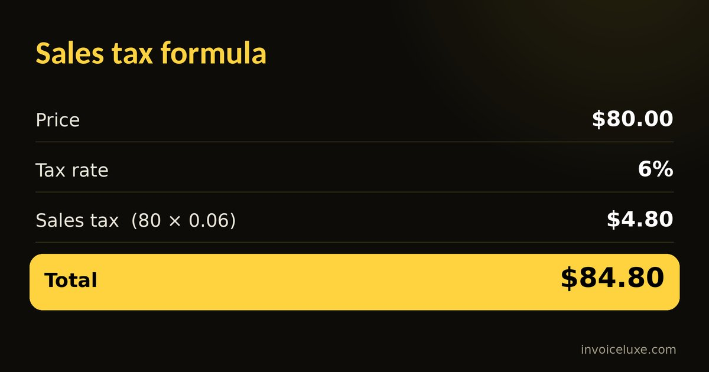

Sales tax is added to the price of most goods and many services at checkout. If you run a shop, send invoices or just want to check a receipt, you only need one formula to work it out.

> **Sales tax = price × tax rate**  
> **Total = price + sales tax**

## Step by step

1. **Convert the rate to a decimal.** Divide the percentage by 100. A 7.25% rate becomes 0.0725.
2. **Multiply the price by that decimal.** The result is the sales tax.
3. **Add the tax to the price.** That is what the customer pays.
4. **Round to the nearest cent.**

You can also do it in one step: multiply the price by 1 plus the rate. At 6%, multiply by 1.06.

## Worked examples

| Price | Tax rate | Sales tax | Total |
|---|---|---|---|
| $80.00 | 6% | $4.80 | $84.80 |
| $249.99 | 7.25% | $18.12 | $268.11 |
| $1,200.00 | 8.5% | $102.00 | $1,302.00 |

For the middle row, 249.99 × 0.0725 = 18.1243, which rounds to $18.12.

## Quick reference at a 7% rate

| Price | Sales tax | Total |
|---|---|---|
| $50 | $3.50 | $53.50 |
| $100 | $7.00 | $107.00 |
| $250 | $17.50 | $267.50 |
| $500 | $35.00 | $535.00 |

## Which rate should you use?

In the United States, sales tax is set by states and often by counties and cities too, so the combined rate depends on where the sale takes place. Rates and the list of taxable items change, so confirm the current rate with your state's revenue department before you charge it. Some states have no statewide sales tax, and many exempt items such as certain groceries.

## Common mistakes

- **Using the wrong rate.** Check the combined state and local rate for the right location.
- **Forgetting to round.** Sales tax is rounded to the cent.
- **Taxing the wrong amount.** Sales tax is usually calculated on the price after a store discount, but rules vary by state and by type of coupon.

## Calculate sales tax in your head

You will not always have a calculator. These shortcuts get you close in a few seconds.

1. **Find 10% first.** Move the decimal point one place to the left.
2. **Split the rate into pieces.** For 7%, take 5% (half of the 10%) and add 2% (twice the 1%).
3. **Add the pieces.**

For a $64 item at 7%: 10% is $6.40, so 5% is $3.20 and 1% is $0.64. 5% plus 2% is $3.20 + $1.28 = **$4.48**. Multiplying 64 × 0.07 gives the same answer.

## The same price at different rates

Sales tax changes by place, so the same shelf price gives different totals. Here is a $19.99 item at three combined rates:

| Combined rate | Sales tax | Total |
|---|---|---|
| 6% | $1.20 | $21.19 |
| 7.25% | $1.45 | $21.44 |
| 8.875% | $1.77 | $21.76 |

For reference, 7.25% is California's statewide base rate before local add-ons, and 8.875% is the combined rate in New York City. Rates change, so always confirm the current figure.

## Calculating sales tax on a whole invoice

When you invoice several items, work out the tax on the taxable subtotal. Here is an invoice with a 7.25% rate:

| Line | Quantity | Unit price | Line total |
|---|---|---|---|
| Item A | 3 | $14.95 | $44.85 |
| Item B | 2 | $29.00 | $58.00 |
| Item C | 1 | $112.40 | $112.40 |
| **Subtotal** | | | **$215.25** |

Sales tax is 215.25 × 0.0725 = 15.605625, which rounds to **$15.61**. The invoice total is **$230.86**. If some lines are not taxable, leave them out of the taxable subtotal. See [sales tax on multiple items](/blog/sales-tax-on-multiple-items/) for the line-by-line method.

## Sales tax in a spreadsheet

Spreadsheets make repeat work easy. With the price in cell B2 and the rate in C2 (as a percentage like 7.25%), use:

- Tax: `=ROUND(B2*C2,2)`
- Total: `=B2+ROUND(B2*C2,2)`

The ROUND function keeps the tax to whole cents so your totals match what a customer sees on a receipt.

## What is actually taxable?

The formula is easy. Deciding what to tax is the harder part. A few general patterns:

- Most physical goods are taxable.
- Many states exempt some groceries, prescription drugs or clothing, but the details differ a lot.
- Services are taxed in some states and not in others.
- Shipping, delivery and digital products follow state-specific rules.

Your state revenue department publishes a list of what is taxable. Check it before you charge tax.

## Sales tax for sellers: a simple routine

1. Find out whether you must collect tax where you sell.
2. Use the correct combined rate for each sale.
3. Show the tax as its own line on every invoice.
4. Keep a record of the tax collected.
5. File and pay on the schedule your state gives you.

Showing tax clearly also helps your customer. See [how to show sales tax on an invoice](/blog/how-to-show-sales-tax-on-an-invoice/) for a layout you can copy.

## Check your work

Do the math in both directions. If $215.25 plus 7.25% tax gives $230.86, then $230.86 divided by 1.0725 should return $215.25. If it does not, a number was mistyped or rounded too early. The [remove sales tax from a total](/blog/remove-sales-tax-from-total/) guide shows the reverse method.

## FAQ

### How do I calculate 8% sales tax on $50?

Multiply 50 by 0.08 to get $4.00 in tax. The total is $54.00.

### How do I convert a percentage to a decimal?

Divide it by 100, or move the decimal point two places to the left. 6.5% becomes 0.065.

### How do I work out the price before tax?

Divide the total by 1 plus the tax rate. For example, $107 divided by 1.07 is $100. See [how to remove sales tax from a total](/blog/remove-sales-tax-from-total/).

### How much is sales tax on $100?

At 7%, the tax is $7.00 and the total is $107.00. At 8.25%, the tax is $8.25 and the total is $108.25. Multiply by the rate as a decimal.

### Do I round sales tax up or to the nearest cent?

Round to the nearest cent unless your state gives a different rule. Some states publish tax bracket tables that you should follow.

### Is sales tax charged on the price before or after a discount?

Usually on the price after a store discount. Manufacturer coupons can be treated differently. See [discount and sales tax together](/blog/discount-and-sales-tax-together/).

### Is this tax advice?

No. This guide explains the math. For rules about what is taxable and which rate applies, check with your state tax agency or an accountant.
