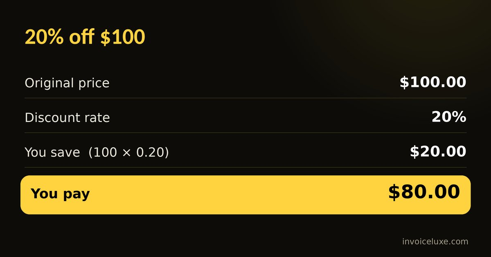
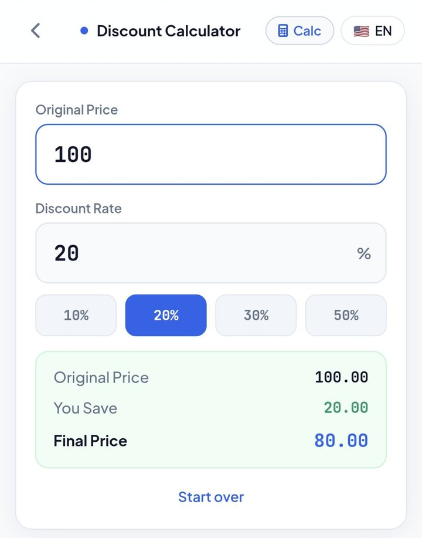

Whether you are comparing deals or setting your own prices, three formulas cover almost every discount question. Each one answers a different question.

## The three formulas

> **Amount saved = original price × discount rate**  
> **Sale price = original price − amount saved**  
> **Discount % = (original price − sale price) ÷ original price × 100**

Use the decimal form of the rate. 20% is 0.20 and 15% is 0.15.

## Example 1: find the sale price

A $100 item is 20% off. The amount saved is 100 × 0.20 = $20, so you pay $80.

## Example 2: find the discount percentage

A jacket was $45 and now costs $36. The difference is $9. Divide 9 by 45 to get 0.20, so the discount is 20%.

## Example 3: a price that is not round

An item costs $249 with 15% off. The amount saved is 249 × 0.15 = $37.35, so the sale price is $211.65.

## Discounts on a $60 item

| Discount | You save | You pay |
|---|---|---|
| 10% | $6.00 | $54.00 |
| 20% | $12.00 | $48.00 |
| 25% | $15.00 | $45.00 |
| 30% | $18.00 | $42.00 |
| 50% | $30.00 | $30.00 |

## Mental math shortcuts

- **10% off:** move the decimal point one place to the left.
- **20% off:** find 10% and double it.
- **25% off:** take a quarter of the price.
- **50% off:** cut the price in half.

## Use the calculator

Enter the original price and the discount rate and the calculator shows what you save and the final price at once. The preset buttons for 10%, 20%, 30% and 50% save time on common sales.

## Common mistakes

- **Using the sale price as the base.** A discount is always a percentage of the original price.
- **Adding two discounts together.** 20% off plus an extra 10% off is 28%, not 30%. See [stacked discounts](/blog/stacked-discounts/).
- **Forgetting sales tax.** Tax is normally added after the discount.

## Real prices, real percentages

| Original price | Sale price | You save | Discount |
|---|---|---|---|
| $85.00 | $63.75 | $21.25 | 25% |
| $249.00 | $199.00 | $50.00 | 20.08% |
| $39.99 | $29.99 | $10.00 | 25.01% |

For the second row, 50 ÷ 249 = 0.2008, so the discount is about 20%. Stores often round the percentage in their ads.

## Dollars off versus percent off

A "$20 off" offer is a different percentage on different prices.

| Offer | On an $80 item | On a $200 item |
|---|---|---|
| $20 off | 25% off | 10% off |
| 20% off | $16 off | $40 off |

If the item is cheap, a fixed amount can beat a percentage. If the item is expensive, the percentage is usually better. Compare the dollar savings, not just the number in the ad.

## Calculate discounts in a spreadsheet

With the original price in A2 and the sale price in B2:

- Discount percentage: `=(A2-B2)/A2`, formatted as a percentage
- Sale price from a percentage in C2: `=A2*(1-C2)`
- Amount saved: `=A2-B2`

## When the discount applies to a bundle

If you buy three items at $24, $36 and $40 and get 15% off the order, the discount applies to the $100 total. You save $15 and pay $85. If the 15% applies only to the most expensive item, you save $6. Read the terms to see what the discount covers.

## After the discount

The price after discount is not always the final price, because tax and shipping can still be added. See [price after discount](/blog/price-after-discount/) and [discount and sales tax together](/blog/discount-and-sales-tax-together/).

## FAQ

### How do I calculate 20% off?

Multiply the price by 0.80. For $50, that is $40.

### What is the formula for a discount percentage?

Subtract the sale price from the original price, divide by the original price and multiply by 100.

### Does a discount change the sales tax?

Usually yes, because tax is normally calculated on the lower price. Rules vary by state and by coupon type.

### How do I find the original price?

Divide the sale price by 1 minus the discount rate. $72 after 20% off is 72 ÷ 0.80 = $90. The full method is in [how to find the original price](/blog/find-original-price-before-discount/).

### How do I calculate a percentage discount from two prices?

Subtract the sale price from the original price, divide by the original price, and multiply by 100.

### Is 50% off the same as half price?

Yes. A 50% discount means you pay half of the original price.
