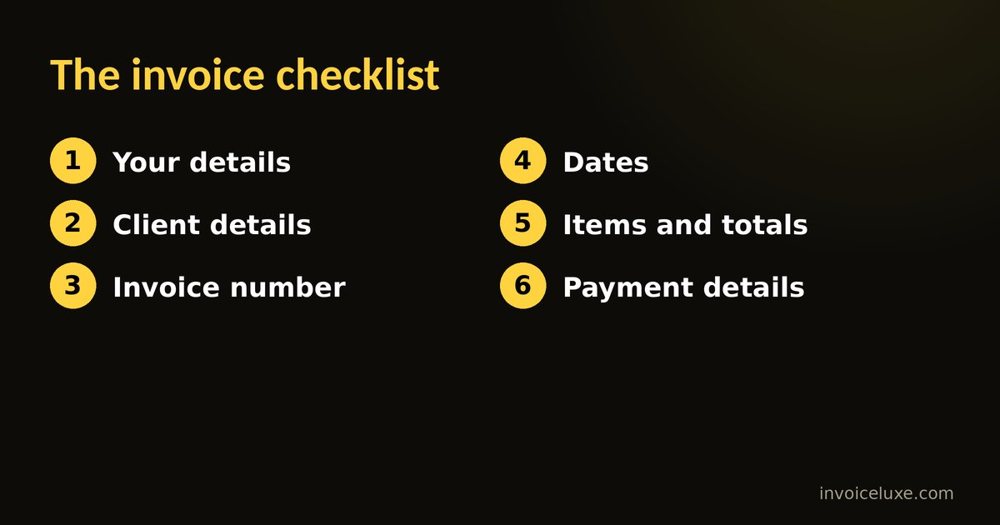
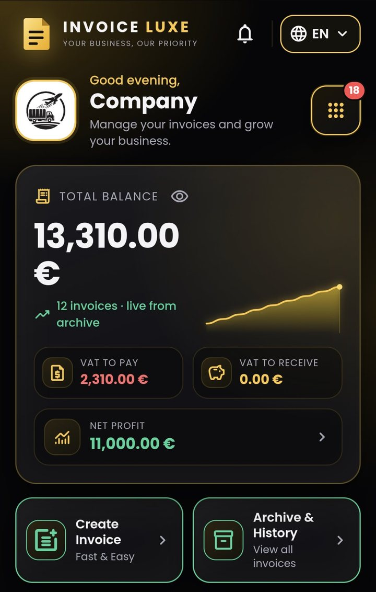

An invoice is how you ask a client to pay you, and it is also a record you will need for your taxes. A clear invoice gets paid faster. A messy one gets questions, delays and sometimes a refusal. This guide shows what an invoice needs and how to make one in about two minutes.

## What every invoice should include

Requirements differ from country to country, so check your local rules. Most invoices contain the same core details:

- **Your details:** company or trading name, address, email, and your tax or VAT number if you have one.
- **Your client's details:** name, address and, for business clients, their tax number.
- **An invoice number:** a unique, sequential number such as 2026-01, 2026-02. Never reuse a number.
- **Dates:** the invoice date and the payment due date.
- **A description of the work:** what you delivered, the quantity and the price per unit.
- **Totals:** subtotal, tax amount and the total to pay, in the right currency.
- **Payment details:** your bank name and account details, so the client knows where to send the money.

## Step by step with Invoice Luxe

1. **Set up your business profile.** Choose your language and currency, then enter your company name, address, bank details and tax numbers. You only do this once.
2. **Add your client.** Save the name, address, city and country in the client registry so you can reuse them on every invoice.
3. **Create the invoice.** Pick the client, check the invoice number and date, and choose a payment term and tax rate.
4. **Add line items.** Write a clear description, the quantity and the price. The total with tax updates as you type.
5. **Preview and pick a template.** Choose a layout that matches your brand and check every detail.
6. **Download the PDF and send it.** Share it by email or WhatsApp.

## Choosing a payment term

The payment term is the number of days your client has to pay. Seven or fourteen days is common for freelancers, and thirty days is common for larger companies. Shorter terms improve your cash flow. Whatever you choose, write the due date on the invoice so nobody has to calculate it.

## How tax appears on an invoice

Show the net price, the tax rate, the tax amount and the gross total separately. For example, a service priced at 1,000 with 21% tax has 210 in tax, so the client pays 1,210. Rates and rules depend on your country and on whether your client is a business or a consumer, so confirm the correct rate with your tax authority or accountant.

## Mistakes that delay payment

- Missing or duplicated invoice numbers.
- No due date, or a payment term the client never agreed to.
- A vague description such as "work done" instead of what you delivered.
- Wrong client name or address, which can make the invoice unusable for their accounting.
- Forgetting your bank details.

Read your invoice once as if you were the client's accountant. If anything is unclear, fix it before you send it.

## A complete sample invoice

| Field | Example |
|---|---|
| Invoice number | INV-2026-014 |
| Invoice date | November 17, 2026 |
| Due date | December 1, 2026 |
| Bill to | Acme Studio, 12 Main Street, Austin, TX |
| Payment terms | Net 14 |

| Description | Qty | Rate | Amount |
|---|---|---|---|
| Logo design | 1 | $600.00 | $600.00 |
| Extra revision rounds | 2 | $75.00 | $150.00 |
| **Subtotal** | | | **$750.00** |
| Sales tax (7%) | | | $52.50 |
| **Total due** | | | **$802.50** |

Add your payment details at the bottom, such as bank transfer instructions or a payment link, and a short thank-you line.

## Before you press send

1. Check that the client's name and address are correct.
2. Check that the number is unique. See [how to number invoices](/blog/how-to-number-invoices/).
3. Check that the due date is clear.
4. Check the maths. Subtotal plus tax should equal the total.
5. Save a PDF copy for your records.

## Get paid faster

- Send the invoice as soon as the work is done.
- Make the total and the due date easy to find.
- Offer more than one way to pay.
- Follow up politely when the due date passes. See [payment reminder email for an overdue invoice](/blog/payment-reminder-email-overdue-invoice/).

## Keep your invoices organized

Use a folder for each year and a clear file name, such as "INV-2026-014-Acme-Studio.pdf". When tax time comes, you will find everything quickly. For more on what to include, see [what to include on an invoice](/blog/what-to-include-on-an-invoice/).

## FAQ

### Is Invoice Luxe free?

Yes. You can create invoices and download PDFs for free, without creating an account.

### Where is my data stored?

Your business and client details are stored in your own browser on your device. They are not uploaded to an account.

### Can I use it in my language?

Yes. Invoice Luxe is available in many languages, with local tax terms in each version.

### Do I need a tax number to send an invoice?

Not always. It depends on your country and your turnover. If you are registered for VAT or sales tax, your number must appear on the invoice.

### Can I create an invoice for free?

Yes. A free invoice generator lets you add your details, choose a template and download a PDF without signing up.

### How soon should I send an invoice after the work?

As soon as the work is done or the milestone is reached. Waiting makes late payment more likely.
