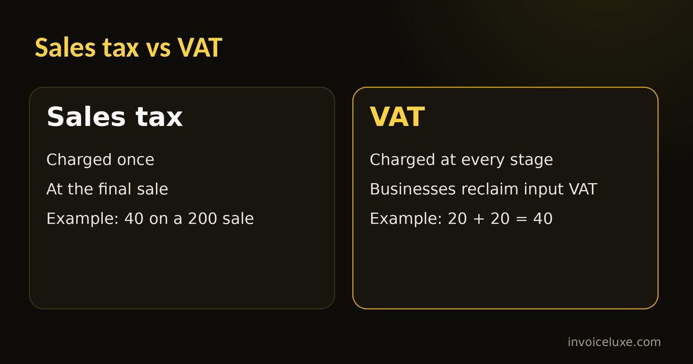

Both sales tax and VAT (value-added tax) are taxes on spending, and customers pay both at the till. Behind the scenes they work very differently, and the difference matters if you sell to customers in more than one country.

## The short answer

- **Sales tax** is collected once, at the final sale to the consumer.
- **VAT** is collected at every stage of the supply chain, and each business reclaims the VAT it paid on its purchases.

The United States has state and local sales taxes but no national VAT. The UK, the EU and many other countries use VAT.

## An example with a 20% rate

Say a product passes from a supplier to a retailer to a customer.

| Step | Sale price | Tax charged | Under VAT, tax paid to the government |
|---|---|---|---|
| Supplier sells to retailer | 100 | 20 | 20 |
| Retailer sells to customer | 200 | 40 | 40 − 20 = 20 |

Under VAT the retailer collects 40 from the customer, reclaims the 20 it paid the supplier, and sends the other 20 to the tax authority. The government receives 40 in total, which is 20% of the final price of 200.

Under a 20% sales tax, only the last sale is taxed. The retailer buys from the supplier without tax, charges the customer 40 and pays all 40 to the government. The total is the same, but it is collected in a different way.

## Side by side

| | Sales tax | VAT |
|---|---|---|
| Where it applies | Final sale to the consumer | Every stage of production and sale |
| Can businesses reclaim it? | No, businesses buying for resale use exemption certificates | Yes, as input VAT |
| How prices are shown | Usually added at checkout | Usually included in the shelf price |
| Who sets the rate | States, counties and cities (in the US) | The national government |

## Why it matters on invoices

If you sell in a VAT country, your invoice must usually show the net price, the VAT rate, the VAT amount and the gross total. In the US, a sales tax line is added to the sale when the item is taxable. Calculating either one comes down to the same math: [multiply by the rate to add tax](/blog/how-to-calculate-sales-tax/), or [divide the total by 1 plus the rate to remove it](/blog/remove-sales-tax-from-total/).

## Why the US has sales tax and not VAT

The United States has no national consumption tax. Sales tax is set by states, and counties and cities often add their own. That is why two shops in the same state can charge different totals for the same item. Most other countries use a national VAT or GST system, and the rate is the same across the country, with only a few exceptions.

## The same $100 item in both systems

Imagine an item that costs the seller $100 before tax.

| | United States (8% sales tax) | United Kingdom (20% VAT) |
|---|---|---|
| Price on the shelf | $100.00 | £120.00 (tax included) |
| Tax | $8.00 added at checkout | £20.00 inside the price |
| Customer pays | $108.00 | £120.00 |

In the US, the tag usually shows the price before tax and the register adds the tax. In the UK and much of Europe, the tag already includes VAT. This is why American shoppers are sometimes surprised at checkout and why European shoppers rarely are.

## How businesses experience each tax

**Under sales tax**, a business that sells to a final customer collects the tax and sends it to the state. A business that buys goods to resell does not pay sales tax on those purchases. It gives its supplier a resale certificate instead.

**Under VAT**, a business charges VAT on its sales and subtracts the VAT it paid on its purchases. It sends the difference to the tax authority. The VAT it paid is called input VAT, and the VAT it charged is called output VAT.

## Other names for VAT

- **GST** (goods and services tax) in Canada, Australia, New Zealand, India and Singapore works like VAT.
- **HST** in some Canadian provinces combines the federal and provincial tax into one rate.

Canada has both a federal GST and provincial sales taxes, so Canadian invoices can look like a mix of both systems. For tax-inclusive pricing, see [VAT inclusive vs exclusive](/blog/vat-inclusive-vs-exclusive/).

## What this means for your invoices

- **US invoice:** show the subtotal, then a line called "Sales tax" with the rate, then the total.
- **UK or EU invoice:** show the net amount, the VAT rate and the VAT amount, and include your VAT number if you are registered.
- **Never mix the labels.** Calling US sales tax "VAT" can confuse your client and your accountant.

If you work with clients in several countries, a flexible invoice generator that lets you set the tax name and rate for each invoice saves time. See [what to include on a VAT invoice](/blog/what-to-include-on-a-vat-invoice/) and [what to include on an invoice](/blog/what-to-include-on-an-invoice/).

## Common mix-ups

- **Assuming sales tax is refundable.** US businesses cannot reclaim sales tax on normal purchases the way VAT-registered businesses reclaim input VAT.
- **Quoting a tax-inclusive price in the US.** Customers expect the tag price to exclude tax. If you show an inclusive price, say so clearly.
- **Forgetting that US rates vary by location.** Use the rate where the sale is taxed, not a single national number.

## FAQ

### Does the US have VAT?

No. The US has no federal VAT or federal sales tax. Sales tax is set at the state and local level.

### Can a US business reclaim sales tax?

Generally no, because sales tax is meant to be paid once, by the final buyer. A reseller can buy goods without paying sales tax by providing a valid resale certificate.

### Which is higher, sales tax or VAT?

It depends on the place. Rates vary widely, so compare the rate for the specific location rather than the type of tax.

### Is GST the same as VAT?

They work in a similar way. Both tax value added at each stage and let businesses reclaim the tax they paid. The name differs by country.

### Do I charge VAT to a US customer?

It depends on where you are based and what you sell. Rules for exports and cross-border sales differ, so check with your tax authority or an accountant.

### Is this tax advice?

No. It is a general explanation. Rules differ by jurisdiction, so check with a tax professional for your situation.
