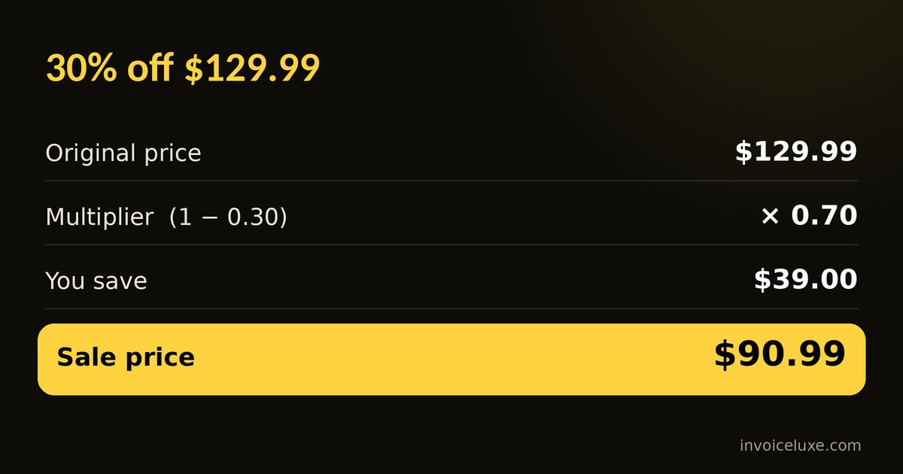
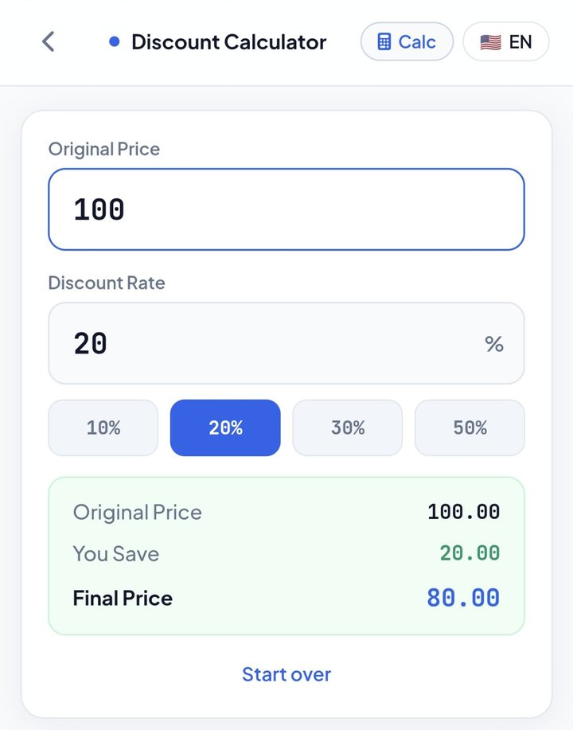

There is a faster way to find a sale price than working out the discount and subtracting it. Multiply the original price by what is left after the discount, and you have the final price in one step.

> **Sale price = original price × (1 − discount rate)**

A 30% discount leaves 70%, so you multiply by 0.70.

## The multiplier table

| Discount | Multiply by |
|---|---|
| 10% off | 0.90 |
| 15% off | 0.85 |
| 20% off | 0.80 |
| 25% off | 0.75 |
| 30% off | 0.70 |
| 40% off | 0.60 |
| 50% off | 0.50 |

## Shopping examples

| Original price | Discount | Calculation | Sale price | You save |
|---|---|---|---|---|
| $129.99 | 30% | 129.99 × 0.70 | $90.99 | $39.00 |
| $59.95 | 40% | 59.95 × 0.60 | $35.97 | $23.98 |
| $18.50 | 25% | 18.50 × 0.75 | $13.88 | $4.62 |

Round to the nearest cent. For $18.50 × 0.75, the exact answer is $13.875, which rounds to $13.88.

## Add sales tax after the discount

In most cases sales tax is applied to the discounted price. Take the $90.99 jacket and add 8% tax:

1. Tax: 90.99 × 0.08 = $7.28
2. Total at the register: 90.99 + 7.28 = **$98.27**

Rules differ by state and by coupon type, so treat this as the usual method and check the receipt.

## Let the calculator do it

Type the original price and the discount rate, and you see the amount saved and the final price immediately. It is handy when you compare two offers side by side.

## A discount ladder for one price

Here is a $240 item at common discounts:

| Discount | Multiplier | Price after discount | You save |
|---|---|---|---|
| 10% | 0.90 | $216.00 | $24.00 |
| 15% | 0.85 | $204.00 | $36.00 |
| 20% | 0.80 | $192.00 | $48.00 |
| 25% | 0.75 | $180.00 | $60.00 |
| 30% | 0.70 | $168.00 | $72.00 |
| 40% | 0.60 | $144.00 | $96.00 |
| 50% | 0.50 | $120.00 | $120.00 |

The multiplier is 1 minus the discount as a decimal. Multiply the price by it and you have the sale price in one step.

## Odd prices and rounding

A $19.99 item at 15% off is 19.99 × 0.85 = 16.9915, which rounds to **$16.99**. Round at the end, not before. If you round each step, you can end up a cent away from the receipt.

## Spot a misleading sale

- **A higher "was" price.** Check whether the item has actually sold at that price.
- **A discount on an add-on.** "20% off accessories" does not change the main product's price.
- **A minimum spend.** If you must spend $100 to get $10 off, the real discount depends on what you buy.

## Price after discount in a spreadsheet

Enter the price in A2 and the discount as a percentage in B2. The sale price is `=ROUND(A2*(1-B2),2)`. Use `$B$2` if you want to apply one discount to a whole column of prices.

## Next step: tax and shipping

Tax is usually added after the discount, and shipping may be added on top. See [stacked discounts](/blog/stacked-discounts/) if you have more than one offer, and [percent off chart](/blog/percent-off-chart/) for a quick look-up.

## FAQ

### What is 30% off $129.99?

Multiply 129.99 by 0.70 to get $90.99.

### How do I take 15% off a price?

Multiply the price by 0.85.

### Is it better to compute the discount first or use the multiplier?

Both give the same result. The multiplier is faster because it is one step.

### How do I find the discount if I only know the two prices?

Subtract the sale price from the original, divide by the original price and multiply by 100. For a quick lookup of common discounts, use the [discount chart](/blog/percent-off-chart/).

### How do I find the sale price quickly?

Multiply the original price by 1 minus the discount. For 30% off, multiply by 0.70.

### Do I round up or down?

Round to the nearest cent after the last calculation.
