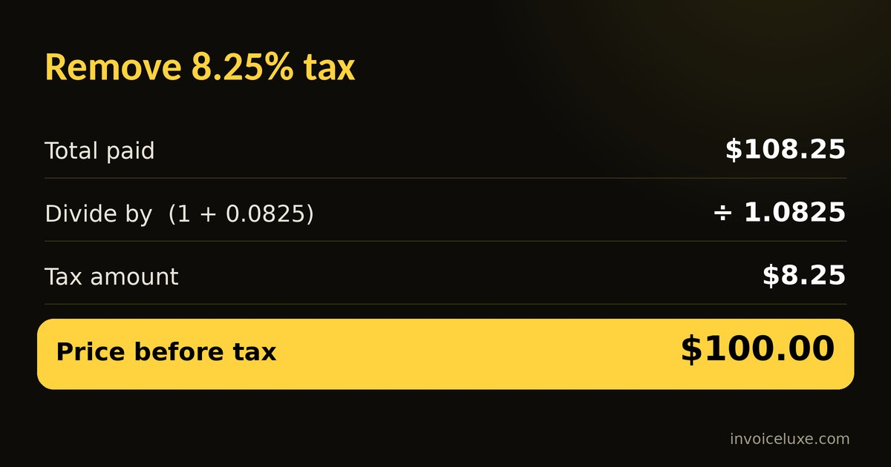

You have a receipt total and want to know the price before tax, for an expense report, a refund or your bookkeeping. The fix is a division, not a subtraction.

> **Price before tax = total ÷ (1 + tax rate)**  
> **Tax amount = total − price before tax**

## Worked examples

| Total paid | Tax rate | Calculation | Price before tax | Tax |
|---|---|---|---|---|
| $108.25 | 8.25% | 108.25 ÷ 1.0825 | $100.00 | $8.25 |
| $53.50 | 7% | 53.50 ÷ 1.07 | $50.00 | $3.50 |
| $87.42 | 6.5% | 87.42 ÷ 1.065 | $82.08 | $5.34 |

## The mistake that gives the wrong answer

Many people take the tax rate off the total. That does not work, because the tax was calculated on the smaller, pre-tax price.

With a total of $108.25 and 8.25% tax:

- **Wrong:** 108.25 − (108.25 × 0.0825) = 108.25 − 8.93 = $99.32
- **Right:** 108.25 ÷ 1.0825 = **$100.00**

The wrong method is off by 68 cents, and the gap grows with bigger amounts and higher rates.

## Step by step

1. Convert the rate to a decimal (8.25% becomes 0.0825).
2. Add 1 to it (1.0825).
3. Divide the total by that number.
4. Subtract the result from the total to find the tax.

## When you need this

- Filling in an expense report that needs the net amount.
- Recording purchases in your books.
- Checking that a store or supplier charged the right amount of tax.
- Splitting a tax-inclusive price on an invoice.

A calculator that adds or removes tax saves you from typing these divisions by hand. Enter the amount and the rate and choose "remove tax".

## A realistic example with receipts

You paid $326.40 for a work trip expense, and the receipt says tax was included at 7.5%. To record the expense and the tax separately:

1. Add 1 to the rate: 1 + 0.075 = 1.075.
2. Divide the total by 1.075: 326.40 ÷ 1.075 = 303.627907, which rounds to **$303.63**.
3. Subtract to find the tax: 326.40 − 303.63 = **$22.77**.

Check it: 303.63 × 1.075 = 326.40.

If the rate is a round number, it is even easier. A $52.00 total at 4% divides by 1.04 to give exactly $50.00 before tax.

## How much of a total is tax?

The tax is not the rate times the total, because the rate applies to the price before tax. The share of a total that is tax is the rate divided by 1 plus the rate.

| Tax rate | Share of the total that is tax | Tax inside a $100 total |
|---|---|---|
| 6% | 5.66% | $5.66 |
| 7% | 6.54% | $6.54 |
| 8% | 7.41% | $7.41 |
| 8.25% | 7.62% | $7.62 |
| 9% | 8.26% | $8.26 |

So if a total is $100 and the rate is 8%, the tax is $7.41, not $8.00.

## Remove tax in a spreadsheet

With the total in B2 and the rate in C2 (for example 8.25%):

- Price before tax: `=ROUND(B2/(1+C2),2)`
- Tax included: `=B2-ROUND(B2/(1+C2),2)`

Fill the formulas down the column to process a whole list of receipts.

## Why this matters

- **Expense reports.** Many companies want the amount before tax and the tax on separate lines.
- **Bookkeeping.** Sales tax you collect is not your income, so you need to separate it.
- **Price checks.** You can confirm that a shop charged the correct rate.
- **Pricing.** If you sell tax-included prices, you need to know how much you actually keep.

## Rounding

Your result may be a cent off from a receipt because stores round tax per item or per receipt. If a single item is involved, trust the receipt. If you are working from a total, the reverse method gives the best estimate. See [sales tax on multiple items](/blog/sales-tax-on-multiple-items/) for why one cent differences happen.

## Quick check

Take your price before tax, multiply by 1 plus the rate, and make sure you get the original total. If you do, the work is right. Use the [discount and sales tax](/blog/discount-and-sales-tax-together/) guide when a discount is also involved.

## FAQ

### How do I remove 7% tax from a total?

Divide the total by 1.07.

### Why can't I just subtract the percentage?

Because the tax is a percentage of the price before tax, not of the total. Dividing by 1 plus the rate reverses it exactly.

### How do I find the tax amount from a total?

Subtract the pre-tax price from the total, or multiply the total by the rate divided by 1 plus the rate.

### Does this work for VAT too?

Yes. VAT-inclusive prices work the same way. For 20% VAT, divide by 1.20.

### How much tax is in a $100 total at 8%?

$7.41. Divide 100 by 1.08 to get $92.59 before tax, then subtract it from $100.

### How do I get the sales tax rate from a receipt?

Divide the tax by the price before tax and multiply by 100. If the tax is $7.41 on a $92.59 price, 7.41 ÷ 92.59 = 0.08, so the rate is 8%.
