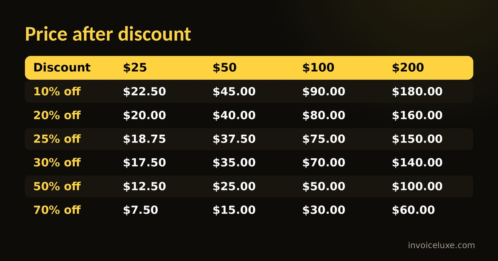

Need a fast answer to "what is 30% off $50?" This chart shows the price you pay after common discounts, so you can read the answer without any math.

## Price after discount

| Discount | Multiplier | $25 | $50 | $100 | $200 |
|---|---|---|---|---|---|
| 10% off | 0.90 | $22.50 | $45.00 | $90.00 | $180.00 |
| 15% off | 0.85 | $21.25 | $42.50 | $85.00 | $170.00 |
| 20% off | 0.80 | $20.00 | $40.00 | $80.00 | $160.00 |
| 25% off | 0.75 | $18.75 | $37.50 | $75.00 | $150.00 |
| 30% off | 0.70 | $17.50 | $35.00 | $70.00 | $140.00 |
| 40% off | 0.60 | $15.00 | $30.00 | $60.00 | $120.00 |
| 50% off | 0.50 | $12.50 | $25.00 | $50.00 | $100.00 |
| 60% off | 0.40 | $10.00 | $20.00 | $40.00 | $80.00 |
| 70% off | 0.30 | $7.50 | $15.00 | $30.00 | $60.00 |

## How to read the chart

Find the discount in the first column and the original price in the header row. The number where they meet is the price you pay. To get the amount you save, subtract that number from the original price.

For example, 30% off $50 costs $35.00, so you save $15.00.

## For prices that are not on the chart

Use the multiplier. Multiply any price by the number in the second column.

- 20% off $64: 64 × 0.80 = $51.20
- 15% off $38.50: 38.50 × 0.85 = $32.73 (rounded from $32.725)
- 40% off $129: 129 × 0.60 = $77.40

## Stacking discounts

If a store gives an extra percentage off an already discounted price, do not add the percentages. Multiply the multipliers instead. See [stacked discounts](/blog/stacked-discounts/) for the details.

## A chart for three common prices

The final price after each discount:

| Discount | $100 | $250 | $500 |
|---|---|---|---|
| 10% | $90.00 | $225.00 | $450.00 |
| 20% | $80.00 | $200.00 | $400.00 |
| 25% | $75.00 | $187.50 | $375.00 |
| 30% | $70.00 | $175.00 | $350.00 |
| 40% | $60.00 | $150.00 | $300.00 |
| 50% | $50.00 | $125.00 | $250.00 |
| 60% | $40.00 | $100.00 | $200.00 |
| 70% | $30.00 | $75.00 | $150.00 |

Find the row for the discount and the column for the price. If your price is not here, scale it: a $50 item costs half the $100 column, and a $1,000 item costs double the $500 column.

## Use the chart in a store

1. Round the price to a number on the chart, such as $98 to $100.
2. Read the discounted price.
3. Adjust for the difference. Two dollars more on the price is about $1.60 more at 20% off.

This gives you a quick answer before you reach the register.

## How the chart is built

Each cell is the price multiplied by 1 minus the discount. For 25% off $250, that is 250 × 0.75 = $187.50. You can build your own chart in a spreadsheet by entering prices across the top, discounts down the side and using `=A$1*(1-$A2)` in the grid.

## Turn it into a decision

A bigger discount on a higher price can still cost more. A 20% discount on a $500 item is $400, and a 50% discount on a $300 item is $150. Compare final prices, then add tax. See [price after discount](/blog/price-after-discount/) and [stacked discounts](/blog/stacked-discounts/).

## FAQ

### What is 20% off $50?

$40.00. You save $10.00.

### What is 50% off $200?

$100.00.

### How do I find a discount that is not on the chart?

Subtract the discount from 100 and divide by 100 to get the multiplier. For 35% off, the multiplier is 0.65.

### How do I add sales tax to the sale price?

Multiply the sale price by 1 plus the tax rate. At 8%, multiply by 1.08.

### What is 25% off $250?

$62.50 off, so you pay $187.50.

### Can I use the chart for discounts like 15% or 35%?

Add the results for two rows. For 35%, you can take 25% and 10% of the price and add them to get the amount saved.
