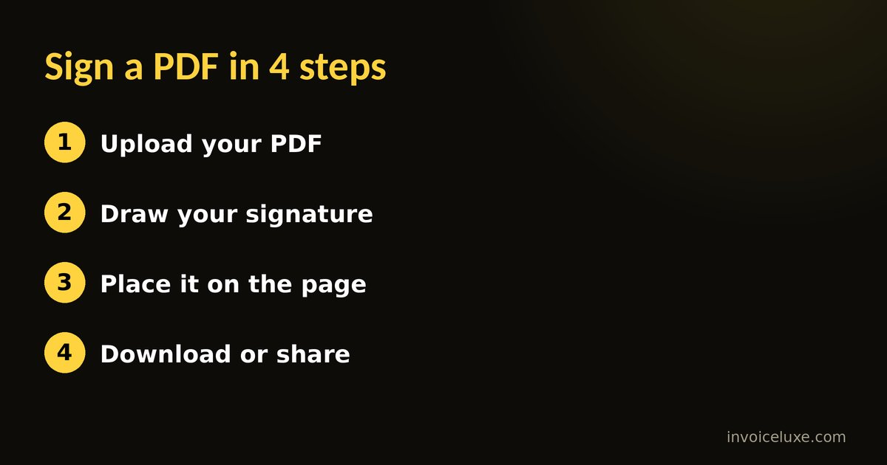

You do not need to print, sign and scan a document anymore. You can sign a PDF in your browser, on a phone or a computer, in about a minute.

## Step by step

1. **Open the signing tool** and upload your PDF.
2. **Draw your signature** with your finger on a phone or with a mouse or trackpad on a computer.
3. **Place it on the page.** Move the signature to the signature line and resize it.
4. **Preview the signed document** and go back to editing if something looks off.
5. **Download the PDF** or share it, for example on WhatsApp.

## Tips for a clean signature

- Sign slowly and use a larger canvas if you can. A phone held sideways gives you more room.
- Keep the signature on the line and away from the printed text.
- Check every page in the preview before you send the file.
- Save the signed file under a new name so you keep the original.

## Is an online signature valid?

In the United States, electronic signatures are generally given legal effect for many ordinary documents under federal and state law. Some documents have special rules, such as certain wills, court papers and notices, and some businesses require a specific signing service. This is general information, not legal advice, so check the requirements for your document.

It helps to know the difference between two things:

- **A signature image placed on a PDF**, which is what a simple signing tool does.
- **A certificate-based digital signature**, which also proves the file was not changed after signing and is used in more formal workflows.

## What you can sign

Contracts, rental agreements, forms, permission slips, invoices, delivery notes and quotes are common examples. If a document needs a witness, a notary or a certificate-based signature, a simple online signature may not be enough.

## Sign before or after other edits

Finish all the edits to the document first, then sign. A signature added before a change can look misleading. If a contract needs changes after signing, create a new version and sign again.

## Keep a record

After you sign, save two copies: the signed PDF and the original. Name them clearly, such as "Contract-Acme-signed.pdf". Keep the email where you sent it, because it shows the date and who received it.

## Sending a signed document

1. Check that the signature is visible on every page that needs it.
2. Check that the file size is reasonable for email.
3. Send it to the right person.
4. Ask for confirmation of receipt.

If you have several files to send, you can combine them into one. See [how to merge PDF files](/blog/how-to-merge-pdf-files/).

## Protect your signature

- Do not share an image of your signature in public places.
- Use a tool that processes files in your browser when you can.
- Be careful with documents from people you do not know.

## Contracts and invoices

For an invoice, a signature is often not required. For a contract or a form, check what the other party accepts. See [how to create an invoice](/blog/how-to-create-an-invoice/).

## FAQ

### Is it free to sign a PDF here?

Yes. The tool is free and works in your browser without an account or an app.

### Can I sign on my phone?

Yes. Use your finger to draw the signature, then place it on the page and download the file.

### Can I sign more than one page?

Yes. Check each page in the preview to make sure the signature is where it should be.

### Can I send the signed PDF straight away?

Yes. After you preview it, you can download the PDF or share it.

### Can I sign a PDF on my phone?

Yes. Open the PDF in a browser tool, draw or type your signature and place it on the page.

### Should I flatten the PDF after signing?

Flattening makes the signature part of the page, which prevents accidental changes. Keep an unflattened copy if you need to edit later.
