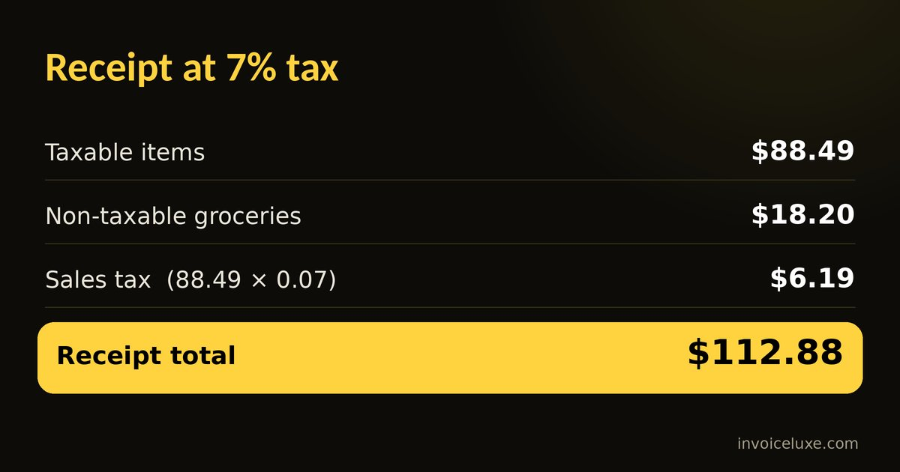

A receipt with several items is not harder than a single price, but two things can change the answer: some items may not be taxable, and the tax can be rounded per item or on the whole receipt.

## Method 1: tax on the taxable subtotal

If you need a refresher on the basic formula, read [how to calculate sales tax](/blog/how-to-calculate-sales-tax/).

1. Add up the prices of the **taxable** items.
2. Multiply that subtotal by the tax rate.
3. Add the tax to the full receipt total.

## A receipt example at 7%

| Item | Price | Taxable? |
|---|---|---|
| Shirt | $24.99 | Yes |
| Notebook | $4.50 | Yes |
| Groceries | $18.20 | No (in this example) |
| Headphones | $59.00 | Yes |

- Taxable subtotal: 24.99 + 4.50 + 59.00 = **$88.49**
- Sales tax: 88.49 × 0.07 = 6.1943, which rounds to **$6.19**
- Receipt subtotal: 24.99 + 4.50 + 18.20 + 59.00 = $106.69
- **Total: $106.69 + $6.19 = $112.88**

Whether groceries are taxed depends on the state, so use your state's rules for your own receipts.

## Method 2: tax on each line

Some point-of-sale systems calculate the tax on every item and add the results.

| Item | Price | Tax at 7% (rounded) |
|---|---|---|
| Shirt | $24.99 | $1.75 |
| Notebook | $4.50 | $0.32 |
| Headphones | $59.00 | $4.13 |
| **Total tax** | | **$6.20** |

That is one cent more than Method 1. Rounding each line to the cent first causes small differences. Neither is a mistake. The method depends on the store's system and local rules.

## What to use for your own invoices

Pick one method and use it on every invoice, so your totals are consistent. Many businesses calculate tax on the invoice subtotal, which is Method 1. Use a calculator that lets you enter the amounts and the rate, and keep taxable and non-taxable items separate.

## Why the two methods can differ by a cent

Tax is rounded to the nearest cent. When you round each line, the small rounding errors can add up differently from one rounding on the subtotal.

Take four packs of gum at $1.35 each with 7% tax:

| Method | Calculation | Tax |
|---|---|---|
| Tax on each line | 1.35 × 0.07 = 0.0945, rounds to $0.09, times 4 | $0.36 |
| Tax on the subtotal | 5.40 × 0.07 = 0.378, rounds to | $0.38 |

Neither is a mistake. Use the method your state or point-of-sale system uses.

## A fuller invoice example

Suppose you invoice a client for materials and labor, and only the materials are taxable in your state:

| Line | Amount | Taxable? |
|---|---|---|
| Materials | $420.00 | Yes |
| Delivery (separately stated) | $35.00 | Depends on the state |
| Labor | $300.00 | No in this example |
| **Subtotal** | **$755.00** | |

If only the materials are taxable at 8.25%, the tax is 420 × 0.0825 = $34.65 and the invoice total is $789.65. If delivery were taxable too, the taxable base would be $455.00 and the tax would be $37.54.

Whether delivery charges are taxable depends on the state, so check your state's rule before you add it to the taxable base.

## How to set up your invoice lines

1. Give every line a taxable or non-taxable flag.
2. Add the taxable lines into one taxable subtotal.
3. Multiply by the combined rate.
4. Show the tax once, below the subtotal.
5. Show the final total.

Customers and auditors both prefer to see the taxable amount separated from the non-taxable amount.

## Discounts on some lines

When a discount applies to only some lines, subtract it from those lines first, then calculate the tax. For an order-wide discount, spread it across the lines in proportion or tax the discounted subtotal. The ordering matters, and [discount and sales tax together](/blog/discount-and-sales-tax-together/) explains it.

## Rounding tips for sellers

- Pick one rounding method and use it for every invoice.
- Round only the final tax amount, not the intermediate steps, unless you tax each line.
- Keep the unrounded rate in your system (for example 8.25%) rather than a shortened one (8.3%).
- Make sure invoice totals match what your accounting records show.

## FAQ

### Do I calculate tax on each item or on the total?

Both are used. Calculating on the taxable subtotal is simpler and gives fewer rounding differences.

### What if some items are tax-exempt?

Leave them out of the taxable subtotal, then add them to the receipt total afterward.

### Why is my receipt one cent different from my calculation?

The store probably rounded the tax line by line. Compare both methods to see the difference.

### Does the order of items change the sales tax?

No. Adding lines in a different order gives the same taxable subtotal and the same tax.

### Should tax be shown per item or once?

Showing it once, under the subtotal, keeps an invoice simple. Per-line tax can be useful when items have different rates.

### Is this tax advice?

No. It explains the math. Which items are taxable depends on your state.
