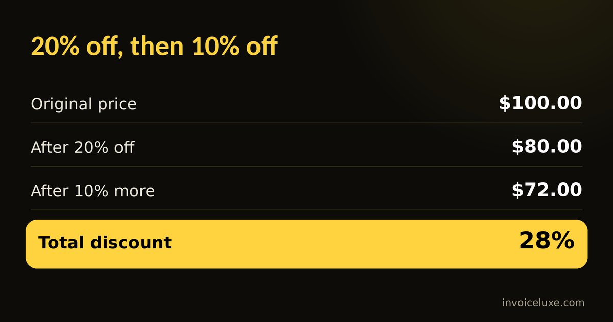

A sign says "20% off, plus an extra 10% off at checkout". Many shoppers expect 30% off, but the real discount is smaller, because the second discount applies to the price that is already lower.

> **Total discount = 1 − (1 − first discount) × (1 − second discount)**

## Example: 20% off, then 10% off $100

1. After 20% off: 100 × 0.80 = $80
2. After another 10% off: 80 × 0.90 = **$72**

You paid $72, so you saved $28. The total discount is 28%, not 30%.

## Common combinations

| First | Second | Real total discount |
|---|---|---|
| 10% | 10% | 19% |
| 20% | 10% | 28% |
| 30% | 20% | 44% |
| 40% | 10% | 46% |
| 50% | 20% | 60% |
| 25% | 25% | 43.75% |

## Does the order matter?

For two percentage discounts, the order does not matter. 20% then 10% gives the same price as 10% then 20%.

For a dollar-off coupon combined with a percentage discount, the order **does** matter. On a $100 item with $10 off and 20% off:

- Coupon first, then percentage: (100 − 10) × 0.80 = **$72**
- Percentage first, then coupon: 100 × 0.80 − 10 = **$70**

Check the store's terms to see how your coupon is applied. Many stores apply the percentage discount to the original price first.

## Add sales tax last

After all discounts, add sales tax to the final price. On the $72 example at 8% tax, the tax is $5.76, so the total is $77.76.

## Use the calculator step by step

Run the first discount in the calculator, then enter the result as the new price and apply the second discount. That gives you the exact final price for any combination.

## Total discount for common pairs

When you stack two percentages, the total discount is smaller than the sum.

| First discount | Second discount | Total discount |
|---|---|---|
| 10% | 10% | 19% |
| 20% | 10% | 28% |
| 25% | 25% | 43.75% |
| 30% | 20% | 44% |
| 40% | 10% | 46% |
| 50% | 20% | 60% |

For 30% and then 20%, multiply 0.70 by 0.80 to get 0.56, so you pay 56% of the price. That is a 44% discount, not 50%.

## Percent off plus dollars off

A $150 jacket has 20% off and you have a $15 coupon. The order matters:

| Order | Calculation | You pay |
|---|---|---|
| Percentage first, then coupon | 150 × 0.80 = 120, then 120 − 15 | $105.00 |
| Coupon first, then percentage | (150 − 15) × 0.80 | $108.00 |

Applying the percentage first gives the lower price here, because the coupon takes a full $15 off after the discount. Stores set their own order, so check the receipt.

## "Extra 20% off sale prices"

This means a second discount on the sale price. If an item is 40% off and you get an extra 20%, you pay 0.60 × 0.80 = 0.48 of the original price, a 52% discount.

## Cart-wide coupons

A coupon on the whole cart may exclude sale items or certain brands. Read the exclusions, then add up only the items that qualify before you work out the savings.

## What about sales tax?

Add tax after all the discounts. See [discount and sales tax together](/blog/discount-and-sales-tax-together/) and [Black Friday price after discount and tax](/blog/black-friday-price-after-discount-and-tax/).

## FAQ

### Is 20% off plus 10% off the same as 30% off?

No. It is 28% off, because the second discount applies to the reduced price.

### How do I calculate two discounts at once?

Multiply the two multipliers. For 20% and 10%, 0.80 × 0.90 = 0.72, so you pay 72% of the original price.

### Which gives a bigger discount, 50% off or 30% plus 20% off?

50% off. Stacking 30% and 20% gives 44%.

### Do dollar coupons stack the same way?

No, the order changes the result. See the $100 example above.

### Why is 30% plus 20% not 50%?

The second discount applies to a smaller price, so it removes less money.

### Does the order of two percentage discounts change the price?

No. 0.70 × 0.80 and 0.80 × 0.70 are the same. The order only matters when one discount is a fixed dollar amount.
