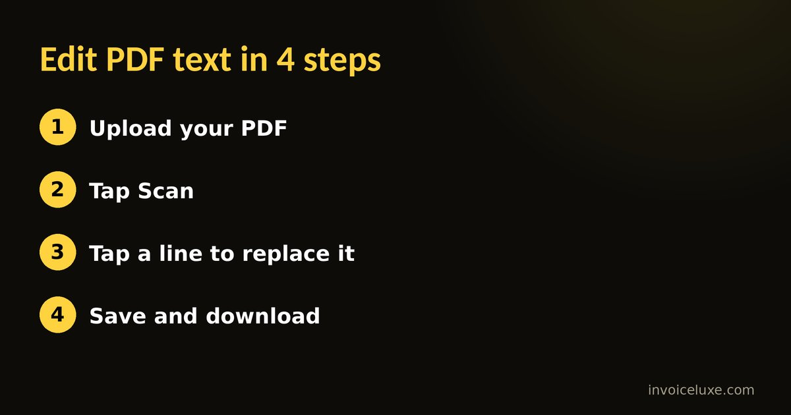

PDFs are built to keep their layout, which makes them hard to change. A browser-based PDF text editor lets you fix a typo, update a date or add a line without going back to the original file.

## Step by step

1. **Open the PDF text editor** and upload your file.
2. **Tap Scan.** The editor detects the lines of text on the page so you can select them.
3. **Tap a line** you want to change.
4. **Replace or delete it.** Type the new text. You can choose the text color, set the size and turn on bold. A preview shows how the new line will look.
5. **Add new text** with the Add Text button if you need an extra line.
6. **Save** the changes and download the updated PDF.

## Tips for better results

- **Scan first.** Lines only become selectable after the scan, so run it before you try to tap a line.
- **Check the preview** before you save. It shows the text size and color you picked.
- **Keep the size similar** to the surrounding text so the edit blends in.
- **Edit one line at a time** and review the page after each change.
- **Keep the original.** Save the edited file under a new name.

## When this works best

Editing is useful for fixing a typo in your own invoice, updating a date or an address on a form you created, or adding a note to a document. For heavy layout changes, edit the source file in the program that created it, then export a new PDF.

## Edit only what you are allowed to edit

Changing the content of documents you do not own, such as contracts signed by someone else, official records or identity documents, can be illegal and can cause real harm. Use a PDF editor for your own documents and for changes the other party has agreed to.

## Fonts and layout

PDFs do not behave like word processor files. If you change a line of text, the new text may not match the old font or may not fit in the same space. For best results:

1. Keep the new text about the same length as the old.
2. Choose a font that looks similar.
3. Check the line spacing and alignment.
4. Zoom in to check the result.

## Better ways for big changes

For large edits, go back to the source file, such as a Word document or a spreadsheet, make the change and export a new PDF. Editing the PDF directly is best for small fixes such as a date, a name or a typo.

## Quick fixes you can do

- Correct a typo in a name or address
- Update a date or an invoice number
- Fix an amount, if you also check the totals
- Add a note or a line

If you change an amount, make sure the subtotal, tax and total still agree. See [invoice mistakes to avoid](/blog/invoice-mistakes-to-avoid/).

## Save a copy

Save the edited file under a new name and keep the original. This way you can always go back. If the document is an invoice you already sent, issue a corrected version and tell the client.

## Be honest

Only change documents that belong to you or that you have the right to edit. Changing someone else's contract, receipt or official record is not acceptable.

## FAQ

### Is the PDF text editor free?

Yes. It is free and works in your browser, without an account.

### Why do I have to scan before editing?

The scan finds the text lines on the page, which lets you tap a line to replace or delete it.

### Can I change the text color and size?

Yes. When you replace a line you can choose the color, the size and bold.

### Will the new text look exactly like the old font?

It may differ slightly, so check the preview and adjust the size before saving.

### Can I edit any PDF?

Most text-based PDFs can be edited. Scanned PDFs are pictures, so they need to be converted to text first.

### Will editing change the original file?

Not if you save the result as a new file.
