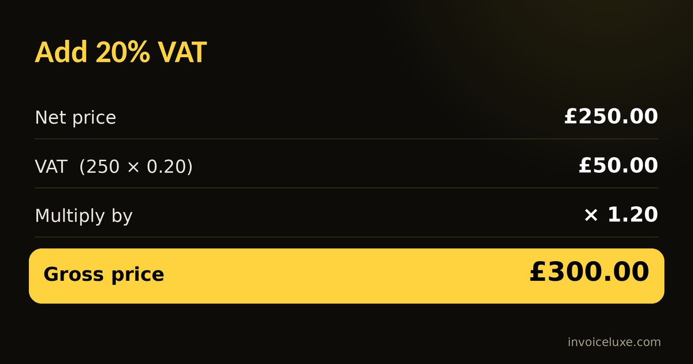
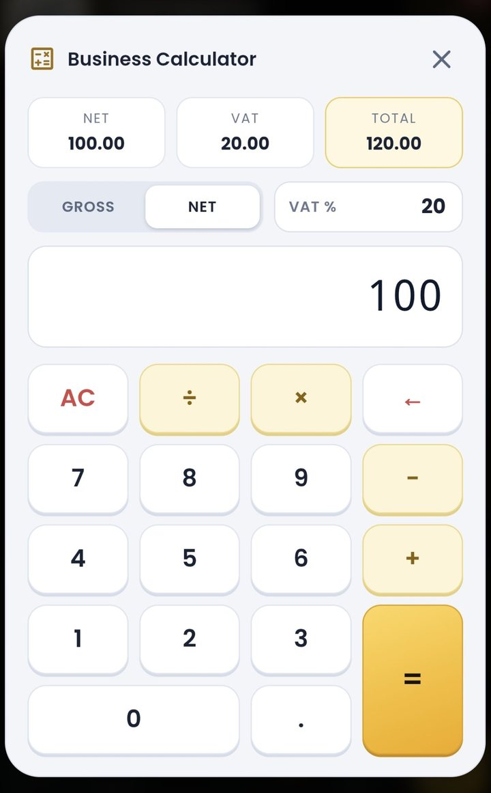

VAT is added to the price of most goods and services in the UK, the EU and many other countries. Adding it takes one multiplication. Removing it takes one division.

The UK standard VAT rate is 20%, with a reduced rate of 5% and a zero rate for some items. Rates can change, so confirm the current rates on GOV.UK.

> **Add VAT: net price × (1 + VAT rate)**  
> **Remove VAT: gross price ÷ (1 + VAT rate)**

## Add VAT to a net price

A service costs £250 before VAT. At 20%:

- VAT: 250 × 0.20 = £50
- Gross price: 250 × 1.20 = **£300**

## Remove VAT from a gross price

A receipt shows £360 including VAT at 20%:

- Net price: 360 ÷ 1.20 = **£300**
- VAT: 360 − 300 = **£60**

## The mistake to avoid

Do not subtract 20% from the gross price. That gives £360 × 0.80 = £288, which is wrong. VAT was calculated on the net price of £300, so you must divide by 1.20.

A handy shortcut: at 20% VAT, the VAT in a gross price is one sixth of it. £360 ÷ 6 = £60.

## Other rates

| Rate | To add VAT | To remove VAT |
|---|---|---|
| 20% (standard) | × 1.20 | ÷ 1.20 |
| 5% (reduced) | × 1.05 | ÷ 1.05 |
| 0% (zero) | × 1.00 | ÷ 1.00 |

At 5%, £210 gross becomes £200 net, with £10 of VAT.

## Use the calculator

A business calculator that handles net, VAT and total together saves time. Enter the amount, set the VAT percentage and see the net, VAT and total at once.

## On your invoice

Show the net price, the VAT rate, the VAT amount and the gross total as separate lines. If you are VAT registered, include your VAT number as well.

## A table for different rates

For a net price of 100:

| VAT rate | VAT | Gross price |
|---|---|---|
| 5% | 5.00 | 105.00 |
| 10% | 10.00 | 110.00 |
| 15% | 15.00 | 115.00 |
| 20% | 20.00 | 120.00 |
| 25% | 25.00 | 125.00 |

To go the other way, divide the gross price by 1 plus the rate: 1.05, 1.10, 1.15, 1.20 or 1.25.

## An invoice with two rates

Some invoices contain items with different VAT rates. Calculate each group separately:

| Line | Net | Rate | VAT | Gross |
|---|---|---|---|---|
| Services | 300.00 | 20% | 60.00 | 360.00 |
| Printed material | 80.00 | 5% | 4.00 | 84.00 |
| **Total** | **380.00** | | **64.00** | **444.00** |

Then add the VAT amounts together to show the total VAT. Keep the rate next to each line so the customer can see how you calculated it.

## VAT in a spreadsheet

With the net price in A2 and the rate in B2:

- VAT: `=ROUND(A2*B2,2)`
- Gross: `=A2+ROUND(A2*B2,2)`
- Net from gross: `=ROUND(A2/(1+B2),2)`

## When to add and when to remove

- **Add VAT** when you quote a net price to a business customer and need to show the gross total.
- **Remove VAT** when you only know the shelf price and need the net amount for your accounts.

For the details on each direction, see [how to calculate VAT](/blog/how-to-calculate-vat/) and [calculate VAT backwards](/blog/calculate-vat-backwards/).

## FAQ

### How do I add 20% VAT to a price?

Multiply the net price by 1.20.

### How do I take VAT out of a price?

Divide the gross price by 1.20 for the 20% rate.

### What is the VAT on £120 including VAT?

£120 ÷ 1.20 = £100 net, so the VAT is £20.

### How do I add 20% VAT to a price?

Multiply the net price by 1.20. A net price of 250 becomes 300.

### How do I take VAT out of a gross price?

Divide by 1.20. A gross price of 300 becomes 250 net.

### Is this tax advice?

No. It explains the calculation. For your own VAT obligations, check with HMRC or an accountant.
