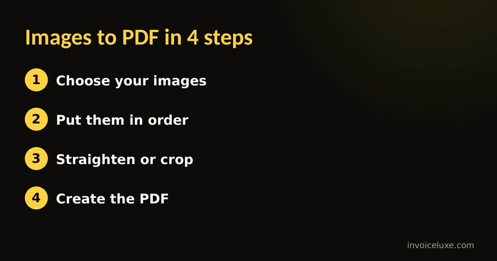
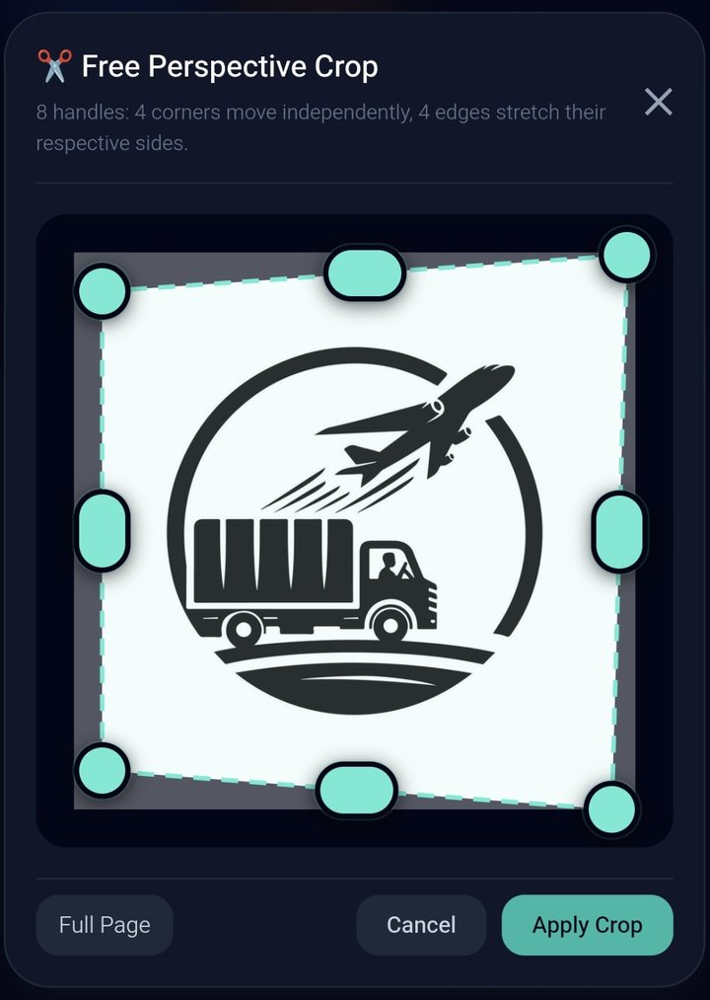

A single PDF is easier to email, print and upload than a pile of photos. You can combine JPG and PNG images into one PDF right in your browser, without installing an app.

## Step by step

1. **Open the PDF tools** and choose the option for images.
2. **Add your images.** Pick JPG or PNG files from your phone or computer, or take new photos.
3. **Put them in order.** The first image becomes the first page.
4. **Straighten or crop** any photo that is tilted or has extra background.
5. **Create the PDF** and download it.

## Get a clean scan with your phone

- Use daylight or a bright lamp and avoid shadows from your hand.
- Place the page on a plain, dark surface so the edges stand out.
- Hold the phone straight above the page.
- Crop each photo so only the page is visible.

## Straighten photos with perspective crop

A photo taken at an angle makes the page look like a trapezoid. A perspective crop lets you move each corner to the corner of the page, so the result looks like a flat scan. Invoice Luxe's PDF tools include a free perspective crop with handles on all four corners and all four edges.

## Tips for a good PDF

- **Keep the order right.** Check the page order before you create the file.
- **Use one orientation.** Rotate photos first so every page faces the same way.
- **Watch the file size.** Very large photos make a heavy PDF. If the file is too big to email, compress it.
- **Name the file clearly,** for example "receipts-october.pdf".

## Common uses

Receipts for an expense report, a signed form, ID documents for an application, homework pages, and pictures of products for a catalog all work well as a single PDF.

## Choose the right size

A document with many photos can become very large. Use these guidelines:

| Use | Suggested quality |
|---|---|
| Email attachment | Medium, so the file stays under about 10 MB |
| Printing | High, around 200 to 300 dpi |
| Online form upload | Check the site's file size limit |

If the file is too large, reduce the image size before converting, or choose a lower quality setting.

## Order matters

Place the images in the right order before you convert. For a multi-page document, the first image becomes page one. If you need to rearrange, do it before you save the PDF.

## Receipts and expense claims

For expense claims, make one PDF per trip or per month. Name the file with the date and the purpose, such as "Receipts-2026-11-Austin-trip.pdf". See [how to merge PDF files](/blog/how-to-merge-pdf-files/) to combine PDFs you have already made.

## Common problems

- **Sideways pages:** rotate the image before converting.
- **Dark or shadowed scans:** take the photo in even light, and avoid shadows from your phone.
- **Cut-off edges:** leave a small margin around the page.
- **Large file size:** compress the images first.

## Check the result

Open the PDF and scroll through every page. Check that text is readable and that nothing is missing. Then send or upload it. For a document that needs a signature, see [how to sign a PDF online](/blog/how-to-sign-a-pdf-online/).

## FAQ

### Can I combine JPG and PNG in one PDF?

Yes. You can mix both formats and place them in any order.

### Is it free?

Yes. It is free and works in your browser, without signing up.

### How do I make the PDF smaller?

Use smaller images or compress the PDF after you create it.

### Can I sign the PDF after I create it?

Yes. Use the sign tool to add your signature, then download the signed file. See [how to sign a PDF online](/blog/how-to-sign-a-pdf-online/).

### Can I convert a photo from my phone?

Yes. Select the photo, convert it and download the PDF.

### Is the quality reduced when I convert an image to PDF?

Not normally. The image is placed in the PDF at its original resolution unless you choose to compress it.
