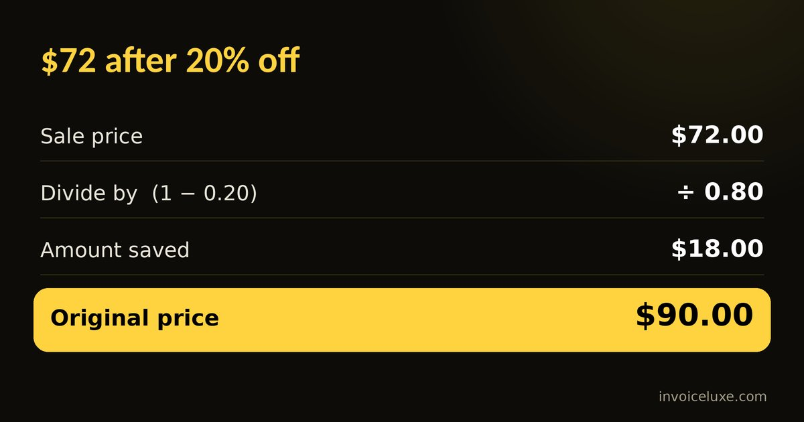

You know what you paid and how much the discount was, and you want to know what the price was before the sale. The answer is one division.

> **Original price = sale price ÷ (1 − discount rate)**

## Worked examples

| Sale price | Discount | Calculation | Original price |
|---|---|---|---|
| $72.00 | 20% | 72 ÷ 0.80 | $90.00 |
| $59.50 | 15% | 59.50 ÷ 0.85 | $70.00 |
| $39.99 | 30% | 39.99 ÷ 0.70 | $57.13 |

For the last row, 39.99 ÷ 0.70 = 57.1285, which rounds to $57.13.

## Why you cannot just add the percentage back

If an item cost $72 after 20% off, you might add 20% to get $72 × 1.20 = $86.40. That is wrong, because the 20% was taken from the original price, not from $72.

- **Wrong:** 72 × 1.20 = $86.40
- **Right:** 72 ÷ 0.80 = **$90.00**

Check: 20% of $90 is $18, and $90 − $18 = $72.

## Step by step

1. Convert the discount to a decimal (20% becomes 0.20).
2. Subtract it from 1 (1 − 0.20 = 0.80).
3. Divide the sale price by that number.

## Where this is useful

- Checking whether a "was" price on a sale tag is believable.
- Finding the list price when you only have a receipt.
- Recording an item's full price in your inventory or books.
- Working out how much margin a discount used up.

## Find the discount if you know both prices

If you have both the original and the sale price, the discount percentage is (original − sale) ÷ original × 100. For $90 and $72, that is 18 ÷ 90 = 20%.

## Check your result with a calculator

Enter the original price you found and the discount rate in a discount calculator. If it returns your sale price, your answer is right.

## A table to work backwards

If you paid the sale price shown, here is the original price:

| Sale price | Discount | Calculation | Original price |
|---|---|---|---|
| $67.50 | 25% | 67.50 ÷ 0.75 | $90.00 |
| $48.00 | 20% | 48.00 ÷ 0.80 | $60.00 |
| $150.00 | 40% | 150.00 ÷ 0.60 | $250.00 |
| $35.00 | 30% | 35.00 ÷ 0.70 | $50.00 |

The rule is to divide by 1 minus the discount, not to add the percentage back.

## When the receipt includes tax

You paid $97.20 in total, tax was 8% and the item had 10% off. Work backwards in two steps:

1. Remove the tax: 97.20 ÷ 1.08 = $90.00.
2. Undo the discount: 90.00 ÷ 0.90 = **$100.00**.

Undo the steps in the opposite order. See [remove sales tax from a total](/blog/remove-sales-tax-from-total/) for the tax step.

## In a spreadsheet

With the sale price in A2 and the discount in B2:

- Original price: `=A2/(1-B2)`
- Amount saved: `=A2/(1-B2)-A2`

## Check it

Multiply the original price by 1 minus the discount. If you get the sale price, your answer is right. For $90 at 25%, 90 × 0.75 = 67.50.

## When it helps

- Checking a deal against a "was" price
- Working out how much a seller marked an item down
- Preparing a refund or a price adjustment
- Recording the full price of an item on a business expense

## FAQ

### How do I find the original price from a 25% discount?

Divide the sale price by 0.75.

### How do I find the original price after a 50% discount?

Divide by 0.50, which means doubling the sale price.

### Does sales tax change this calculation?

Remove the sales tax first by [dividing the receipt total by 1 plus the tax rate](/blog/remove-sales-tax-from-total/). Then use the discount formula on the pre-tax price.

### Why is my answer a few cents off?

Prices are rounded to the cent, so the original price you find may differ by a cent or so from the real tag price.

### Why can't I add the discount to the sale price?

Because the discount was taken from the original price, which is bigger. Adding 25% to $67.50 gives $84.38, not $90.00.

### How do I find the original price if I know the amount saved?

Divide the amount saved by the discount rate. If you saved $22.50 at 25%, the original price was $90.00.
