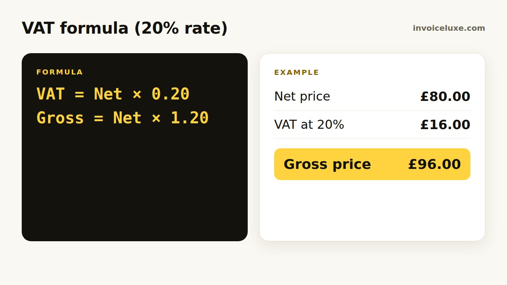
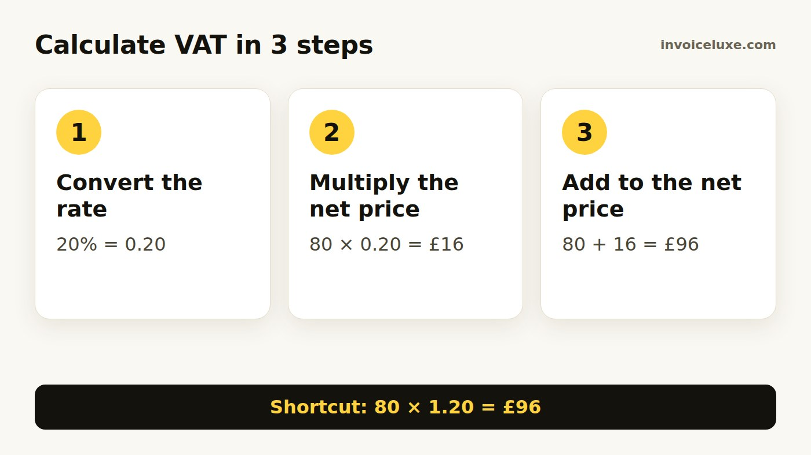

VAT is a tax added to the price of most goods and services. To calculate it, you multiply the price before VAT (the net price) by the VAT rate.

The UK standard rate is 20%, with a reduced rate of 5% and a zero rate for some items. Rates can change, so confirm the current ones on GOV.UK.

> **VAT = net price × VAT rate**  
> **Gross price = net price × (1 + VAT rate)**

## How do you calculate VAT in 3 steps?

A freelancer charges £80 before VAT. At the 20% rate:

1. Turn the rate into a decimal: 20% = 0.20
2. Multiply the net price by it: 80 × 0.20 = **£16 VAT**
3. Add it to the net price: 80 + 16 = **£96**

You can also do it in one step: 80 × 1.20 = £96.

## What is VAT at 20%, 5% and 0%?

| Rate | VAT on £100 net | Gross price | Multiplier |
|---|---|---|---|
| 20% (standard) | £20.00 | £120.00 | × 1.20 |
| 5% (reduced) | £5.00 | £105.00 | × 1.05 |
| 0% (zero) | £0.00 | £100.00 | × 1.00 |

## How do you calculate VAT on several items?

Add the net prices first, then work out VAT once on the total. This avoids rounding differences.

- Items: £19.99 + £34.50 + £12.75 = £67.24 net
- VAT at 20%: 67.24 × 0.20 = 13.448, rounded to **£13.45**
- Total: **£80.69**

## What mistakes should you avoid?

- **Using the gross price as the starting point.** VAT is calculated on the net price.
- **Subtracting 20% to remove VAT.** To go backwards you must divide, see [how to calculate VAT backwards](/blog/calculate-vat-backwards/).
- **Mixing up the rate.** Check whether an item is standard, reduced or zero rated.

## Use the VAT calculator

A calculator saves time when you have many prices. Enter the net amount and the rate, and see the VAT and the total at once. For a full walkthrough of adding and removing VAT, read [how to add or remove VAT](/blog/add-or-remove-vat/).

## Standard, reduced, zero-rated and exempt

These terms look similar, but they work differently:

| Type | VAT charged to the customer? | Can you reclaim VAT on your costs? |
|---|---|---|
| Standard-rated (for example 20%) | Yes | Yes |
| Reduced-rate (for example 5%) | Yes, at the lower rate | Yes |
| Zero-rated (0%) | No VAT is added, but the sale is still reported | Yes |
| Exempt | No | Usually not |

Zero-rated and exempt look the same on the invoice, because no VAT is added, but they are treated differently in your VAT return.

## What you pay to the tax authority

Registered businesses charge VAT on sales (output VAT) and subtract the VAT they paid on purchases (input VAT). The difference is what they pay.

| | Amount |
|---|---|
| Output VAT on sales | £4,800.00 |
| Input VAT on purchases | £1,350.00 |
| **VAT to pay** | **£3,450.00** |

If the input VAT is bigger than the output VAT, the business can usually claim a refund. The numbers above are examples.

## Do I need to register?

Businesses must register for VAT once their taxable turnover passes a threshold. In the UK, the threshold has been £90,000, but thresholds change, so check the current figure on GOV.UK or with your local tax authority. Some businesses register voluntarily to reclaim VAT on their costs.

## Keep VAT records

Keep copies of all sales and purchase invoices, and keep a record of the VAT rate used for each line. A simple spreadsheet with net, VAT and gross columns makes your return much easier. See [what to include on a VAT invoice](/blog/what-to-include-on-a-vat-invoice/) and [VAT calculation mistakes](/blog/vat-calculation-mistakes/).

## FAQ

### How do I calculate 20% VAT on a price?

Multiply the net price by 0.20 to get the VAT, or by 1.20 to get the price including VAT.

### What is the VAT on £100?

At 20% the VAT is £20, so the total is £120. At 5% the VAT is £5.

### Is VAT calculated on the net or the gross price?

On the net price, which is the price before VAT is added.

### What is the difference between zero-rated and exempt?

Zero-rated sales are taxable at 0%, and you can reclaim VAT on related costs. Exempt sales are outside VAT charging, and you usually cannot reclaim the related VAT.

### Who pays VAT in the end?

The final consumer. Businesses collect it and pass it on, after subtracting the VAT they paid.

### Is this tax advice?

No. It explains the calculation. For your own VAT obligations, check with HMRC or an accountant.
