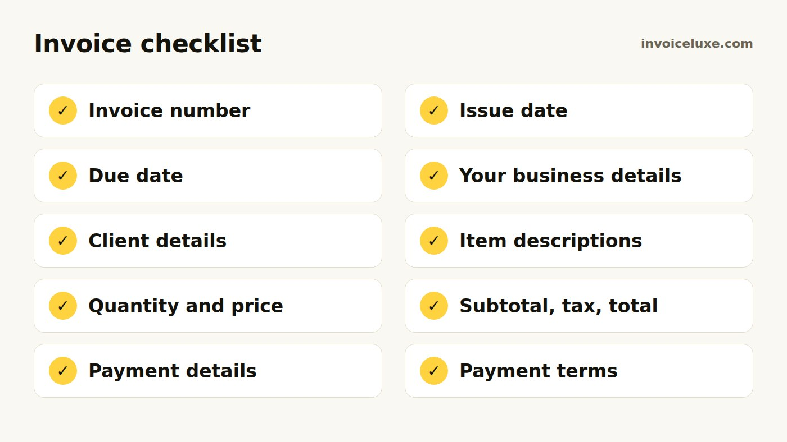
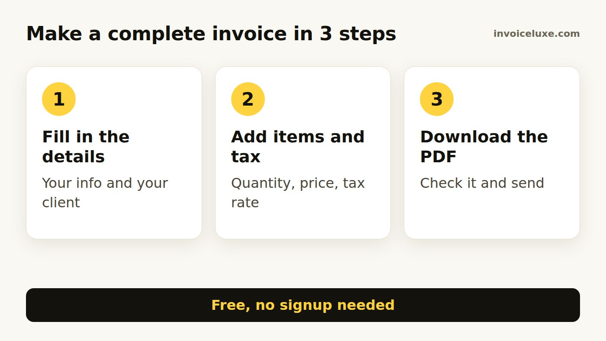

A clear invoice gets paid faster. A missing detail can delay payment for weeks, because the client has to come back and ask.

Use this checklist before you send any invoice.

## What must an invoice include?

1. **The word "Invoice".** It makes the document easy to recognise.
2. **A unique invoice number.** See [how to number invoices](/blog/how-to-number-invoices/).
3. **Issue date and due date.** The due date should be a real date, not only "30 days".
4. **Your business name, address and contact details.** Add your tax or VAT number if you have one.
5. **Your client's name and address.** Use the legal business name when you can.
6. **A description of each item.** Say what was done or sold, with dates if it helps.
7. **Quantity, unit price and line total.** Hours and rates for services, units and prices for products.
8. **Subtotal, tax and total.** Show tax as its own line.
9. **Payment details.** Bank details, a payment link or accepted methods.
10. **Payment terms.** For example "Payment due within 14 days". Read more on [invoice payment terms](/blog/invoice-payment-terms/).

## What extras can help you get paid?

- A **purchase order number** if your client uses them.
- A **late payment note**, such as interest or a fixed fee after the due date.
- A short **thank-you line**. It costs nothing and keeps the tone friendly.
- Your **logo**, so the invoice looks professional.

## Common invoice mistakes

- No due date, so the client pays whenever they like.
- A different business name from the one on the contract.
- Tax mixed into the price with no separate line.
- Bank details with a typo.

## Create an invoice with all of this

A free invoice generator keeps these fields in the right place, adds up the totals and exports a PDF. If you are new to it, follow the steps in [how to create an invoice](/blog/how-to-create-an-invoice/).

## What changes by type of business

| Business | Extra details that help |
|---|---|
| Freelancer or consultant | Hours or project name, hourly rate, scope, payment link |
| Online shop | Order number, shipping address, shipping cost, tax by item |
| Contractor | Job address, materials, labor, change orders |
| Landlord or property manager | Billing period, unit, itemized charges |

Start with the core details, then add the ones your client needs to approve and pay quickly.

## A short list of core fields

1. Your name or business name, address and contact details
2. Your client's name and address
3. A unique invoice number
4. The invoice date and the due date
5. A clear description of each item or service
6. Quantity, rate and amount for each line
7. Subtotal, tax and total
8. Payment details and accepted methods

## Details large clients often need

- **Purchase order (PO) number:** many companies cannot pay without it.
- **Project or cost code:** it helps them allocate the expense.
- **Tax ID:** your EIN or other business number, if they ask for it. Never put a Social Security number on an invoice.
- **Billing period:** useful for retainers and recurring work.

## Make the invoice easy to scan

Use a simple layout. Put the total and due date where the client's eye goes first, and use the same layout every time. See [free invoice template example](/blog/free-invoice-template-example/) and [how to create an invoice](/blog/how-to-create-an-invoice/).

## Avoid common problems

Most payment delays come from missing information: no PO number, a wrong address, or an unclear description. See [invoice mistakes to avoid](/blog/invoice-mistakes-to-avoid/) for a checklist.

## FAQ

### What is the minimum information on an invoice?

At least the invoice number, date, seller and buyer details, a description of what was supplied, the amount and any tax. Some countries require more, so check your local rules.

### Does an invoice need a due date?

It is not always required by law, but you should always add one. Without it, clients do not know when to pay.

### Can I send an invoice as a PDF?

Yes. A PDF is the most common format and is accepted almost everywhere.

### Is this legal advice?

No. Invoice rules differ by country. Check with your tax authority or an accountant.

### Do I need to include my tax ID on an invoice?

Only if your client or local law requires it. Use your business number, not a personal ID number.

### Should I list every hour on the invoice?

If the client pays by the hour, list the hours or attach a timesheet. For fixed-price work, a clear description is enough.
