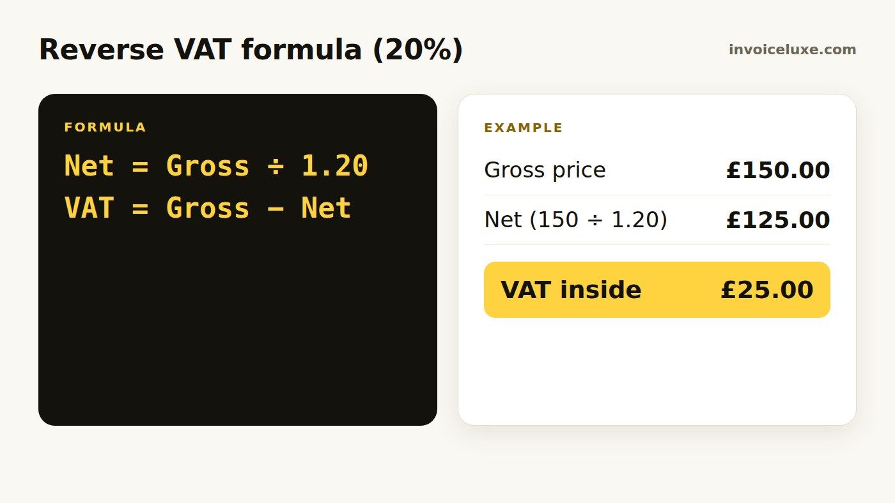
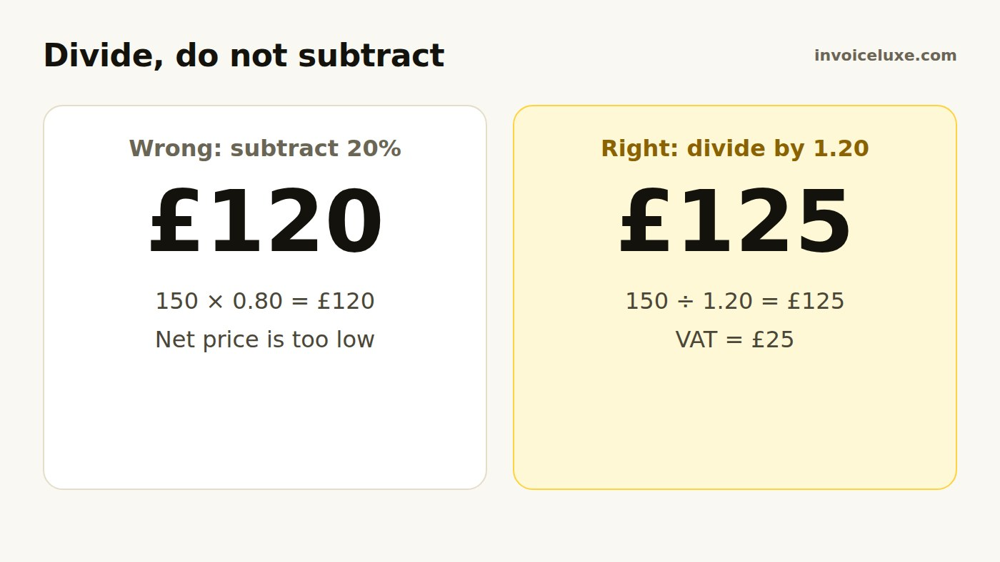

You have a total that already includes VAT, and you need the price before VAT. This is called calculating VAT backwards, or a reverse VAT calculation.

The key rule: **divide, do not subtract.**

> **Net price = gross price ÷ (1 + VAT rate)**  
> **VAT = gross price − net price**

## How do you remove 20% VAT from a price?

A receipt says £150 including VAT at 20%:

1. Divide by 1.20: 150 ÷ 1.20 = **£125 net**
2. Subtract to find the VAT: 150 − 125 = **£25**

## Why is subtracting 20% wrong?

Taking 20% off £150 gives £120, which is wrong. VAT was added to the net price of £125, so it is 20% of £125, not 20% of £150. Dividing by 1.20 undoes the addition correctly.

## Is there a shortcut?

Yes. The VAT inside a gross price is a fixed fraction of it:

- At **20%**, VAT is one sixth of the gross price. £150 ÷ 6 = £25.
- At **5%**, VAT is one twenty-first. £63 ÷ 21 = £3, so the net price is £60.

## Reverse VAT table at 20%

| Gross price | Net price | VAT |
|---|---|---|
| £60 | £50.00 | £10.00 |
| £120 | £100.00 | £20.00 |
| £240 | £200.00 | £40.00 |
| £600 | £500.00 | £100.00 |

## Check your answer

Multiply the net price by 1.20. If you get back the gross price, the calculation is right. £125 × 1.20 = £150.

To add VAT going forwards, see [how to calculate VAT](/blog/how-to-calculate-vat/). For a side-by-side view, read [how to add or remove VAT](/blog/add-or-remove-vat/).

## More gross prices at 20%

| Gross price | Divide by 1.20 | Net price | VAT inside |
|---|---|---|---|
| 60.00 | 60 ÷ 1.2 | 50.00 | 10.00 |
| 120.00 | 120 ÷ 1.2 | 100.00 | 20.00 |
| 240.00 | 240 ÷ 1.2 | 200.00 | 40.00 |
| 600.00 | 600 ÷ 1.2 | 500.00 | 100.00 |

For these round numbers, the VAT inside is one sixth of the gross price at 20%.

## A restaurant bill example

A bill is £86.40 and includes 20% VAT.

1. Net: 86.40 ÷ 1.20 = **£72.00**
2. VAT: 86.40 − 72.00 = **£14.40**

If you need the VAT for an expense claim, one sixth of £86.40 is also £14.40.

## Other rates

At 5%, divide by 1.05. A gross price of 105 has a net of 100 and VAT of 5. At 10%, divide by 1.10. At 25%, divide by 1.25. Always use 1 plus the rate as a decimal.

## In a spreadsheet

- Net: `=ROUND(A2/(1+B2),2)`
- VAT: `=A2-ROUND(A2/(1+B2),2)`

Put the rate in B2 as a percentage, such as 20%.

## Keep the original receipt

When you reclaim VAT or record an expense, keep the receipt that shows the VAT. A calculated figure is a good check, but the receipt is your evidence. See [VAT inclusive vs exclusive](/blog/vat-inclusive-vs-exclusive/) and [add or remove VAT](/blog/add-or-remove-vat/).

## FAQ

### How do I calculate VAT backwards?

Divide the VAT-inclusive price by 1 plus the VAT rate. At 20%, divide by 1.20.

### How do I find the VAT amount in a total?

At 20%, divide the gross total by 6. At 5%, divide it by 21.

### What is £120 excluding VAT?

£120 ÷ 1.20 = £100 net, with £20 VAT.

### How do I find the VAT in a total of 120?

At 20%, the VAT is 20, because 120 ÷ 1.20 is 100 and 120 − 100 is 20.

### Why is subtracting 20% wrong?

Because the 20% was added to the net price, not the gross price. Twenty percent of 120 is 24, which would leave 96, not 100.

### Is this tax advice?

No. It explains the calculation. For your own VAT obligations, check with HMRC or an accountant.
