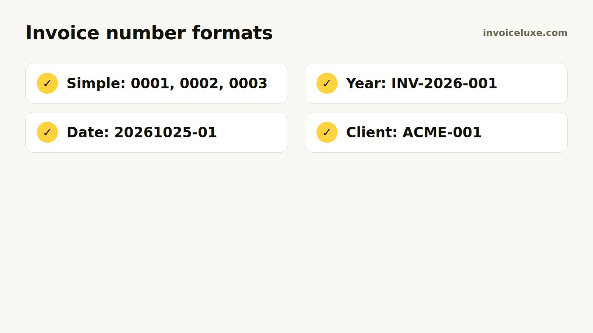
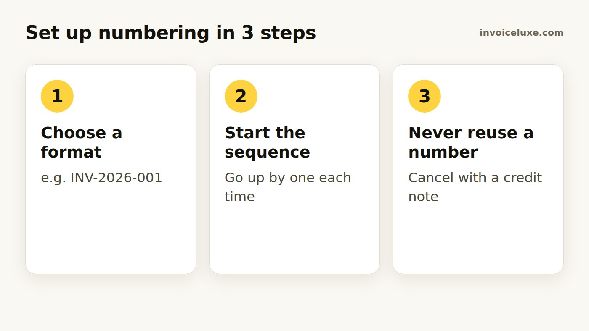

Every invoice needs its own number. It lets you and your client find the invoice later, and it keeps your records in order.

A good numbering system is unique, consistent and easy to read. You do not need anything fancy.

## What are the rules for invoice numbers?

- **Unique.** Never use the same number twice.
- **Consistent.** Pick one format and stick to it.
- **In order.** Many tax authorities, including HMRC for VAT invoices, expect a unique sequential number. Even where it is not required, it is good practice.
- **No gaps without a reason.** If an invoice is cancelled, keep its number and issue a credit note.

## What invoice number formats can you use?

| Format | Example | Best for |
|---|---|---|
| Simple sequence | 0001, 0002, 0003 | Most freelancers |
| Year + sequence | INV-2026-001 | Easy yearly records |
| Date based | 20261025-01 | Many invoices per month |
| Client code + sequence | ACME-001 | A few big clients |

## Which format should you choose?

For most small businesses, **year + sequence** is the sweet spot. You can see the year at a glance, and the sequence restarts each January.

If you work with several clients and want to see their invoices together, use a client code.

## Do you have to start at 1?

No. You can start at 1001 if you do not want clients to see that you are new. Just keep going upwards without gaps.

## What if you make a mistake?

Do not delete or reuse the number. Issue a **credit note** to cancel the wrong invoice, then send a new invoice with the next number.

## Make it automatic

An invoice generator that increases the number for you removes the risk of duplicates. For the other details that every invoice needs, read [what to include on an invoice](/blog/what-to-include-on-an-invoice/).

## Example numbering schemes

| Scheme | First invoices | Good for |
|---|---|---|
| Simple sequence | 001, 002, 003 | Very small businesses |
| Year plus sequence | 2026-001, 2026-002 | Most freelancers |
| Year, month and sequence | 2026-11-001 | Higher volume |
| Client code plus sequence | ACME-001, ACME-002 | Several regular clients |

Pick one scheme and keep it. Consistency matters more than the format.

## What to do about credit notes

Give credit notes their own series, such as CN-2026-001, and refer to the original invoice number. This keeps your invoice sequence clean and makes it clear which invoice a credit relates to. See [how to send an invoice to a customer](/blog/how-to-send-an-invoice-to-a-customer/) for sending and tracking.

## Gaps and duplicates

- **A gap in the sequence** is not always a problem, but you should be able to explain it. Note why an invoice was voided.
- **A duplicate number** is a bigger problem. It confuses clients and accountants.
- **Voided invoices:** keep them, marked as void, instead of deleting them.

## Numbering in a spreadsheet

Keep a register with the invoice number, date, client, amount and status. Add one row each time you create an invoice, and use the last number plus one. Even a simple sheet prevents duplicates.

## When you start a new year

You can continue the sequence or restart at 001 with the new year in front. Either way is fine. Many businesses prefer year-based numbers because they make records easy to sort. See [invoice mistakes to avoid](/blog/invoice-mistakes-to-avoid/).

## FAQ

### How should I number my invoices?

Use a unique, sequential number in one consistent format, for example INV-2026-001.

### Can I start invoice numbers at 1001?

Yes. Any starting number is fine as long as the numbers stay unique and go up in order.

### Can two invoices have the same number?

No. Each invoice needs its own number so it can be identified and tracked.

### What do I do with a cancelled invoice?

Keep its number, issue a credit note and send a corrected invoice with a new number.

### Should invoice numbers be in order?

Yes, in most cases. A sequential order makes it easier to spot a missing invoice.

### Can I use letters in invoice numbers?

Yes. Prefixes such as INV or a client code are common, as long as each number is unique.
