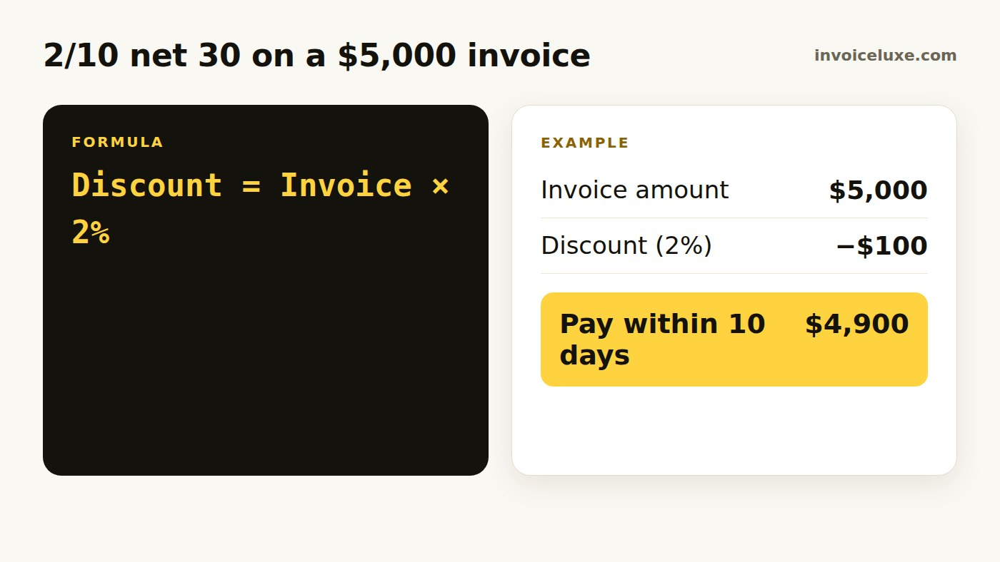
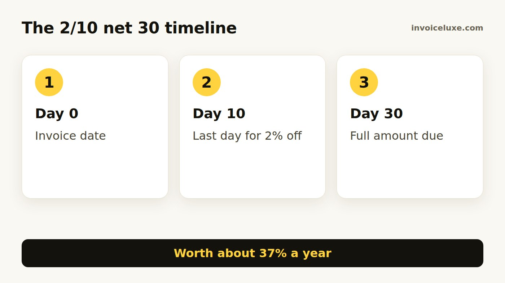

**2/10 net 30** is a common payment term. It means: take **2% off** if you pay within **10 days**, otherwise pay the **full amount within 30 days**.

Suppliers offer it to get paid sooner. Buyers take it because the saving is bigger than it looks.

> **Early payment discount = invoice amount × discount %**

## How do you calculate the early payment discount?

An invoice for $5,000 has terms 2/10 net 30:

- Discount: 5,000 × 0.02 = **$100**
- Pay within 10 days: **$4,900**
- Pay on day 11 to 30: **$5,000**

## What is 2/10 net 30 worth per year?

By paying 20 days earlier, you save 2%. Over a year, that adds up to a high return:

> **Annual rate = discount ÷ (100 − discount) × 365 ÷ (full days − discount days)**

For 2/10 net 30: 2 ÷ 98 × 365 ÷ 20 = **about 37.2% a year**.

Borrowing money to pay early can be worth it if the loan costs less than that.

## Other common terms

| Terms | Meaning | Annual rate |
|---|---|---|
| 1/10 net 30 | 1% off in 10 days, full in 30 | about 18.4% |
| 2/10 net 30 | 2% off in 10 days, full in 30 | about 37.2% |
| 2/10 net 60 | 2% off in 10 days, full in 60 | about 14.9% |
| Net 30 | No discount, full in 30 days | none |

## Should you offer it as a seller?

It makes sense if cash flow matters more to you than 2% of the invoice. Check your margin first, then add the term to the invoice clearly. See [invoice payment terms](/blog/invoice-payment-terms/) for wording ideas.

## Use the calculator

The discount calculator shows the amount saved and the final price. For general percentages, read [how to calculate a discount percentage](/blog/how-to-calculate-discount-percentage/).

## An example invoice

A $5,000 invoice has terms of 2/10 net 30.

| Payment date | Amount due |
|---|---|
| Within 10 days | $4,900.00 (a $100 discount) |
| Days 11 to 30 | $5,000.00 |
| After day 30 | $5,000.00 plus any late fee |

The customer saves $100 by paying 20 days early. The seller gets cash sooner, but gives up $100.

## Writing the terms on an invoice

Be clear and specific. A line like this works well:

"Terms: 2% discount if paid within 10 days of the invoice date. Full amount due within 30 days."

Add the discount deadline as a date, not only a number of days. For example, "Pay by November 24 and save $100.00". See [invoice payment terms](/blog/invoice-payment-terms/) for more wording.

## When sales tax is involved

Check how your state treats a discount for early payment. In some places, the tax is calculated on the full price, and in others on the lower amount. Record the treatment in your accounting system and be consistent.

## When it makes sense

- **For the seller:** when cash flow matters more than the discount cost, or when a customer often pays late.
- **For the buyer:** when the saving is bigger than what you could earn by keeping the cash. A 2% saving for paying 20 days early is a high return.

## Make it easy to follow

Customers use early payment discounts only if they notice them. Put the terms near the total, mention them in your reminder emails, and apply the discount correctly when the payment arrives. See [payment reminder email for an overdue invoice](/blog/payment-reminder-email-overdue-invoice/) for follow-up wording.

## FAQ

### What does 2/10 net 30 mean?

A 2% discount if you pay within 10 days, and the full amount due within 30 days.

### Is an early payment discount worth taking?

Usually yes. 2/10 net 30 equals roughly 37% a year, which is more than most borrowing costs.

### How do I add it to an invoice?

Write the terms on the invoice, for example "2/10 net 30", and say the discount amount and the last day to claim it.

### Is this financial advice?

No. It explains the calculation. Check your own cash flow and terms.

### Do customers have to take the early payment discount?

No. It is an option. They can pay the full amount by the due date.

### What if a customer pays on day 12 and takes the discount anyway?

Check your terms, and send a short note asking for the remaining balance, or decide whether to accept it as a goodwill gesture.
