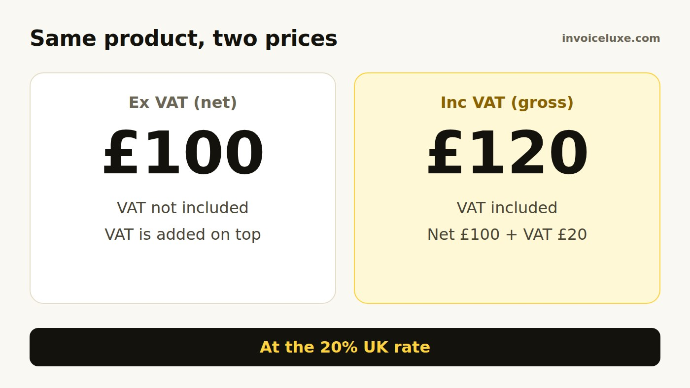
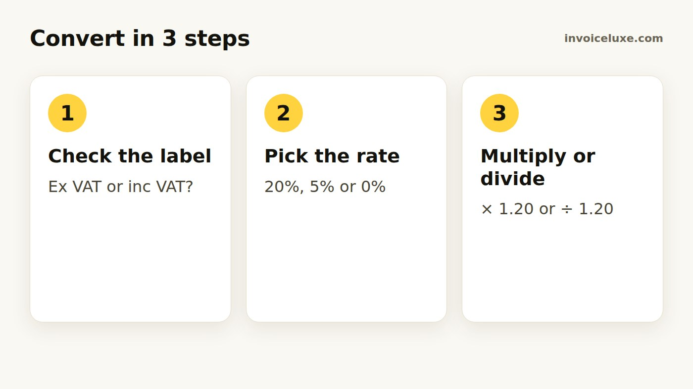

A price **including VAT** (inc VAT, gross) already contains the tax. A price **excluding VAT** (ex VAT, net) does not, so VAT is added on top.

Both can describe the same product. They only differ in whether the tax is already in the number.

## What do the labels mean?

| You see | Also called | Meaning |
|---|---|---|
| Ex VAT, excl. VAT | Net price | VAT not included |
| Inc VAT, incl. VAT | Gross price | VAT included |
| + VAT | Net price | VAT will be added |

## How do you convert between them?

At the UK standard rate of 20%:

- **Ex VAT to inc VAT:** multiply by 1.20. £1,200 ex VAT is £1,440 inc VAT.
- **Inc VAT to ex VAT:** divide by 1.20. £1,440 inc VAT is £1,200 ex VAT.

Do not subtract 20% to go back. See [how to calculate VAT backwards](/blog/calculate-vat-backwards/).

## Which price should you show?

- **Consumers (B2C):** in the UK, prices shown to consumers generally need to include VAT.
- **Businesses (B2B):** quotes and invoices often show prices ex VAT, because the buyer can usually reclaim the VAT.

Always say clearly which one you mean, for example "£1,200 + VAT".

## Why does it matter for your budget?

A £1,200 quote ex VAT costs £1,440 if you cannot reclaim VAT. A business that is VAT registered can usually reclaim it, so the real cost is £1,200. Always check which one you are comparing.

## Use the VAT calculator

Enter a price, pick the rate and see both the net and gross amounts. To go further, read [how to calculate VAT](/blog/how-to-calculate-vat/) and [how to add or remove VAT](/blog/add-or-remove-vat/).

## Converting a price list

Say your price list shows VAT-inclusive prices at 20% and your business customers want net prices:

| Inclusive price | Net price | VAT |
|---|---|---|
| 49.99 | 41.66 | 8.33 |
| 120.00 | 100.00 | 20.00 |
| 299.00 | 249.17 | 49.83 |

Divide by 1.20 to get the net price, then subtract to get the VAT. For 49.99, 49.99 ÷ 1.2 = 41.658, which rounds to 41.66.

## Who usually sees which price

- **Consumers** usually see VAT-inclusive prices in many countries, because that is the price they will pay.
- **Business customers** usually prefer net prices, because they can reclaim the VAT.

If you sell to both, state clearly which kind of price you show, for example "£100 + VAT" or "£120 including VAT".

## Contracts and quotes

A price of "£1,000" in a contract can be read two ways. Avoid arguments by writing "£1,000 plus VAT" or "£1,000 including VAT". If the VAT rate changes, a "plus VAT" price will follow the new rate, and an "including VAT" price may need to be renegotiated.

## Effect on your income

If you quote an inclusive price, you keep only the net amount. At 20% VAT, a £120 inclusive price leaves you £100. If you accidentally treat £120 as net income, you will overstate your earnings and underpay VAT.

## Check before you send

1. Does the price list say "inc. VAT" or "ex. VAT"?
2. Is the VAT rate stated?
3. Does the invoice show net, VAT and gross separately?

See [add or remove VAT](/blog/add-or-remove-vat/) and [what to include on a VAT invoice](/blog/what-to-include-on-a-vat-invoice/).

## FAQ

### What does inc VAT mean?

It means VAT is already included in the price shown.

### What does ex VAT mean?

It means VAT is not included and will be added on top.

### How do I convert a price ex VAT to inc VAT?

Multiply by 1 plus the VAT rate. At 20%, multiply by 1.20.

### Should I show prices with or without VAT?

Show inclusive prices to consumers and exclusive prices to businesses, and always label them clearly.

### How do I convert an inclusive price to exclusive?

Divide by 1 plus the VAT rate. At 20%, divide by 1.20.

### Is this tax advice?

No. For your own VAT obligations, check with HMRC or an accountant.
