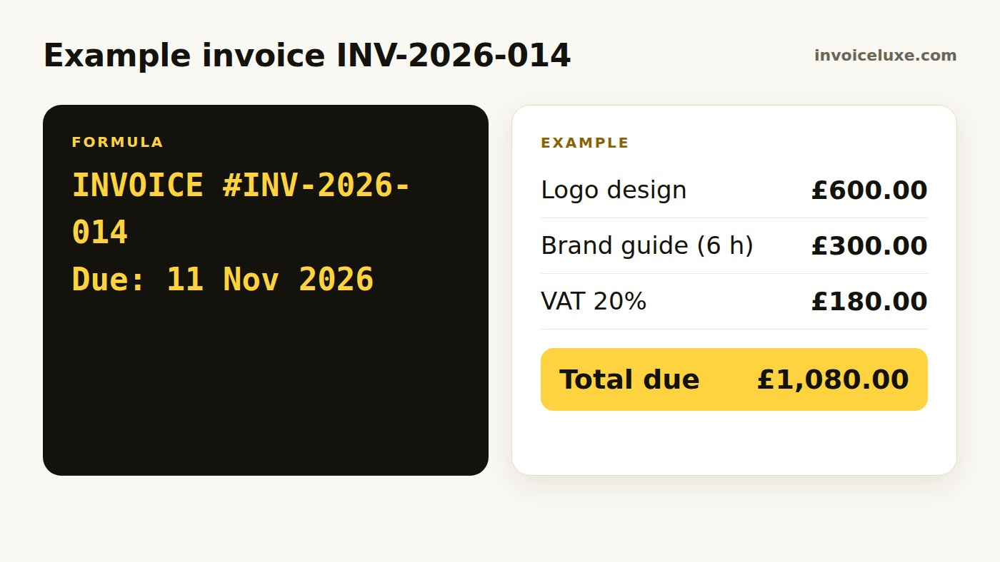
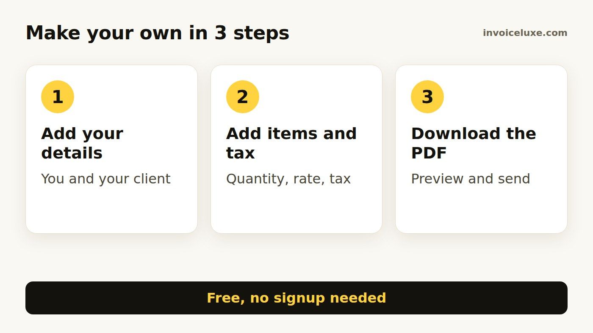

You do not need complicated software to send a good invoice. A simple, clear layout is enough.

Below is a freelancer invoice example you can copy, and a quick way to make your own as a PDF.

## What does a simple invoice look like?

**INVOICE #INV-2026-014**  
Issue date: 28 October 2026 · Due date: 11 November 2026

**From:** Jane Cooper Design, 12 Park Lane, London  
**To:** Northwind Ltd, 4 King Street, Manchester

| Description | Qty | Rate | Amount |
|---|---|---|---|
| Logo design | 1 | £600.00 | £600.00 |
| Brand guide (hours) | 6 | £50.00 | £300.00 |
| **Subtotal** | | | £900.00 |
| VAT 20% | | | £180.00 |
| **Total due** | | | **£1,080.00** |

**Payment:** bank transfer, sort code 00-00-00, account 00000000, reference INV-2026-014  
**Terms:** payment due within 14 days.

## How do you make your own in 3 steps?

1. **Add your details.** Your business name, address, logo and your client's details.
2. **Add items and tax.** Enter each service or product with quantity and price, and set the tax rate.
3. **Download the PDF.** Check the preview, then send it by email.

## Tips for a better invoice

- Put the **due date** where it is easy to see.
- Make the **total** the biggest number on the page.
- Add **payment details** so the client does not need to ask.
- Use the same layout every time, so clients recognise it.

For the full list of fields, read [what to include on an invoice](/blog/what-to-include-on-an-invoice/). For a longer walkthrough, see [how to create an invoice](/blog/how-to-create-an-invoice/).

## A template for services and products

| Description | Qty | Unit price | Amount |
|---|---|---|---|
| Website design, homepage | 1 | $900.00 | $900.00 |
| Stock photos | 5 | $12.00 | $60.00 |
| **Subtotal** | | | **$960.00** |
| Tax (0%) | | | $0.00 |
| **Total due** | | | **$960.00** |

Use this layout for any mix of services and products. Add a tax line only when you must charge tax, and fill in the rate.

## Customize it for your business

- Add your logo and colors, so the invoice looks like part of your brand.
- Include your payment methods at the bottom.
- Add a note about payment terms and late fees.
- Add a thank-you line, which costs nothing and sounds friendly.

## Save it as a PDF

Send invoices as PDFs. They look the same on every device and are hard to change by accident. Name the file clearly, for example "Invoice-2026-014-Client.pdf". See [how to number invoices](/blog/how-to-number-invoices/).

## Template for recurring work

If you bill the same client each month, copy the invoice, change the number, date and period, and send it. Keep the line items the same, so the client recognizes them. See [what to include on an invoice](/blog/what-to-include-on-an-invoice/) for ideas.

## Check it before you send

1. Is every field filled in?
2. Do the numbers add up?
3. Is the due date clear?

See [how to create an invoice](/blog/how-to-create-an-invoice/) for a full walk-through.

## FAQ

### Is there a free invoice template?

Yes. You can use a free online invoice generator and download the result as a PDF with no signup.

### Do I need Word or Excel to make an invoice?

No. An invoice generator in your browser is faster and keeps the totals correct.

### What should a freelancer invoice include?

Invoice number, dates, your details, your client's details, item descriptions, amounts, tax, total and payment details.

### Is this legal advice?

No. Invoice rules differ by country, so check with your tax authority.

### Is there a free invoice template I can download?

Yes. A free invoice generator creates a ready-to-send PDF in your browser.

### Do I need accounting software to use a template?

No. A simple template and a folder for your PDFs are enough for a small business.
