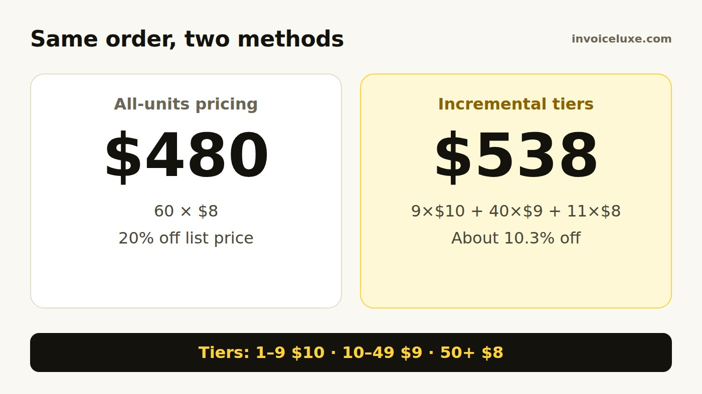
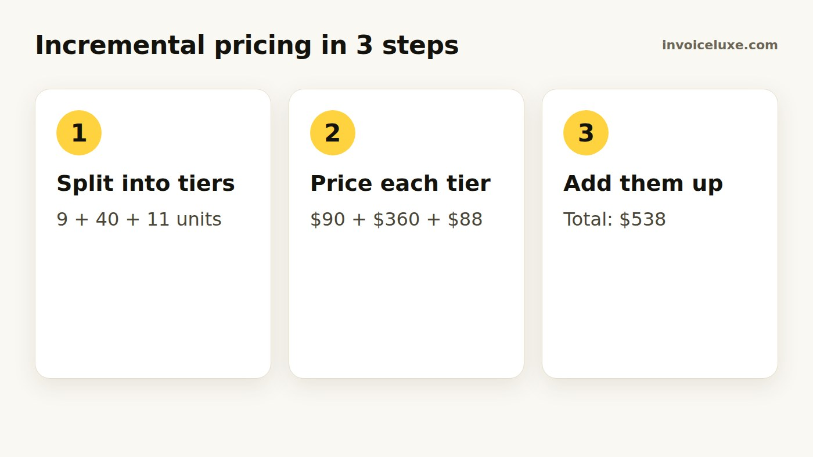

A bulk discount lowers the price per item when a customer buys more. The maths depends on how you apply the tiers.

There are two common ways, and they give very different totals.

> **Total = quantity × price per unit at that tier**

## What are the price tiers in this example?

| Quantity | Price per unit |
|---|---|
| 1 to 9 | $10 |
| 10 to 49 | $9 |
| 50 or more | $8 |

## How does all-units pricing work?

The tier price applies to **every unit** in the order.

- 20 units: 20 × $9 = **$180**
- 60 units: 60 × $8 = **$480**

It is simple and rewards big orders, but the price can drop sharply at the tier edge.

## How does incremental pricing work?

Each tier price applies only to the units **inside that tier**.

- 20 units: 9 × $10 + 11 × $9 = $90 + $99 = **$189**
- 60 units: 9 × $10 + 40 × $9 + 11 × $8 = $90 + $360 + $88 = **$538**

## How much is the discount worth?

At list price, 60 units cost 60 × $10 = $600.

- All-units: $480, which is **20% off**
- Incremental: $538, which is **about 10.3% off**

## Which method should you use?

All-units pricing is easier to explain and encourages customers to buy up to the next tier. Incremental pricing protects your margin on big orders. Check your costs first with the [markup vs discount](/blog/markup-vs-discount/) guide.

## Use the calculator

Use the discount calculator to turn a percentage into a price, and see [how to calculate a discount percentage](/blog/how-to-calculate-discount-percentage/) for the formula.

## A second example with 60 units

A product costs $12 per unit with these tiers:

| Quantity | Unit price |
|---|---|
| 1 to 24 | $12.00 |
| 25 to 49 | $11.00 |
| 50 or more | $10.00 |

For an order of 60 units:

| Method | Calculation | Total | Effective discount |
|---|---|---|---|
| Without any discount | 60 × 12 | $720.00 | 0% |
| All-units pricing | 60 × 10 | $600.00 | 16.67% |
| Incremental pricing | 24 × 12 + 25 × 11 + 11 × 10 | $673.00 | 6.53% |

All-units pricing is far more generous, and incremental pricing keeps more margin for the seller.

## Check your margin first

Before you set a tier, work out the profit at that price. If your cost is $7 per unit, a $10 price leaves $3 profit, a 30% margin. A $9 price would leave $2, which is 22%. See [profit margin formula](/blog/profit-margin-formula/).

## Make it easy for the customer to understand

- Show the tiers in a small table on the quote or price list.
- Show the effective unit price on the invoice.
- Put the discount as a separate line, so the customer sees the saving.
- Mention the next tier, such as "add 5 more units to get $10 each".

## Common pitfalls

- **Gaps in the tiers.** Make sure every quantity is covered.
- **Surprise at the boundary.** A customer buying 49 units may pay more than one buying 50. Tell them about the next tier.
- **Ignoring shipping.** A bigger order costs more to ship.
- **Forgetting tax.** The discount lowers the taxable price. See [discount and sales tax together](/blog/discount-and-sales-tax-together/).

## FAQ

### How do I calculate a bulk discount?

Find the price per unit for the quantity ordered, then multiply by the quantity. With incremental tiers, price each tier separately and add them.

### What is the difference between all-units and incremental discounts?

All-units applies the lower price to every unit. Incremental applies it only to units inside the tier.

### What discount should I offer?

Start from your margin. Make sure the discounted price still covers your costs and a profit.

### Is all-units or incremental pricing better?

All-units is simpler and more attractive to buyers. Incremental pricing protects the seller's margin. Choose the one that fits your costs.

### How many tiers should I offer?

Two or three. More tiers are harder to explain and to invoice.
