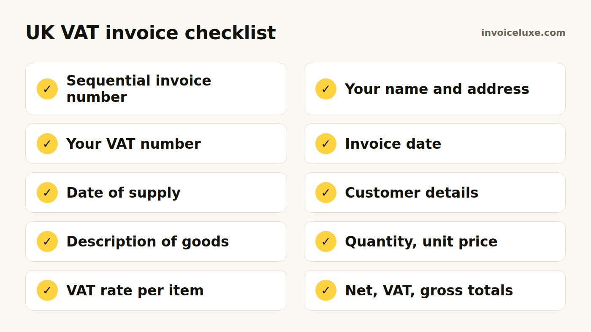
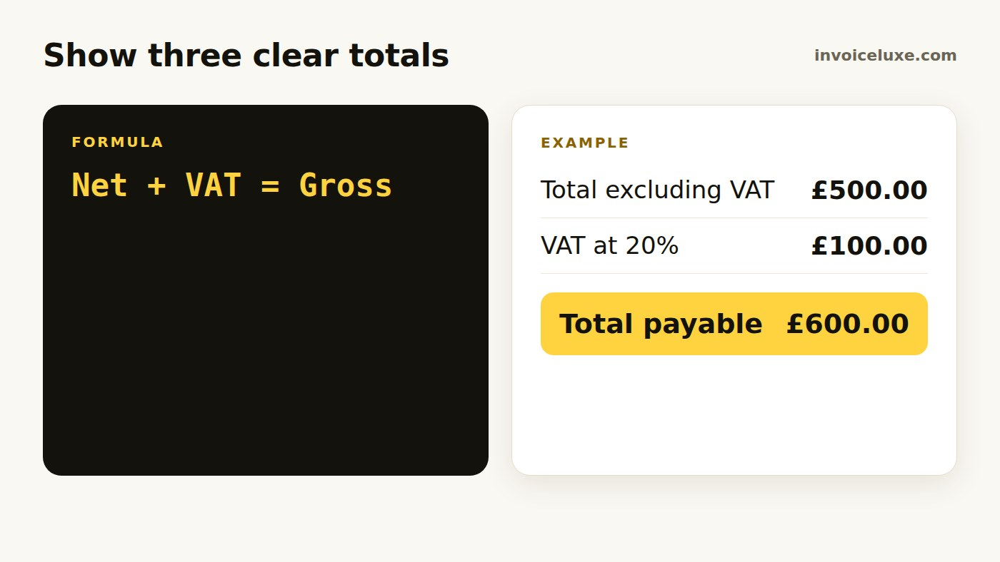

If you are VAT registered, your invoices must carry certain details so your customer can reclaim the VAT. This guide covers the usual items on a UK VAT invoice.

Rules can change, so check the current guidance on GOV.UK, including the simpler invoices allowed for small retail sales.

## What should a VAT invoice show?

1. **A unique, sequential invoice number.** See [how to number invoices](/blog/how-to-number-invoices/).
2. **Your business name and address.**
3. **Your VAT registration number.** UK numbers look like GB followed by 9 digits.
4. **The invoice date.**
5. **The date of supply**, if it is different from the invoice date.
6. **Your customer's name and address.**
7. **A description of the goods or services.**
8. **The quantity and the unit price, excluding VAT.**
9. **The VAT rate for each item.** 20%, 5% or 0%.
10. **The total excluding VAT, the total VAT and the total payable.**

## How should the totals be laid out?

Show three clear lines:

| Line | Example |
|---|---|
| Total excluding VAT | £500.00 |
| VAT at 20% | £100.00 |
| **Total payable** | **£600.00** |

If an invoice has items at different rates, show the VAT for each rate.

## Common VAT invoice mistakes

- Missing the **VAT registration number**.
- Showing only the gross price, with no **VAT amount**.
- Using the **wrong rate** for an item.
- Gaps or repeats in the **invoice numbers**.

## Build it into your invoices

An invoice generator with a VAT field fills in the totals for you. To check the maths, see [how to calculate VAT](/blog/how-to-calculate-vat/), and read [what to include on an invoice](/blog/what-to-include-on-an-invoice/) for the general checklist.

## A sample VAT invoice layout

| Description | Net | VAT rate | VAT | Gross |
|---|---|---|---|---|
| Consulting, 8 hours at £75 | £600.00 | 20% | £120.00 | £720.00 |
| Printed report | £50.00 | 5% | £2.50 | £52.50 |
| **Total** | **£650.00** | | **£122.50** | **£772.50** |

Add above the table: your business name and address, your VAT registration number, the customer's name and address, the invoice number, the invoice date and the date of supply if it differs.

## Simplified invoices

Some countries allow a simplified invoice for small sales, with fewer details. In the UK, for example, a less detailed VAT invoice is allowed for sales under a set amount, which has been £250. The rules change, so confirm them on your tax authority's website before you use a simplified invoice.

## Timing

Tax authorities often set a deadline for issuing a VAT invoice after the sale. In the UK, it is normally within 30 days of the supply. Issue invoices promptly and keep them in order. See [how to number invoices](/blog/how-to-number-invoices/).

## Credit notes

When you cancel or reduce an invoice, issue a credit note that refers to the original invoice. It should show the VAT you are reversing, so both parties can correct their VAT returns.

## Keep records

Keep copies of every VAT invoice you issue and receive. Many tax authorities ask for records to be kept for several years. In the UK, the usual period is six years. Check the rule for your country.

## Common checks

- Is the VAT number correct and visible?
- Does each line show the rate?
- Do the totals match?
- Is the currency clear?

See [what to include on an invoice](/blog/what-to-include-on-an-invoice/) for the basics, and [VAT calculation mistakes](/blog/vat-calculation-mistakes/) for errors to avoid.

## FAQ

### Is a VAT number required on an invoice?

Yes, if you are VAT registered, a full VAT invoice should show your VAT registration number.

### Does a VAT invoice need to be numbered?

Yes. It should have a unique number, and HMRC expects it to be sequential.

### Can I send a VAT invoice as a PDF?

Yes. Electronic invoices are accepted as long as they contain the required details.

### Is a VAT number required on every invoice?

If you are VAT-registered, yes. Your invoices to other businesses usually need it.

### Can I use a simplified invoice for any sale?

Only where your tax rules allow it, usually for lower amounts. Check your local rules.

### Is this tax advice?

No. For your own VAT obligations, check with HMRC or an accountant.
