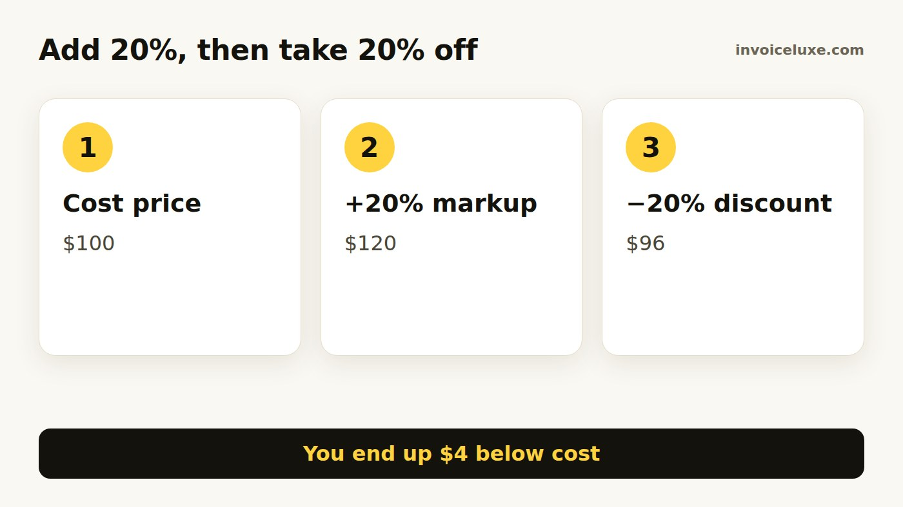
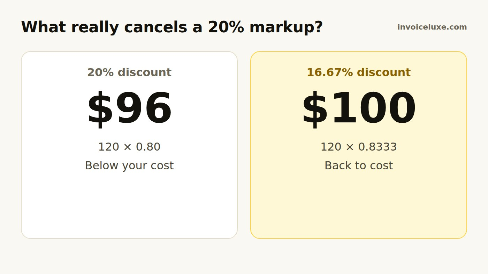

Add 20% to a price, then take 20% off. Do you get back to where you started? No, and the gap can cost you money.

The reason is that the two percentages apply to different amounts.

## What happens when you add and remove 20%?

1. Cost price: **$100**
2. Add a 20% markup: 100 × 1.20 = **$120**
3. Give a 20% discount: 120 × 0.80 = **$96**

You end up $4 below your cost. The discount was 20% of the bigger $120, so it removed more than the markup added.

## What discount cancels a markup exactly?

> **Discount that returns to cost = markup ÷ (1 + markup)**

| Markup | Discount to return to cost |
|---|---|
| 10% | 9.09% |
| 20% | 16.67% |
| 25% | 20% |
| 50% | 33.33% |

So after a 20% markup, a discount of 16.67% brings the price back to $100.

## How do you price a sale safely?

- Decide the **lowest price** you can accept first.
- Work backwards: a $120 price with a 15% discount gives $102, still above the $100 cost.
- Remember that **margin is not markup**. A 20% markup is a 16.67% margin on the selling price.

## Use the calculators

Use the discount calculator to see the price after a percentage off. For margins and markup, try the [profit margin calculator](/profit-margin-calculator.html). To go deeper on percentages, read [how to calculate a discount percentage](/blog/how-to-calculate-discount-percentage/).

## Markup and margin are not the same

Markup is profit as a percentage of cost. Margin is profit as a percentage of the selling price.

| Cost | Markup | Selling price | Profit | Margin |
|---|---|---|---|---|
| $60 | 25% | $75.00 | $15.00 | 20% |
| $60 | 50% | $90.00 | $30.00 | 33.3% |
| $60 | 100% | $120.00 | $60.00 | 50% |

A 100% markup is a 50% margin, which surprises many people. When you plan a discount, margin is the number that tells you how much room you have.

## What a discount does to your profit

An item costs you $60 and sells for $100, a $40 profit. See what a discount does:

| Discount | New price | Profit | Change in profit | Extra units needed to earn the same total |
|---|---|---|---|---|
| 10% | $90.00 | $30.00 | −25% | 33% more |
| 20% | $80.00 | $20.00 | −50% | 100% more |

A 20% discount cuts the profit in half, so you must sell twice as many units to earn the same total profit. Before you offer a sale, ask whether your customers will really buy that many more.

## Set a floor price

Decide the lowest price you will accept. Add your cost, your overheads and a minimum profit. Do not discount below it. For margin formulas, see [profit margin formula](/blog/profit-margin-formula/).

## Better ways to give value

- Add a free item or service, instead of cutting the price.
- Offer a discount only on a bigger order. See [bulk discount pricing](/blog/bulk-discount-pricing/).
- Offer an early payment discount to improve cash flow. See [early payment discount 2/10 net 30](/blog/early-payment-discount-2-10-net-30/).

## FAQ

### Does a 20% discount cancel a 20% markup?

No. A 20% discount on the marked-up price leaves you below your original cost.

### What discount cancels a 20% markup?

About 16.67%, which is 20 ÷ 120.

### What is the difference between markup and margin?

Markup is profit as a percentage of cost. Margin is profit as a percentage of the selling price.

### Is this financial advice?

No. It explains the calculation. Check your own costs before setting prices.

### Is a 50% markup the same as a 50% margin?

No. A 50% markup on a $60 cost gives a $90 price, which is a 33.3% margin.

### How much can I discount without losing money?

Up to the point where the price equals your cost, but that earns no profit. Keep a margin above your costs and overheads.
