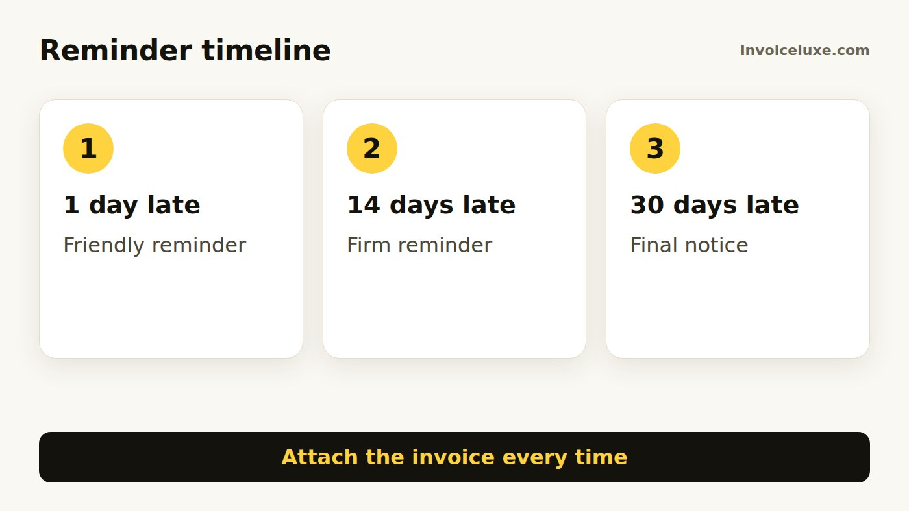
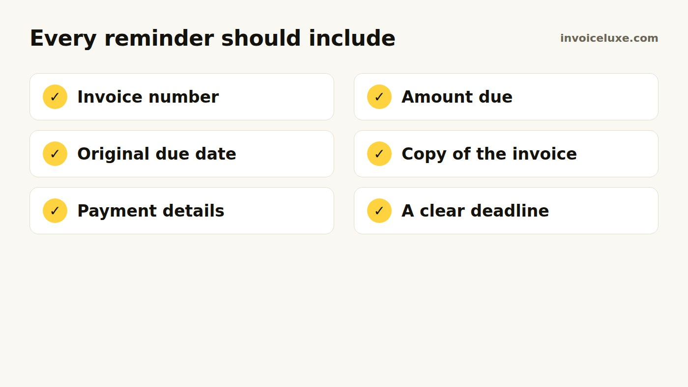

Late payments are common, and a polite reminder usually fixes them. Most clients simply forgot or lost the invoice.

Send reminders in steps, starting friendly and getting firmer only if you need to.

## When should you send a reminder?

| When | Tone | Goal |
|---|---|---|
| 1 to 3 days after the due date | Friendly | Check it was received |
| About 14 days late | Firm | Ask for a payment date |
| About 30 days late | Final notice | Set a deadline and next step |

## What does a friendly reminder look like?

> **Subject:** Invoice INV-2026-014 due on 11 November
>
> Hi Sam, a quick reminder that invoice INV-2026-014 for £1,080 was due on 11 November. I have attached a copy. Could you let me know when I can expect payment? Thanks, Jane

## What does a firm reminder look like?

> **Subject:** Overdue: invoice INV-2026-014
>
> Hi Sam, invoice INV-2026-014 for £1,080 is now 14 days overdue. Please arrange payment by 28 November. If there is a problem with the invoice, tell me and I will fix it right away. Thanks, Jane

## What does a final notice look like?

> **Subject:** Final notice: invoice INV-2026-014
>
> Hi Sam, this is a final reminder that invoice INV-2026-014 for £1,080 is 30 days overdue. Under our payment terms, late interest applies. Please pay by 5 December to avoid further action. Thanks, Jane

## Tips that get you paid

- Attach the **invoice again**, so the client can pay at once.
- Include the **amount, number and due date** in the subject.
- Keep a calm tone and **write down every contact**.
- Mention **late fees** only if they were in your terms. Work out the amount with the [late payment interest calculator](/late-payment-interest-calculator.html).

Prevent the problem next time with clear terms, see [invoice payment terms](/blog/invoice-payment-terms/) and [what to include on an invoice](/blog/what-to-include-on-an-invoice/).

## A reminder schedule

| When | Message | Tone |
|---|---|---|
| 3 days before the due date | Heads-up that the invoice is coming due | Friendly |
| Due date | Short note with the payment link | Friendly |
| 3 days late | "Did this get through?" | Polite |
| 7 days late | Clear request with the amount and date | Firm |
| 14 days late | Mention late fee and next steps | Firm |
| 30 days late | Final notice | Formal |

You do not have to use every step. Pick a schedule you can keep and apply it to every client.

## Subject lines that get opened

- "Invoice 2026-014 is due on December 1"
- "Quick reminder: invoice 2026-014"
- "Invoice 2026-014 is 7 days overdue"
- "Final notice: invoice 2026-014"

Put the invoice number and the situation in the subject. People open emails they recognize.

## What every reminder should contain

1. The invoice number and amount
2. The original due date
3. A link or attachment with the invoice
4. A simple way to pay
5. Your contact details if there is a problem

Keep it short, and always attach the invoice again.

## Keep the relationship

A late invoice is usually a mistake, not a refusal. Assume good intent in your first reminders, and ask whether anything is blocking payment, such as a missing PO number. If a client keeps paying late, change your terms for future work. See [invoice payment terms](/blog/invoice-payment-terms/) and [late payment fees and interest](/blog/late-payment-fees-and-interest/).

## FAQ

### How do I politely ask for payment?

Be short, give the invoice number, amount and due date, attach the invoice and ask when you can expect payment.

### How long should I wait before sending a reminder?

A friendly reminder 1 to 3 days after the due date is normal.

### Can I charge interest on an overdue invoice?

Only if your terms or local law allow it. Add the terms to your invoice before the work starts.

### Is this legal advice?

No. For disputes or debt recovery, speak to a lawyer or accountant.

### How many reminders should I send?

Three to four is common: a friendly one, a firm one, a final notice and, if needed, a call.

### Should I send reminders before the due date?

A short note a few days before can prevent a late payment. It is optional, but it works well for large invoices.
