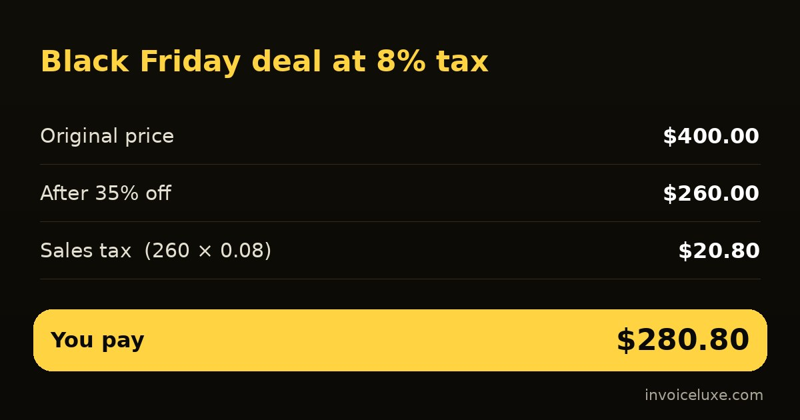

Black Friday and Cyber Monday are full of big percentages, but the number that matters is what leaves your bank account. That is the price after the discount **and** after sales tax. Here is how to work it out before you hit "buy".

> **Final price = original price × (1 − discount) × (1 + sales tax rate)**

## Step 1: Take the discount first

Convert the percentage to a decimal and subtract it from 1. For 35% off, multiply by 0.65.

A $400 TV at 35% off costs 400 × 0.65 = **$260.00**. You save $140.

## Step 2: Add sales tax to the sale price

In most US states, sales tax is charged on the price you actually pay after a store discount. At 8%, the tax on $260.00 is 260 × 0.08 = **$20.80**, so the total is **$280.80**.

If you want the full rules on order of operations, read [discount and sales tax: which comes first](/blog/discount-and-sales-tax-together/).

## Step 3: Check the stacked discounts

"40% off, plus an extra 10% with code" is not 50% off. The second discount applies to the already reduced price.

On a $200 jacket: 200 × 0.60 × 0.90 = **$108.00**. That is 46% off in total, not 50%. More examples are in [stacked discounts](/blog/stacked-discounts/).

| Deal | Real total discount |
|---|---|
| 20% off plus 10% off | 28% |
| 30% off plus 20% off | 44% |
| 40% off plus 10% off | 46% |
| 50% off plus 20% off | 60% |

## Step 4: Test the "was" price

A deal that says "was $129.99, now $79.99" saves you $50.00, which is 50 ÷ 129.99 = **38.46%**. If the sign says "50% off", the math does not match. Check the price history before you trust a "was" price.

## Do not forget shipping

Free shipping thresholds can push you to add items you do not need. Shipping can also be taxable in some states. See [sales tax on shipping and handling](/blog/sales-tax-on-shipping-and-handling/).

## Quick checklist before you buy

1. Calculate the price after the discount.
2. Add sales tax at your combined local rate.
3. Add shipping if it is not free.
4. Compare the final total with the lowest price you have seen.

## FAQ

### How do I calculate a Black Friday discount?

Multiply the original price by 1 minus the discount as a decimal. For 30% off a $90 item, multiply 90 by 0.70 to get $63.00.

### Is sales tax charged before or after the discount?

For store discounts, sales tax is usually charged on the lower price. Manufacturer coupons can work differently, and rules vary by state.

### Is 20% off plus 10% off the same as 30% off?

No. It equals 28% off, because the second discount applies to the reduced price.

### Is this financial or tax advice?

No. It shows the math. Check your state's rules and the store's terms for your own purchases.
