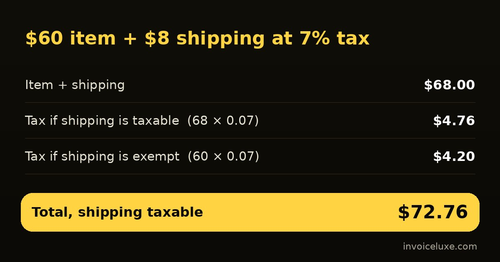

You sell an item for $60 and charge $8 for shipping. Do you charge sales tax on the $8? In the United States the answer changes from state to state, and it also depends on how you bill the shipping.

## The short answer

- **Some states tax shipping** even when it is listed as a separate line.
- **Some states do not tax shipping** if it is separately stated and reflects the real cost of delivery.
- **Some states depend on conditions**, such as who delivers the goods or whether the buyer could have avoided the charge.

Published state guides place states such as Texas, New York, Pennsylvania and Ohio among those that generally tax shipping, and states such as Arizona, Maryland and Virginia among those that generally do not when it is listed separately. Rules change, so confirm with your state before you rely on any list.

## Worked example at 7%

An item costs $60.00 and shipping costs $8.00.

| Case | Taxable amount | Sales tax | Total |
|---|---|---|---|
| Shipping is taxable | $68.00 | $4.76 | $72.76 |
| Shipping is not taxable | $60.00 | $4.20 | $64.20 + $8.00 = $72.20 |

The difference is $0.56 on one order. Across hundreds of orders it adds up, and an audit can include the under-collected tax.

## "Handling" can change the answer

In some states, a combined "shipping and handling" charge can make the whole amount taxable, even if plain shipping would be exempt. Handling covers your own packing and labor, not just the carrier's fee. If your state treats the two differently, list them on separate lines.

## Exempt items

When you ship something that is itself tax exempt, delivery of that item is generally exempt too. For a mixed order, many states expect you to split the shipping between taxable and exempt items.

## How to show shipping on an invoice

1. List the products and tax them as required.
2. Add a separate line called "Shipping" with the actual delivery cost.
3. Apply tax to that line only if your state says it is taxable.
4. Show the total clearly.

The full layout is in [how to show sales tax on an invoice](/blog/how-to-show-sales-tax-on-an-invoice/).

## Which address decides the rate?

Many states use the buyer's delivery address. Read [origin vs destination sales tax](/blog/origin-based-vs-destination-based-sales-tax/).

## Free shipping

If you offer free shipping, there is no shipping charge to tax. But the product is still taxed at the right rate on its own price.

## FAQ

### Do I charge sales tax on shipping?

Only if your state treats shipping as taxable. Check your state's rules and how you list the charge.

### Is shipping taxable if I list it separately?

In many states a separate line is exempt, and in others it is still taxable. Do not assume.

### What about shipping to another state?

The rules of the destination state may apply if you have nexus there. See [what is sales tax nexus](/blog/what-is-sales-tax-nexus/).

### Is this tax advice?

No. It is a general guide. Confirm with your state's revenue department.
