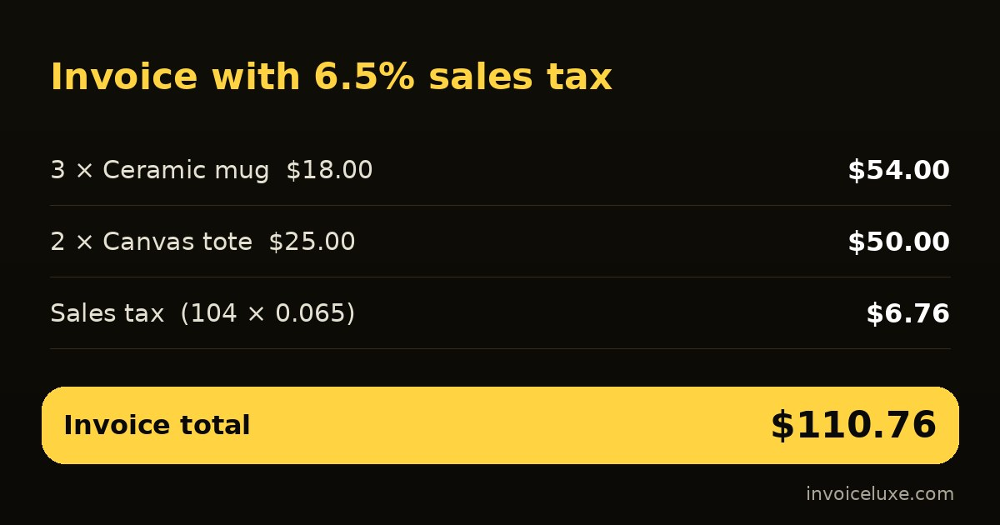

A clear tax line prevents questions, delays and bookkeeping headaches. Here is how to show sales tax on an invoice so the client can check every number.

## What the tax section should include

- The **subtotal** before tax
- The **tax rate** (for example 6.5%)
- The **tax amount** in dollars
- The **grand total**
- Your **sales tax permit number**, if your state asks you to show it

For the rest of the invoice, use the checklist in [what to include on an invoice](/blog/what-to-include-on-an-invoice/).

## A worked example at 6.5%

| Item | Qty | Price | Amount |
|---|---|---|---|
| Ceramic mug | 3 | $18.00 | $54.00 |
| Canvas tote | 2 | $25.00 | $50.00 |

- Subtotal: $104.00
- Sales tax (6.5%): 104 × 0.065 = **$6.76**
- **Total: $110.76**

## When only some lines are taxable

Mark each line as taxable or not. Add up the taxable lines, apply the rate to that amount only, and then add the non-taxable lines to the total.

| Line | Amount | Taxable? |
|---|---|---|
| Printed materials | $300.00 | Yes |
| Design work | $2,500.00 | No |
| Sales tax at 7% on $300.00 | $21.00 | |
| **Total** | **$2,821.00** | |

More on this in [do freelancers charge sales tax](/blog/do-freelancers-charge-sales-tax/).

## Shipping and discounts

List shipping on its own line and tax it only if your state requires it. See [sales tax on shipping](/blog/sales-tax-on-shipping-and-handling/). Apply store discounts before tax. See [discount and sales tax](/blog/discount-and-sales-tax-together/).

## Round once, not on every step

Pick one method and use it on every invoice. Calculating the tax on the taxable subtotal gives the fewest rounding differences. See [sales tax on multiple items](/blog/sales-tax-on-multiple-items/).

## Common mistakes

1. Using the wrong rate for the buyer's location.
2. Taxing an exempt line, or skipping tax on a taxable one.
3. Hiding the tax inside the price without saying so.
4. Forgetting the exemption certificate when a customer claims to be exempt.

## A complete sample layout

Here is a clean layout that works for most small businesses in the United States:

| Description | Qty | Unit price | Amount |
|---|---|---|---|
| Website banner design | 1 | $450.00 | $450.00 |
| Printed flyers | 200 | $0.60 | $120.00 |
| **Subtotal** | | | **$570.00** |
| Sales tax on taxable items ($120.00 at 6.5%) | | | $7.80 |
| **Total due** | | | **$577.80** |

In this example, only the printed flyers are taxable, so the tax is calculated on $120.00 and not on the whole subtotal.

## Tax-exempt customers

When a customer is exempt, do not charge tax. Instead:

1. Ask for their exemption or resale certificate.
2. Add a note such as "Sales tax exempt, certificate on file".
3. Keep the certificate with your records.

Without the certificate, a state can ask you to pay the tax yourself.

## Extra details that help

- **Your sales tax permit number**, when your state or customer asks for it.
- **The location used to set the rate**, such as the delivery address, for sales to multiple jurisdictions.
- **The tax period**, if you invoice on a regular schedule.
- **A short note** if the price includes tax, so there is no confusion.

## Sales to several locations

If you sell to customers in different cities or states, each invoice may need a different rate. A template with an editable rate field is more reliable than one fixed number. Keep a table of the rates you use, and check it at the start of every year.

## Credit notes and refunds

When you refund a customer, the sales tax usually goes back too. Issue a credit note that shows the amount and the tax separately, and match it to the original invoice number. See [how to number invoices](/blog/how-to-number-invoices/) to keep your records in order.

## Making it easy to read

A client reads an invoice quickly. Put the subtotal, the tax and the total in the same place on every invoice, and use bold for the total. If you want to double-check the numbers, use the calculator above or follow [how to calculate sales tax](/blog/how-to-calculate-sales-tax/).

Related reading: [what to include on an invoice](/blog/what-to-include-on-an-invoice/) and [how to create an invoice](/blog/how-to-create-an-invoice/).

## FAQ

### Where do I put sales tax on an invoice?

Below the subtotal and above the grand total, as a separate labeled line with the rate and the amount.

### Should I show the tax rate?

Yes. Showing the rate lets the client verify the math and helps your own records.

### Can I include tax in the price?

You can, but state clearly that the price includes tax. To split it out later, see [how to remove sales tax from a total](/blog/remove-sales-tax-from-total/).

### Do I need to show my sales tax permit number?

Not always, but some states and some business customers expect it. Check your state's rules.

### What should I write for a tax-exempt customer?

Write that the sale is exempt and reference the certificate, for example "Exempt, certificate on file".

### Is this tax advice?

No. It shows how to present the numbers. Which items are taxable depends on your state.
