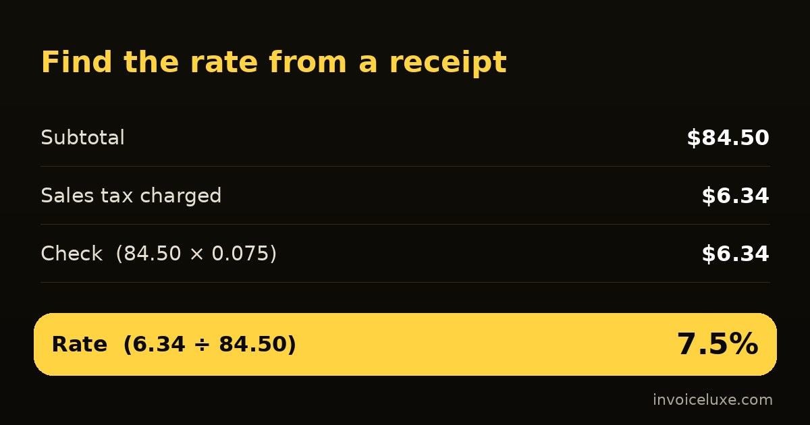

Sometimes you have a receipt or an invoice and you want to know what rate the seller charged. Maybe the tax line looks too high, or you are checking your books. Two simple formulas give the answer.

## Formula 1: you know the tax amount and the subtotal

> **Rate = tax ÷ subtotal × 100**

A receipt shows a subtotal of $84.50 and sales tax of $6.34.

6.34 ÷ 84.50 = 0.07503, which is **7.5%**.

You can confirm it: 84.50 × 0.075 = 6.3375, which rounds to $6.34.

## Formula 2: you know the subtotal and the total

> **Rate = (total ÷ subtotal − 1) × 100**

A purchase has a subtotal of $40.00 and a total of $43.30.

43.30 ÷ 40.00 = 1.0825. Subtract 1 to get 0.0825, which is **8.25%**.

## Why the answer is not always a round number

Tax is rounded to the cent, so a very small purchase can give a rate that looks off. A $0.50 item at 7% has 3.5 cents of tax, which rounds to 4 cents. Divide 4 by 50 and you get 8%, not 7%. Use a larger amount for a more accurate check.

| Subtotal | Tax | Rate |
|---|---|---|
| $20.00 | $1.65 | 8.25% |
| $84.50 | $6.34 | 7.5% |
| $150.00 | $9.75 | 6.5% |
| $320.00 | $27.20 | 8.5% |

## What to do with the result

- Compare it with the combined rate for the store's location. See [combined sales tax rate explained](/blog/combined-sales-tax-rate-explained/).
- If the rate looks wrong, ask the seller for a corrected receipt.
- If you only have the total and the rate, you can work backward. See [how to calculate the price before sales tax](/blog/remove-sales-tax-from-total/).

## Mixed receipts

If only some items are taxable, divide the tax by the **taxable** subtotal, not the full subtotal. Otherwise the rate will look too low. See [sales tax on multiple items](/blog/sales-tax-on-multiple-items/).

## Four receipts, four rates

Use the formula on a few receipts:

| Receipt | Subtotal | Tax | Calculation | Rate |
|---|---|---|---|---|
| A | $60.00 | $4.20 | 4.20 ÷ 60.00 | 7.00% |
| B | $48.00 | $3.96 | 3.96 ÷ 48.00 | 8.25% |
| C | $23.50 | $1.59 | 1.59 ÷ 23.50 | 6.77%, probably 6.75% |
| D | $129.99 | $10.72 | 10.72 ÷ 129.99 | 8.25%, after rounding |

Receipts C and D show why you cannot always get a perfect number. Tax is rounded to the nearest cent, so a small receipt can give a rate slightly above or below the real one. The larger the subtotal, the closer your result gets to the posted rate.

## A quick method with the total

If you only know the subtotal and the total:

1. Subtract the subtotal from the total to get the tax.
2. Divide the tax by the subtotal.
3. Multiply by 100.

For a $48.00 subtotal and a $51.96 total, the tax is $3.96 and the rate is 8.25%.

## Use a larger receipt to confirm

When you want the exact rate, use a receipt where the subtotal is $100 or more, and where every item is taxable. Compare the result against what you expect from your state and city. If it matches your rate table, you have the right rate.

## What if the rate seems wrong?

1. Check that every item is taxable. A non-taxable item in the subtotal will lower the result.
2. Check for discounts that were taken before or after the tax.
3. Look at whether shipping or a service fee was taxed.
4. Compare with the combined rate for that address. See [combined sales tax rate explained](/blog/combined-sales-tax-rate-explained/).

## When to use this

- Checking a vendor's invoice
- Working out the tax rate for an expense claim
- Finding the rate when the receipt shows only totals
- Verifying that a shop charged the correct rate

## Do the reverse to check yourself

Multiply the subtotal by 1 plus the rate. For receipt B, 48.00 × 1.0825 = 51.96, which matches the total. If you find the price before tax from a total instead, use [remove sales tax from a total](/blog/remove-sales-tax-from-total/).

## FAQ

### How do I calculate the sales tax percentage from a receipt?

Divide the tax amount by the pre-tax subtotal and multiply by 100.

### What if I only know the total and the subtotal?

Divide the total by the subtotal, subtract 1 and multiply by 100.

### Why does my result differ slightly from the posted rate?

Rounding to the cent can cause small differences, and some items on a receipt may not be taxed.

### Can I find the rate if the receipt shows a tax amount but no rate?

Yes. Divide the tax amount by the pre-tax subtotal and multiply by 100.

### Why is my calculated rate a little off from the posted rate?

Rounding. Tax is rounded to the nearest cent, which can shift the result on small receipts.

### Is this tax advice?

No. It is a way to check the math on a receipt.
