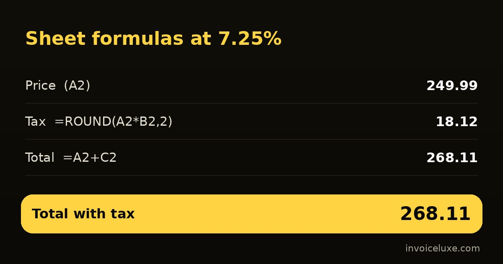

A spreadsheet is a fast way to calculate sales tax for a price list or a month of orders. The formulas are the same in Excel and Google Sheets.

## Set up the columns

| Column | Content | Example |
|---|---|---|
| A | Price before tax | 249.99 |
| B | Tax rate | 7.25% |
| C | Sales tax | formula |
| D | Total | formula |

Type the rate as a percentage (7.25%) or as a decimal (0.0725). Either works.

## Formula 1: sales tax amount

In cell C2:

`=ROUND(A2*B2,2)`

This multiplies the price by the rate and rounds to the cent. For 249.99 at 7.25%, the result is **18.12**.

## Formula 2: total with tax

In cell D2:

`=A2+C2`

Or in one step, without a tax column:

`=ROUND(A2*(1+B2),2)`

The total is **268.11**.

## Formula 3: remove tax from a total

If A2 holds a total that includes tax:

`=ROUND(A2/(1+B2),2)`

A total of $107.25 at 7.25% gives **$100.00**. The tax part is then `=A2-ROUND(A2/(1+B2),2)`, which is $7.25. See [how to calculate the price before sales tax](/blog/remove-sales-tax-from-total/).

## Formula 4: add up a whole column

For the total tax on 100 rows:

`=SUM(C2:C101)`

To tax only the rows marked "Yes" in column E, use:

`=SUMIF(E2:E101,"Yes",A2:A101)*B2`

This adds the taxable amounts and then applies the rate once, which matches the method in [sales tax on multiple items](/blog/sales-tax-on-multiple-items/).

## Tips for fewer errors

1. **Keep the rate in one cell** and refer to it as `$B$2` so you can change it in one place.
2. **Round on the tax line,** not on every intermediate step.
3. **Format money cells** with two decimals.
4. **Mark taxable lines** so non-taxable items do not get taxed by mistake.

## When a calculator is faster

For a single invoice, a calculator is quicker than a spreadsheet. Enter the price and the rate and get the tax and the total at once.

## A complete invoice table you can copy

Set up one row per line item. With the quantity in B, the unit price in C and the tax rate in a single cell F1 (for example 7.25%), use these columns:

| Column | Header | Formula (row 2) |
|---|---|---|
| A | Item | (text) |
| B | Qty | (number) |
| C | Unit price | (number) |
| D | Line total | `=B2*C2` |
| E | Tax | `=ROUND(D2*$F$1,2)` |
| F | Total | `=D2+E2` |

The dollar signs in `$F$1` lock the rate, so you can copy the formula down without it moving. Change the rate once and every row updates.

## Tax on the subtotal instead of each line

If you prefer to tax the subtotal, place the sum in a cell and calculate the tax once:

- Subtotal: `=SUM(D2:D20)`
- Tax: `=ROUND(D21*$F$1,2)`
- Total: `=D21+D22`

See [sales tax on multiple items](/blog/sales-tax-on-multiple-items/) to understand why the two methods can differ by a cent.

## Only tax the taxable rows

Add a column G named "Taxable?" and enter Y or N. Then calculate tax with an IF formula:

`=IF(G2="Y",ROUND(D2*$F$1,2),0)`

You can also sum only the taxable lines: `=SUMIF(G2:G20,"Y",D2:D20)`. Multiply that amount by the rate to get the tax on the taxable subtotal.

## Discounts before tax

With a discount rate in H1, use `=ROUND(D2*(1-$H$1)*$F$1,2)` for the tax on the discounted amount, and `=D2*(1-$H$1)+E2` for the total. For the order of the math, see [discount and sales tax together](/blog/discount-and-sales-tax-together/).

## Formatting and checks

- Format the rate cell as a percentage, so 7.25% is stored as 0.0725.
- Format money cells with two decimal places.
- Use a check cell: the sum of the line totals plus the sum of the tax should match the grand total.
- Protect the formula cells so they are not overwritten by accident.

## Google Sheets extras

Google Sheets accepts the same formulas. You can also use `ARRAYFORMULA` to fill a whole column at once. For example, `=ARRAYFORMULA(IF(B2:B="","",ROUND(B2:B*$F$1,2)))` fills the tax for every row that has a price.

## Common spreadsheet mistakes

- Typing the rate as 7.25 instead of 7.25%, which multiplies by 725% instead of 7.25%
- Forgetting the dollar signs, so the rate moves when you copy the formula
- Rounding each step instead of only the final tax
- Mixing taxable and non-taxable rows in one subtotal

If you do not want to build a sheet, the free [sales tax calculator](/blog/how-to-calculate-sales-tax/) method above works for single invoices.

## FAQ

### What is the formula for sales tax in Excel?

Multiply the price by the rate and round: `=ROUND(A2*B2,2)`.

### How do I add sales tax to a price in Google Sheets?

Use `=ROUND(A2*(1+B2),2)` where A2 is the price and B2 is the rate.

### How do I remove sales tax in a spreadsheet?

Divide the total by 1 plus the rate: `=ROUND(A2/(1+B2),2)`.

### How do I round sales tax in Excel?

Wrap the formula in ROUND with two decimals, for example `=ROUND(B2*C2,2)`.

### How do I lock the tax rate cell?

Use dollar signs in the reference, such as `$F$1`, so it stays fixed when you copy the formula down.

### Is this tax advice?

No. It shows the spreadsheet math. Which items are taxable depends on your state.
