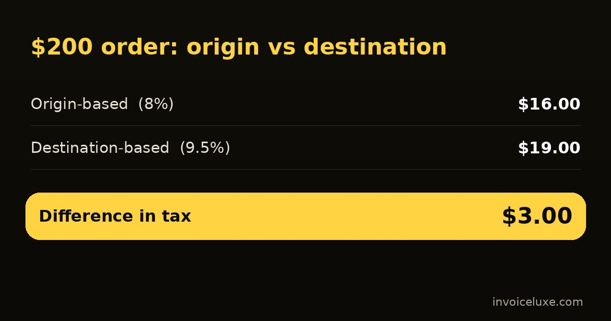

If you sell to customers in different cities, which sales tax rate do you charge? The answer depends on whether your state is **origin-based** or **destination-based**.

## The difference

- **Origin-based:** the rate depends on the **seller's** location.
- **Destination-based:** the rate depends on the **buyer's** location, usually the delivery address.

## An example

You sell from City A, where the combined rate is 8%. A buyer in City B, where the combined rate is 9.5%, orders a $200 item.

| Method | Rate used | Sales tax | Total |
|---|---|---|---|
| Origin-based | 8% | $16.00 | $216.00 |
| Destination-based | 9.5% | $19.00 | $219.00 |

## Which states use which?

Published state guides describe most states as destination-based. States often listed as origin-based for in-state sales include Arizona, Illinois, Mississippi, Missouri, Ohio, Pennsylvania, Tennessee, Texas, Utah and Virginia. California is mixed: the state, county and city parts follow the seller, while district taxes follow the buyer.

Lists differ between sources, and the rules often change for out-of-state sales. Check your state's guidance, especially for sales that cross a state line.

## Out-of-state and online sales

When you sell to a buyer in another state where you have nexus, you usually follow that state's rules, and most states treat that as destination-based. See [what is sales tax nexus](/blog/what-is-sales-tax-nexus/).

## Why it is harder than it looks

With a destination-based system, one state can have hundreds of different local rates. A single shop with online customers may need to look up the rate for every delivery address. That is why many sellers use rate lookup tools or software once they grow.

## What to do as a small seller

1. **Find out which system your state uses** for in-state sales.
2. **Use the exact address** for rate lookups. See [combined sales tax rate explained](/blog/combined-sales-tax-rate-explained/).
3. **Show the rate** on every invoice. See [how to show sales tax on an invoice](/blog/how-to-show-sales-tax-on-an-invoice/).
4. **Keep records** of which rate you used and why.

## FAQ

### What is the difference between origin-based and destination-based sales tax?

Origin-based uses the seller's location to set the rate. Destination-based uses the buyer's location.

### Which method does my state use?

Check your state's revenue department. Most states are destination-based, and about ten use origin-based rules for in-state sales.

### Does the buyer's state matter if I sell online?

Often yes, if you have nexus in that state.

### Is this tax advice?

No. It is a general overview. Confirm the rules for your state and sale type.
