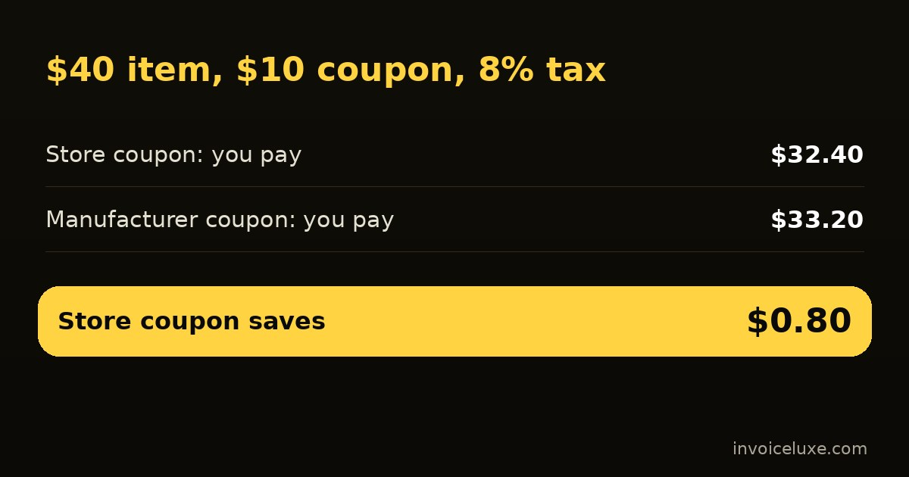

Two coupons that both take $10 off can lead to different totals. The reason is sales tax: some coupons reduce the price that gets taxed, and some do not.

## Store coupons vs manufacturer coupons

- A **store coupon** is issued and paid for by the store. It usually reduces the selling price, so the tax is calculated on the lower amount.
- A **manufacturer coupon** is paid for by the brand, which reimburses the store. Many states treat it as a form of payment, so tax is calculated on the **full** price.

The New York State Tax Department explains this split in its guidance on coupons. Other states follow different rules, so check yours.

## A side-by-side example

A $40.00 item with a $10.00 coupon at 8% sales tax.

| | Store coupon | Manufacturer coupon |
|---|---|---|
| Taxable price | $30.00 | $40.00 |
| Sales tax (8%) | $2.40 | $3.20 |
| Price plus tax | $32.40 | $43.20 |
| Coupon applied after tax | | −$10.00 |
| **You pay** | **$32.40** | **$33.20** |

The store coupon saves you $0.80 more in this case.

## Rebates

A **mail-in or online rebate** is usually paid after the sale. Tax is normally charged on the full price you paid at the register, and the rebate comes back to you later as a refund of part of the cost. The tax already paid is not usually refunded.

## Discount cards and loyalty programs

Discounts the store gives you at the register generally lower the price and the tax. Points or credits you redeem may be treated like payment or like a discount, depending on the program and the state.

## What this means if you sell

When you run a promotion, decide how the discount is recorded on the invoice, and show it clearly:

1. List the full price.
2. Show the discount as a line with a minus sign.
3. Apply tax on the amount your state says is taxable.

For the layout, see [how to show sales tax on an invoice](/blog/how-to-show-sales-tax-on-an-invoice/). For the general order of operations, see [discount and sales tax: which comes first](/blog/discount-and-sales-tax-together/).

## Check the math before you buy

To compare two offers, work out the final price for each, including tax. The [price after a discount](/blog/price-after-discount/) guide shows the quick method, and [stacked discounts](/blog/stacked-discounts/) covers coupons used together.

## FAQ

### Do coupons reduce sales tax?

Store coupons usually do. Manufacturer coupons often do not, because tax is charged on the full price.

### Is sales tax charged before or after a coupon?

For store discounts, usually after the discount. For manufacturer coupons, often before. Rules vary by state.

### Do rebates reduce sales tax?

Usually not. The tax is charged at the register on the price you paid.

### Is this tax advice?

No. Rules differ by state. Check your state's guidance.
