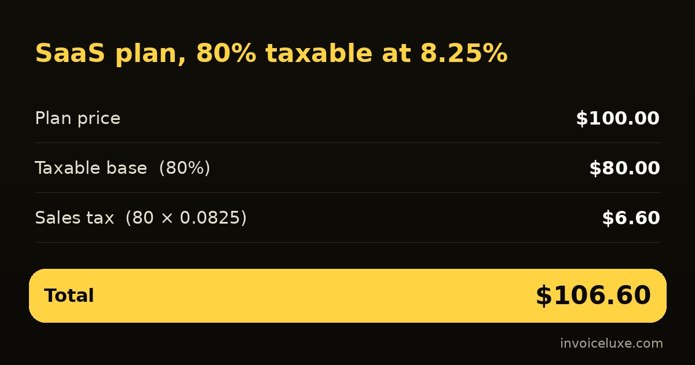

Selling an ebook, a template, a course or a software subscription? Sales tax on digital goods is one of the least consistent areas in US tax. Some states tax them, some do not, and some tax only part.

## Why it is confusing

Sales tax laws were written for physical goods. States have updated them at different speeds. Terms such as "digital goods", "prewritten software", "software as a service (SaaS)" and "information services" all have different definitions.

## The three common outcomes

1. **Taxable.** The state taxes digital goods or SaaS like physical products.
2. **Partly taxable.** Only part of the price is taxed, or the rate depends on the customer type.
3. **Not taxable.** The state does not tax them.

## Examples from published state guides

These examples are for orientation only, and the rules change, so verify them.

| Treatment | Examples |
|---|---|
| Generally taxable | New York, Pennsylvania, Washington, Texas (partly) |
| Generally not taxable | Florida, Illinois, Colorado, Georgia |
| Depends on the buyer | Ohio (business use) and Iowa (personal use) |

Texas is a good example of a partial case. It treats SaaS as a data processing service and taxes only part of the charge.

## A worked example (partial taxation)

A $100 monthly SaaS plan where 80% of the charge is taxable and the combined rate is 8.25%:

- Taxable base: 100 × 0.80 = $80.00
- Sales tax: 80 × 0.0825 = **$6.60**
- Total: $106.60

## Where does the sale happen?

For digital goods, the buyer's location usually matters, not the seller's. If you sell to customers in many states, you may need to register in states where you cross a threshold. See [what is sales tax nexus](/blog/what-is-sales-tax-nexus/).

## What freelancers and creators should do

1. **List your products** and what each one is: download, subscription, custom work or a service.
2. **Check each state** where you have many customers.
3. **Separate custom services from products** on invoices, because they may be taxed differently. See [do freelancers charge sales tax](/blog/do-freelancers-charge-sales-tax/).
4. **Use platforms with tax handling** when it fits, since some platforms collect for you. See [sales tax for marketplace sellers](/blog/sales-tax-for-etsy-amazon-ebay-sellers/).
5. **Keep records** of where each sale was delivered.

## Do not forget use tax

If you buy software or digital tools for your business without tax being charged, you may owe use tax. See [sales tax vs use tax](/blog/sales-tax-vs-use-tax/).

## FAQ

### Is SaaS taxable?

In some states yes, in some no, and some tax part of it. Check each state where you sell.

### Do I charge sales tax on ebooks and downloads?

It depends on the buyer's state and how it defines digital goods.

### What about custom design or writing delivered as a file?

Many states treat it as a service, but some tax it as a digital product. Confirm with the state.

### Is this tax advice?

No. Digital goods rules change often. Ask your state or a tax professional.
