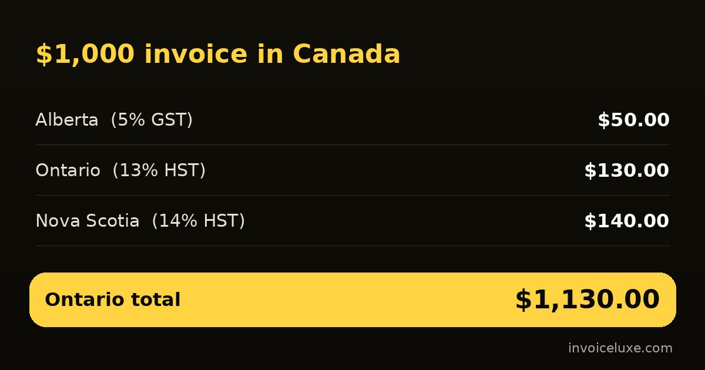

Canada has several sales taxes, and which one applies depends on the province. If you invoice Canadian clients or sell in Canada, here is how GST, HST, PST and QST fit together.

## The four taxes

- **GST (Goods and Services Tax):** a 5% federal tax charged across Canada.
- **HST (Harmonized Sales Tax):** the federal and provincial taxes combined in one rate, used in some provinces.
- **PST (Provincial Sales Tax):** a separate provincial tax in some provinces, charged on top of GST.
- **QST (Quebec Sales Tax):** Quebec's own tax, charged together with GST.

## 2026 rates by province

| Province or territory | Tax | Rate |
|---|---|---|
| Alberta | GST only | 5% |
| British Columbia | GST + PST | 5% + 7% |
| Manitoba | GST + PST | 5% + 7% |
| New Brunswick | HST | 15% |
| Newfoundland and Labrador | HST | 15% |
| Nova Scotia | HST | 14% |
| Northwest Territories | GST only | 5% |
| Nunavut | GST only | 5% |
| Ontario | HST | 13% |
| Prince Edward Island | HST | 15% |
| Quebec | GST + QST | 5% + 9.975% |
| Saskatchewan | GST + PST | 5% + 6% |
| Yukon | GST only | 5% |

Rates change, so check the Canada Revenue Agency (CRA) before you charge tax.

## A worked example

You invoice $1,000 for services.

| Location | Tax | Tax amount | Total |
|---|---|---|---|
| Ontario | 13% HST | $130.00 | $1,130.00 |
| Alberta | 5% GST | $50.00 | $1,050.00 |
| Nova Scotia | 14% HST | $140.00 | $1,140.00 |

For Quebec on a $100 sale: GST is $5.00 and QST is $9.98 (100 × 0.09975), for a total of **$114.98**. Quebec's QST is calculated on the price, not on the price plus GST.

## Which province's rate applies?

For many sales, the rate depends on where the supply is made or delivered, and the place of supply rules can be complex for services and online sales. Confirm the rule with the CRA for your case.

## When do you need to register?

Businesses generally must register for GST/HST once their taxable revenue passes the **small supplier threshold** of CAD $30,000 over four consecutive calendar quarters. Below that you may register voluntarily, and registration lets you claim input tax credits on your business purchases.

## How to show the tax on an invoice

Show the subtotal, the tax name and rate, the tax amount and the total. Show your **GST/HST registration number** on the invoice. The layout is in [how to show sales tax on an invoice](/blog/how-to-show-sales-tax-on-an-invoice/), and you can compare with [sales tax vs VAT](/blog/sales-tax-vs-vat/).

## Removing tax from a total

If you only have the total, divide by 1 plus the rate. For Ontario, 1,130 ÷ 1.13 = 1,000. See [how to calculate the price before sales tax](/blog/remove-sales-tax-from-total/).

## The small supplier threshold

In Canada, most businesses that sell taxable goods or services must register for GST/HST once they pass the small supplier threshold. That threshold is $30,000 in taxable sales over four consecutive calendar quarters. Below it, registration is optional, and some businesses register voluntarily so that they can claim input tax credits.

## Input tax credits

A registered business can usually claim back the GST/HST it paid on business expenses. These are called input tax credits.

| Item | Amount |
|---|---|
| GST/HST collected from customers | $2,600.00 |
| GST/HST paid on business expenses | $650.00 |
| **Net tax to send to the government** | **$1,950.00** |

The numbers are examples. Keep your invoices and receipts, because you need them to support the credits.

## A worked example in two provinces

A consultant charges $2,000 for a project.

| Province | Tax | Calculation | Total |
|---|---|---|---|
| Alberta | 5% GST | 2,000 × 0.05 = $100 | $2,100.00 |
| Ontario | 13% HST | 2,000 × 0.13 = $260 | $2,260.00 |

In British Columbia, the GST is 5%, and a separate provincial tax may apply to some goods but not to many services. Check the rule for each province before you invoice.

## What your invoice should show

- Your business name and address
- The invoice date and number
- Your GST/HST registration number
- The amount before tax, the tax charged and the total
- The customer's name

The registration number is the business number followed by RT and four digits, such as 123456789 RT0001, in the example format. Larger invoices have extra requirements, so check the current rules from the Canada Revenue Agency.

## Filing and paying

Returns are usually filed monthly, quarterly or yearly, depending on your sales. File on time even if you owe nothing. Payments can be made online or through your bank.

## Selling to the United States and other countries

Exports of goods and many services to customers outside Canada are often zero-rated, meaning the tax rate is 0% but you can still claim input tax credits. The rules depend on what you sell and where the customer is, so check the details before you invoice.

## Comparing with the US system

Canada's GST/HST works like a value-added tax, and US sales tax is only charged on the final sale. See [sales tax vs VAT](/blog/sales-tax-vs-vat/) for a side-by-side comparison, and [how to show sales tax on an invoice](/blog/how-to-show-sales-tax-on-an-invoice/) for a layout you can adapt.

## FAQ

### What is the difference between GST and HST?

GST is the 5% federal tax. HST combines the federal part and the provincial part into a single rate in participating provinces.

### Do I charge both GST and PST?

In British Columbia, Manitoba and Saskatchewan, PST is charged in addition to GST on many goods. Services are often treated differently, so check the rules.

### Do I need to register for GST/HST?

Generally once revenue passes CAD $30,000 over four consecutive calendar quarters, or earlier if you choose.

### What is the small supplier threshold?

It is $30,000 in taxable sales over four consecutive calendar quarters. Above it, you must register.

### Can I claim GST/HST I paid on my expenses?

If you are registered, usually yes, through input tax credits. Keep the receipts.

### Is this tax advice?

No. Rates and rules change. Confirm them with the Canada Revenue Agency or an accountant.
