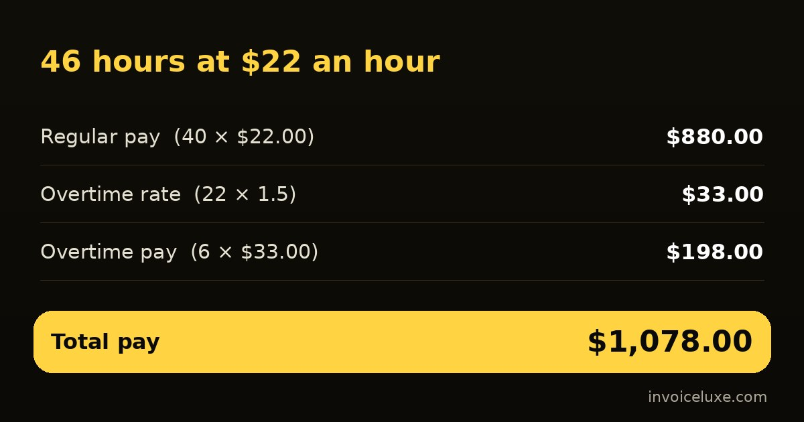

Overtime pay rewards the hours you work beyond the standard week. The most common version in the US is **time and a half**: 1.5 times your regular hourly rate.

## The federal rule

Under the federal Fair Labor Standards Act (FLSA), most non-exempt employees must be paid at least **1.5 times their regular rate** for hours worked over **40 in a workweek**. Some states add rules of their own, such as daily overtime, so your state may differ. Salaried employees may be exempt depending on duties and salary, and independent contractors are not covered the same way.

## The formula

> **Overtime rate = regular hourly rate × 1.5**
> **Total pay = regular hours × regular rate + overtime hours × overtime rate**

## Example 1: $22 per hour, 46 hours

- Regular pay: 40 × $22.00 = $880.00
- Overtime rate: 22 × 1.5 = $33.00
- Overtime pay: 6 × $33.00 = $198.00
- **Total: $1,078.00**

## Example 2: $18.50 per hour, 50 hours

- Regular pay: 40 × $18.50 = $740.00
- Overtime rate: 18.50 × 1.5 = $27.75
- Overtime pay: 10 × $27.75 = $277.50
- **Total: $1,017.50**

## Quick reference

| Hourly rate | Overtime rate (1.5×) | Double time (2×) |
|---|---|---|
| $15.00 | $22.50 | $30.00 |
| $20.00 | $30.00 | $40.00 |
| $25.00 | $37.50 | $50.00 |
| $30.00 | $45.00 | $60.00 |

## Things that can change the answer

- **State rules.** Some states require overtime after 8 hours in a day, or double time after longer shifts.
- **Regular rate.** It can include certain bonuses, not just the hourly wage.
- **Workweek.** Overtime is counted per fixed workweek, not by averaging two weeks.
- **Unpaid breaks.** Unpaid meal breaks are not counted as hours worked, but short breaks usually are.

## Track the hours accurately

A small rounding difference on every shift adds up. Log start time, end time and break for each day, then total the week. A work hours calculator does this for you and can create a PDF report. To convert minutes into decimal hours first, see [how to convert minutes to decimal hours](/blog/convert-minutes-to-decimal-hours/).

## If you are a freelancer

Contractors usually set their own rates, and they are not paid overtime by default. If you bill by the hour, see [how to invoice hourly clients from a timesheet](/blog/how-to-invoice-hourly-clients-from-a-timesheet/) and [how to calculate your freelance hourly rate](/blog/freelance-hourly-rate/).

## FAQ

### How do you calculate time and a half?

Multiply the regular hourly rate by 1.5. At $20 an hour, time and a half is $30 an hour.

### How many hours before overtime starts?

Under federal law, overtime generally starts after 40 hours in a workweek. Some states have daily rules too.

### Is overtime paid for salaried workers?

Not always. It depends on whether the job is exempt, which depends on duties and salary level.

### Is this legal or payroll advice?

No. It explains the calculation. Check your state's labor department or a payroll professional.
