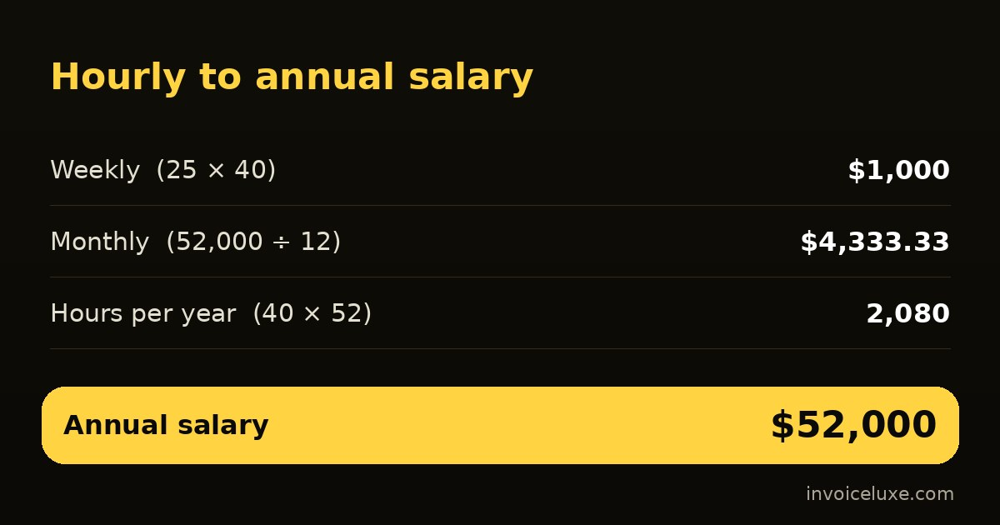

Want to know what an hourly wage is worth per year? Multiply it by **2,080**. That number comes from a standard full-time year: 40 hours a week for 52 weeks.

> **Annual salary = hourly rate × hours per week × 52**
> **For a 40-hour week: hourly rate × 2,080**

## Quick table (full-time, 40 hours a week)

| Hourly rate | Weekly | Monthly | Annual |
|---|---|---|---|
| $15 | $600 | $2,600.00 | $31,200 |
| $20 | $800 | $3,466.67 | $41,600 |
| $25 | $1,000 | $4,333.33 | $52,000 |
| $30 | $1,200 | $5,200.00 | $62,400 |
| $40 | $1,600 | $6,933.33 | $83,200 |
| $50 | $2,000 | $8,666.67 | $104,000 |

Monthly pay is the annual amount divided by 12.

## Salary to hourly

Reverse the formula: **annual salary ÷ 2,080 = hourly rate**.

A $52,000 salary is 52,000 ÷ 2,080 = **$25.00 an hour**.

## Part-time or different schedules

Change the weekly hours. At $20 an hour for 30 hours a week:

20 × 30 × 52 = **$31,200 a year**.

## Time off

If you take unpaid weeks off, reduce the weeks. At $25 an hour, 40 hours a week and 50 paid weeks, pay is 25 × 40 × 50 = **$50,000**. Paid vacation and holidays normally stay in the 52 weeks for an employee.

## Gross vs take-home

These figures are **gross pay**, before income tax, payroll tax and other deductions. Your take-home pay is lower. The calculation does not include benefits or taxes.

## If you are self-employed

Your hourly rate must cover more than a wage: business costs, taxes, unbilled time and time off. A freelancer who wants $52,000 of income usually needs to charge more than $25 an hour. See [how to calculate your freelance hourly rate](/blog/freelance-hourly-rate/).

## Include overtime

If you work more than 40 hours a week, the extra hours may pay more. See [how to calculate overtime pay](/blog/how-to-calculate-overtime-pay/).

## Track the hours you actually work

If your hours change every week, a timesheet gives a more accurate picture than a formula. Log your start, end and break time each day and let the calculator total your hours and pay.

## Salary to hourly: more examples

Divide the annual salary by 2,080, the number of hours in a standard full-time year (40 hours × 52 weeks).

| Annual salary | Hourly rate |
|---|---|
| $50,000 | $24.04 |
| $62,000 | $29.81 |
| $75,000 | $36.06 |
| $100,000 | $48.08 |

## Compare two job offers

One job pays $32 an hour and another pays a $62,000 salary. The salary equals $62,000 ÷ 2,080 = $29.81 an hour. The hourly job pays more per hour, but check:

- Paid time off
- Health insurance and retirement contributions
- Overtime rules
- Whether the hours are guaranteed

A job that pays less per hour may be worth more once benefits are counted.

## Adjust for unpaid time off

If you are paid by the hour and take three weeks off without pay, you work fewer hours.

| | Weeks | Hours | Pay at $30 an hour |
|---|---|---|---|
| Full year | 52 | 2,080 | $62,400 |
| With 3 unpaid weeks | 49 | 1,960 | $58,800 |

That is $3,600 less than the full-year number. Remember this when you plan a budget.

## For freelancers

Your effective hourly rate is your income divided by all the hours you worked, not just the billed ones. If you spend 10 hours on admin for every 30 billable hours, your real rate is lower than your charge rate. See [freelance hourly rate](/blog/freelance-hourly-rate/).

## Keep it simple

For a quick estimate, multiply the hourly rate by 2,000 to get a rough annual figure. Use 2,080 when you want the exact full-time number.

## FAQ

### How do I convert hourly pay to annual salary?

Multiply your hourly rate by the hours you work each week and by 52. For a full-time job, multiply by 2,080.

### How much is $25 an hour per year?

About $52,000 a year before taxes, at 40 hours a week.

### How do I convert salary to an hourly rate?

Divide the annual salary by the number of hours you work in a year, such as 2,080.

### Is this financial advice?

No. It is a simple conversion. Your real income depends on taxes, deductions and benefits.

### How do I convert an hourly wage to a yearly salary?

Multiply the hourly rate by the hours you work per week and by 52.

### Is the annual figure before or after tax?

Before. It is the gross pay, not the take-home pay.
