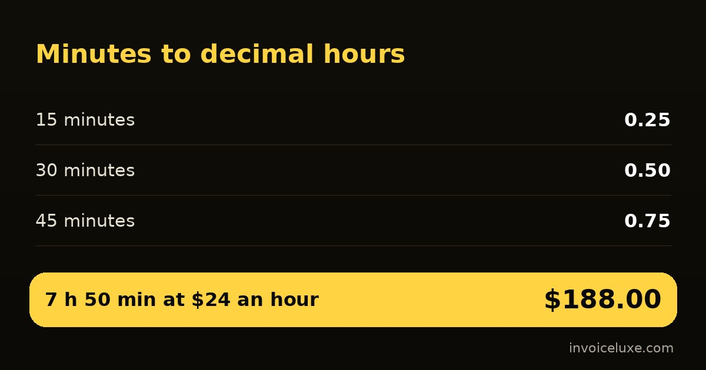

Payroll and invoices use decimal hours: 7.75 instead of 7 hours 45 minutes. The conversion is simple, but it is easy to get wrong, because there are 60 minutes in an hour, not 100.

> **Decimal hours = hours + minutes ÷ 60**

## Examples

- 7 hours 45 minutes: 45 ÷ 60 = 0.75, so **7.75 hours**
- 8 hours 20 minutes: 20 ÷ 60 = 0.333, so **8.33 hours**
- 6 hours 10 minutes: 10 ÷ 60 = 0.167, so **6.17 hours**

## Minutes to decimal chart

| Minutes | Decimal hours |
|---|---|
| 6 | 0.10 |
| 10 | 0.17 |
| 15 | 0.25 |
| 20 | 0.33 |
| 30 | 0.50 |
| 45 | 0.75 |
| 50 | 0.83 |

## Decimal hours back to minutes

Multiply the decimal part by 60. For 7.75 hours, 0.75 × 60 = 45, so it is **7 hours 45 minutes**.

## Pay from decimal hours

Multiply the decimal hours by the hourly rate.

A shift of 7 hours 50 minutes at $24 an hour:

- Decimal hours: 7 + 50 ÷ 60 = 7.8333
- Pay: 7.8333 × 24 = **$188.00**

If you round the hours to 7.83 first, you get $187.92. Pick one rounding rule and use it every time.

## Common mistakes

1. **Writing 7:45 as 7.45.** The correct decimal is 7.75.
2. **Rounding too early.** Round at the end, not on each day.
3. **Mixing methods.** Some employers round to the nearest 15 minutes. Check the policy.

## Add up several days

Convert each day to decimal hours, then add them. Or add hours and minutes first and convert once at the end. Both should match when you do not round in between. A time calculator can add and subtract hours and minutes and show decimal hours at the same time.

## Use it on a timesheet or invoice

Decimal hours make invoices easier to read: "32.00 hours × $65.00". See [how to invoice hourly clients from a timesheet](/blog/how-to-invoice-hourly-clients-from-a-timesheet/). For overtime calculations, see [how to calculate overtime pay](/blog/how-to-calculate-overtime-pay/).

## Adding times from different days

Suppose you worked 3 hours 50 minutes on one job and 2 hours 25 minutes on another.

1. Add the hours: 3 + 2 = 5.
2. Add the minutes: 50 + 25 = 75, which is 1 hour 15 minutes.
3. Total: 6 hours 15 minutes.
4. Convert: 15 ÷ 60 = 0.25, so the total is **6.25 hours**.

Add the time first, then convert. If you convert each piece first and round, small errors can add up.

## A common mistake

7.30 hours is not 7 hours 30 minutes. It is 7 hours and 18 minutes, because 0.30 × 60 = 18. Always check which format a timesheet uses.

## Rounding to the nearest quarter hour

Some employers and clients round time to 15-minute blocks.

| Time worked | Decimal | Rounded to quarter hour |
|---|---|---|
| 7:37 | 7.62 | 7.50 |
| 7:53 | 7.88 | 8.00 |

Round the same way every time, and agree on the rule with your client or employer.

## In a spreadsheet

If a cell holds a time such as 7:45, multiply by 24 to get decimal hours: `=A2*24`. Format the result as a number. If you have hours in A2 and minutes in B2, use `=A2+B2/60`.

## Use it for pay and invoices

Multiply the decimal hours by your rate to find the amount. 6.25 hours at $60 an hour is $375.00. See [how to invoice hourly clients from a timesheet](/blog/how-to-invoice-hourly-clients-from-a-timesheet/) and [how to calculate overtime pay](/blog/how-to-calculate-overtime-pay/).

## FAQ

### How do I convert minutes to decimal hours?

Divide the minutes by 60 and add the result to the whole hours.

### What is 45 minutes in decimal?

0.75 hours.

### What is 7 hours 30 minutes in decimal?

7.5 hours.

### Do I round decimal hours?

Usually to two decimals. Use the same rule every time.

### How do I convert 45 minutes to decimal hours?

Divide 45 by 60 to get 0.75 hours.

### What is 1 hour 20 minutes in decimal?

1 plus 20 ÷ 60, which is 1.33 hours.
