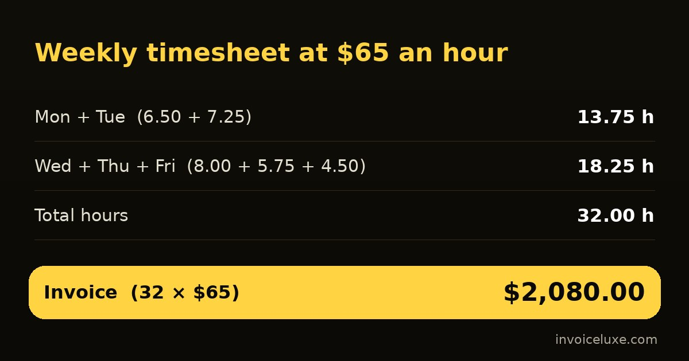

Billing by the hour is simple when your records are clean. The timesheet is your proof, and the invoice is a clear summary of it. Here is how to go from one to the other without disputes.

## Step 1: Record time as you work

For each day, log the start time, end time, breaks and what you worked on. Notes such as "homepage edits" or "client call" make the invoice easy to justify later.

## Step 2: Convert to decimal hours

Invoices use decimal hours: 7.75, not 7 hours 45 minutes. See [how to convert minutes to decimal hours](/blog/convert-minutes-to-decimal-hours/).

## Step 3: Total the hours and multiply

| Day | Hours |
|---|---|
| Monday | 6.50 |
| Tuesday | 7.25 |
| Wednesday | 8.00 |
| Thursday | 5.75 |
| Friday | 4.50 |
| **Total** | **32.00** |

At $65.00 an hour: 32 × 65 = **$2,080.00**.

## Step 4: Build the invoice

Include:

- Your name and the client's name
- An invoice number and date. See [how to number invoices](/blog/how-to-number-invoices/)
- The billing period, for example "Nov 30 to Dec 4"
- Hours, rate and the amount for each line or task
- Sales tax if your services are taxable. See [do freelancers charge sales tax](/blog/do-freelancers-charge-sales-tax/)
- Payment terms and due date. See [invoice payment terms](/blog/invoice-payment-terms/)

The full checklist is in [what to include on an invoice](/blog/what-to-include-on-an-invoice/).

## Step 5: Attach or share the timesheet

Send the timesheet as a PDF with the invoice when the client expects detail. Many clients approve faster when they can see the hours by day.

## Rounding rules

Decide how you round, and put it in your agreement:

- **Exact minutes** is the most precise.
- **Nearest 15 minutes** is common and easy to read.
- **Minimum billing blocks**, such as a one-hour minimum for a call, should be agreed in advance.

## Ways to avoid disputes

1. Agree on the rate and the scope in writing before you start.
2. Send invoices regularly, weekly or every two weeks, rather than one big bill.
3. Keep notes of what you did on each day.
4. Tell the client early if you will exceed an estimate.

## Hourly rate check

If you are not sure your rate is right, see [how to calculate your freelance hourly rate](/blog/freelance-hourly-rate/).

## FAQ

### How do I invoice for hours worked?

List the hours, the rate and the total for the period, and attach the timesheet if the client wants detail.

### Should I round my hours?

Choose a rule, such as exact minutes or the nearest 15 minutes, and state it in your agreement.

### How often should I invoice hourly clients?

Weekly, every two weeks or monthly. Shorter periods mean smaller bills and faster payment.

### Is this tax or legal advice?

No. It is a billing guide. Taxes and contract terms depend on your situation.
