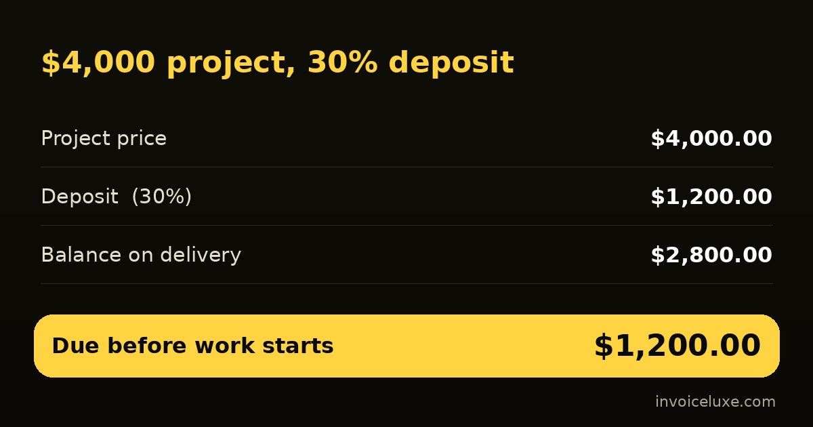

A deposit protects you. It covers your early costs, shows that the client is serious and reduces the chance that you finish the work and then chase payment. Here is how to ask for one without it feeling awkward.

## How much deposit to ask for

There is no fixed rule, but these ranges are common:

| Project type | Typical deposit |
|---|---|
| Small project, quick turnaround | 50% |
| Mid-size project | 25% to 40% |
| Large project with milestones | 20% to 30% at the start, then milestone payments |
| Ongoing monthly work | First month in advance |

## Example: $4,000 project, 30% deposit

- Deposit: 4,000 × 0.30 = **$1,200**
- Balance: 4,000 − 1,200 = **$2,800**, due on delivery

## Milestone version

Split a $4,000 project into 40% at the start, 30% at the midpoint and 30% at delivery:

| Milestone | Share | Amount |
|---|---|---|
| Start | 40% | $1,600 |
| Midpoint | 30% | $1,200 |
| Delivery | 30% | $1,200 |

## What to say

Put the deposit in your **quote or proposal**, so it is part of the deal from the beginning. A message you can copy:

> Thanks for choosing me for this project. To reserve your start date, I require a 30% deposit of $1,200 before work begins. The remaining $2,800 is due on delivery. I have attached the invoice for the deposit. Work will start as soon as it is paid.

For the quote step, see [how to send a quote or estimate](/blog/how-to-send-a-quote-or-estimate/).

## What to put on the deposit invoice

- A clear description: "Deposit: 30% of project X"
- The total project price and the balance remaining
- A due date, for example "Due before work starts"
- Whether the deposit is refundable, in writing

Use the checklist in [what to include on an invoice](/blog/what-to-include-on-an-invoice/), and set clear terms with [invoice payment terms](/blog/invoice-payment-terms/).

## Sales tax on deposits

If your work is taxable, rules about when to collect tax on a deposit vary by state. Some tax when you are paid, others when you deliver. Check your state. See [do freelancers charge sales tax](/blog/do-freelancers-charge-sales-tax/).

## Deposit, retainer and prepayment

- A **deposit** secures the start and is credited to the final bill.
- A **retainer** is a regular payment that reserves your time. See [recurring invoices and retainers](/blog/recurring-invoices-and-retainers/).
- A **prepayment** is paying in advance for specific services.

## If the client pushes back

Offer a smaller deposit or milestone payments rather than dropping the idea. If someone refuses any upfront payment for a large job, treat it as a signal to take more care.

## Show the deposit on the final invoice

When you send the final invoice, show the full price and subtract what the client already paid:

| Line | Amount |
|---|---|
| Project total | $4,000.00 |
| Deposit paid (October 20) | −$1,200.00 |
| **Balance due** | **$2,800.00** |

Showing the deposit as a credit makes the invoice easy to understand and prevents double payment.

## Write a refund policy

Be clear about what happens if the client cancels. For example:

"The deposit is non-refundable once work begins. If the client cancels before work starts, the deposit is refunded minus any costs already incurred."

Put the policy in your contract or quote, and confirm it before you take the payment. Rules about refunds differ by place, so ask a lawyer if you are unsure.

## Ways to take a deposit

- A bank transfer or payment link in the first invoice
- A signed quote with a payment request
- A card payment, if you accept them, keeping in mind any fees

Send the deposit invoice right after the client accepts your quote, while their interest is high.

## When you might waive it

You may skip a deposit for a long-standing client who always pays on time, or for a very small job. If you do, shorten your payment terms instead. See [invoice payment terms](/blog/invoice-payment-terms/).

## Keep your records tidy

Record deposits separately from final payments, and note which invoice or project they belong to. At the end of the job, check that the deposit has been applied correctly. See [quote vs estimate vs invoice](/blog/quote-vs-estimate-vs-invoice/).

## FAQ

### How much deposit should a freelancer ask for?

Between 25% and 50% is common, depending on project size and risk.

### Should the deposit be refundable?

State it in your agreement. Many freelancers keep the deposit once work has started.

### Do I need a contract for a deposit?

A written agreement or accepted quote is strongly recommended.

### Is this legal advice?

No. For legal terms, ask a lawyer or use a template reviewed for your state.

### Is a deposit taxable?

It can be, depending on your state and what you sell. Check the rules, and see the sales tax section above.

### Can I charge a deposit for a small project?

Yes. A 50% deposit is common for small, fast projects.
