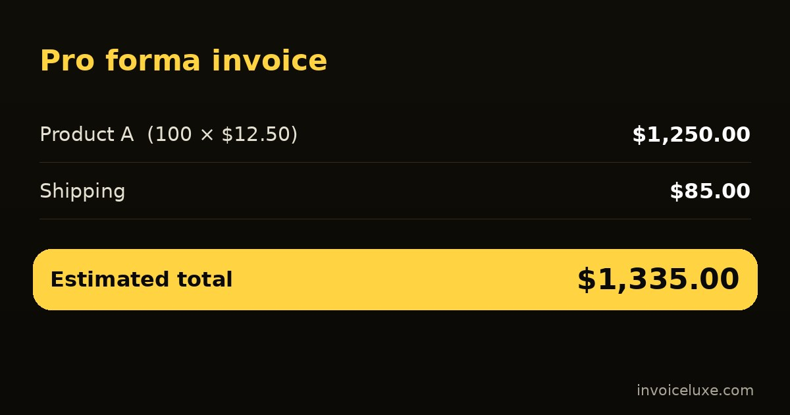

A pro forma invoice is a **preliminary invoice** sent before you deliver goods or services. It says what the final bill is expected to be, but it is not a request for payment in the usual sense, and it is not a record of a completed sale.

## What is it for?

- **Quoting a firm price** for a buyer who needs a formal document
- **Getting prepayment** or approval, for example from a client's finance team
- **Customs declarations** for shipping goods internationally
- **Applying for funding or a letter of credit**
- **Showing costs** before an order is confirmed

## Pro forma vs commercial invoice

| | Pro forma invoice | Commercial (final) invoice |
|---|---|---|
| When | Before delivery | After the sale |
| Purpose | Estimate and approval | Request for payment and record of sale |
| Used for accounting | Not as a sales record | Yes |
| Can change | Yes, if the order changes | Final |

## Pro forma vs quote

A quote is an offer to do the work for a price. A pro forma invoice looks like an invoice and is often used when the buyer needs an invoice-style document before paying. See [quote vs estimate vs invoice](/blog/quote-vs-estimate-vs-invoice/).

## What to include

- The words **"Pro forma invoice"** clearly at the top
- Seller and buyer details
- A reference number and date
- A description of the goods or services, quantity and unit price
- Shipping, taxes and the total
- Payment terms and how long the price is valid
- A note such as "This is not a tax invoice"

## Example

| Item | Qty | Unit price | Amount |
|---|---|---|---|
| Product A | 100 | $12.50 | $1,250.00 |
| Shipping | | | $85.00 |
| **Total** | | | **$1,335.00** |

## What happens next

When the buyer accepts the pro forma invoice and the order is delivered, issue the **final invoice** with a new invoice number. Keep the two linked by referencing the pro forma number. See [how to number invoices](/blog/how-to-number-invoices/).

## Tax on a pro forma invoice

A pro forma invoice often shows an estimate of tax. The actual tax is based on the final sale. See [how to show sales tax on an invoice](/blog/how-to-show-sales-tax-on-an-invoice/).

## Common mistakes

1. Forgetting to label it as pro forma, so the client pays it as a final invoice or records it as a sale.
2. Using the same number series as final invoices.
3. Leaving out an expiry date for the price.

## When a pro forma invoice is useful

- A new customer wants to see the total before they pay
- A buyer needs it for a bank transfer approval or an internal purchase order
- Goods are crossing a border, and the customs authority wants a document that shows the value
- A customer asks for prepayment before you ship

## Number it differently

Use a separate number series, such as PF-001, so a pro forma invoice is never confused with a final invoice. When you send the final invoice, it gets a normal number and refers to the pro forma number.

## Add a validity date

State how long the pro forma invoice is valid, for example "valid for 30 days". Prices, availability and shipping costs can change, and the date protects you.

## International shipments

For export, a pro forma invoice often shows:

- The seller and buyer details
- A description of each item
- The quantity and unit value
- The currency
- The shipping and insurance costs
- The country of origin

Check the requirements of the customs authority in the destination country.

## A common mistake

Do not use a pro forma invoice as a final sales record. It is not a request for payment in the accounting sense, and it can confuse your records. Issue the final invoice when you ship or complete the work. See [quote vs estimate vs invoice](/blog/quote-vs-estimate-vs-invoice/) and [how to create an invoice](/blog/how-to-create-an-invoice/).

## FAQ

### Is a pro forma invoice a legal document?

It is a commercial document, not a record of a sale. Whether it binds either party depends on your agreement.

### Do I get paid based on a pro forma invoice?

A buyer can pay against it, for example as a prepayment, but you should still issue a final invoice.

### Is a pro forma invoice the same as a quote?

Not exactly. It is formatted like an invoice and often used for customs or approvals.

### Is this legal or tax advice?

No. It is a general explanation. Confirm requirements for your situation.

### Is a pro forma invoice legally binding?

Not on its own, but it can form part of an agreement once the buyer accepts it. Add clear terms.

### Can I ask for payment based on a pro forma invoice?

Yes, many sellers ask for prepayment against it. Then issue a final invoice once the sale is complete.
