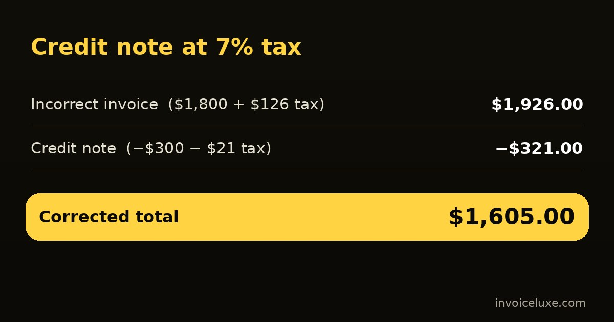

Everyone sends a wrong invoice at some point: a wrong price, quantity, tax rate or customer name. What matters is fixing it in a clean way that leaves a clear record.

## Two ways to correct an invoice

1. **Cancel and reissue.** Void the incorrect invoice and send a new one with a new number.
2. **Issue a credit note (credit memo).** Keep the original and send a separate document that reduces the amount, then send a new invoice if needed.

## Which one to use

| Situation | Best option |
|---|---|
| Invoice sent but not yet paid, error is big | Cancel and reissue |
| Invoice already paid or already recorded | Credit note, then new invoice if needed |
| Small price reduction or partial refund | Credit note |
| Wrong customer or wrong details | Cancel and reissue |

Do not edit and resend the same invoice number. That makes your records confusing for both you and the client.

## Example with sales tax at 7%

The correct invoice should have been $1,500, but you sent $1,800.

| | Subtotal | Tax (7%) | Total |
|---|---|---|---|
| Incorrect invoice | $1,800.00 | $126.00 | $1,926.00 |
| Correct amount | $1,500.00 | $105.00 | $1,605.00 |
| **Credit note** | **−$300.00** | **−$21.00** | **−$321.00** |

The credit note reduces the invoice by $321.00, which brings the total to $1,605.00. Notice that the tax is adjusted as well. See [how to show sales tax on an invoice](/blog/how-to-show-sales-tax-on-an-invoice/).

## What a credit note should include

- The words **"Credit note"** at the top
- A new credit note number
- The number and date of the original invoice
- The reason for the correction
- The amount credited, including tax
- The new balance due

## Steps

1. **Contact the client** and explain the error briefly.
2. **Choose the method:** cancel and reissue, or credit note.
3. **Give the document a clear number.** See [how to number invoices](/blog/how-to-number-invoices/).
4. **Send it** with a short message that shows the new amount due.
5. **Update your records,** including your sales tax records.

A short message you can adapt:

> Hi Sam, I found an error on invoice #1042: the amount should have been $1,500 plus tax. I have attached credit note #C-007 for $321.00. The new balance due is $1,605.00. Sorry for the confusion.

## If the client already paid too much

Refund the difference or apply it as a credit to the next invoice, and put the choice in writing.

## Prevent mistakes

Review the invoice before sending. See [invoice mistakes to avoid](/blog/invoice-mistakes-to-avoid/).

## FAQ

### What is a credit note?

A document that reduces or cancels part or all of an earlier invoice.

### Can I just edit the invoice and send it again?

It is better not to reuse the number. Cancel and reissue, or issue a credit note.

### Do I adjust sales tax on a credit note?

Yes. If you charged too much tax, the credit should include the tax difference.

### Is this accounting advice?

No. It is a general guide. Ask your accountant about your records.
