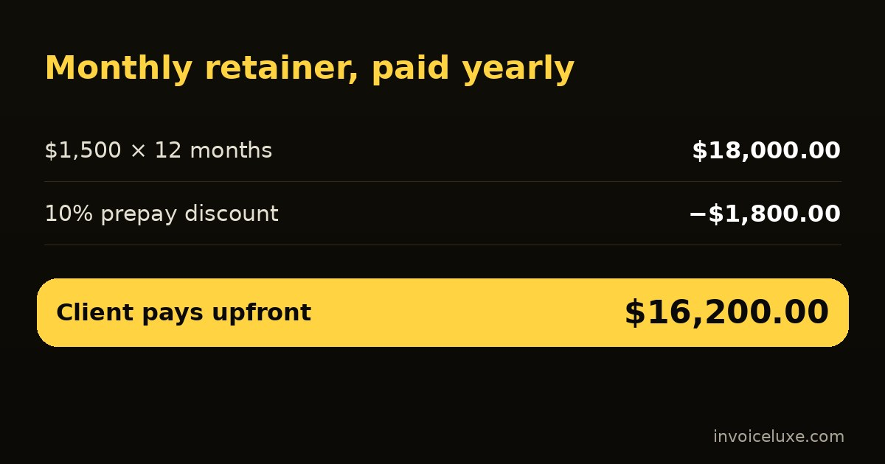

Monthly clients are the most stable income a freelancer or small business can have. Two common ways to bill them are **recurring invoices** and **retainers**. They sound similar but work differently.

## Recurring invoice vs retainer

| | Recurring invoice | Retainer |
|---|---|---|
| What it is | The same invoice issued on a schedule | A payment that reserves your time or availability |
| Typical use | Fixed monthly services such as maintenance or management | Ongoing access to your expertise |
| Billed | At the start or end of each period | Usually at the start of each period |
| Unused time | Not applicable | Depends on the agreement |

## How to price a monthly package

Estimate the hours you expect to spend and multiply by your rate, then add a small buffer for admin. See [how to calculate your freelance hourly rate](/blog/freelance-hourly-rate/).

Example: $1,500 a month for 12 months is **$18,000** a year. If you offer a 10% discount for paying the year upfront, the client pays 18,000 × 0.90 = **$16,200**, which saves them $1,800.

## What to put in the agreement

- **Scope:** what is included and what is not
- **Hours or deliverables** per month
- **Price and billing date**
- **Payment terms.** See [invoice payment terms](/blog/invoice-payment-terms/)
- **Unused hours:** whether they roll over or expire
- **Extra work:** how additional requests are billed
- **Notice period** for ending the arrangement

## Set up recurring invoices well

1. **Use a clear naming and numbering pattern,** such as "Monthly retainer, December 2026". See [how to number invoices](/blog/how-to-number-invoices/).
2. **Bill in advance** when you can, so payment arrives before the work.
3. **Choose one billing day,** such as the 1st of the month.
4. **Send a reminder** a few days before the due date.
5. **Handle late payment** with a clear policy. See [late payment fees and interest](/blog/late-payment-fees-and-interest/).

## Sales tax on recurring services

Whether recurring services are taxable depends on the state and the type of service. Show tax as a separate line if it applies. See [do freelancers charge sales tax](/blog/do-freelancers-charge-sales-tax/).

## Reviewing the arrangement

Once or twice a year, check whether the scope still matches the price. If the client's needs grew, raise the retainer or adjust the scope.

## FAQ

### What is a retainer invoice?

An invoice for a regular payment that reserves your time or availability for a client.

### Should I bill in advance or in arrears?

Advance billing improves cash flow and lowers the risk of late payment.

### What happens to unused retainer hours?

It depends on your agreement. Decide in advance whether they roll over, expire or are refunded.

### Is this legal advice?

No. For contract wording, consult a lawyer or a reviewed template.
